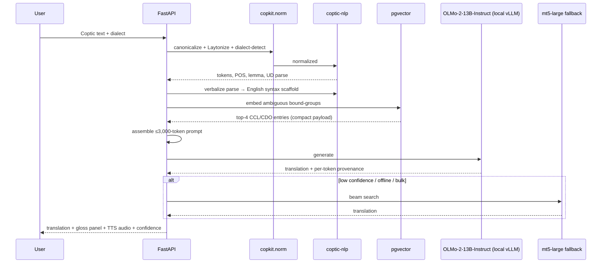
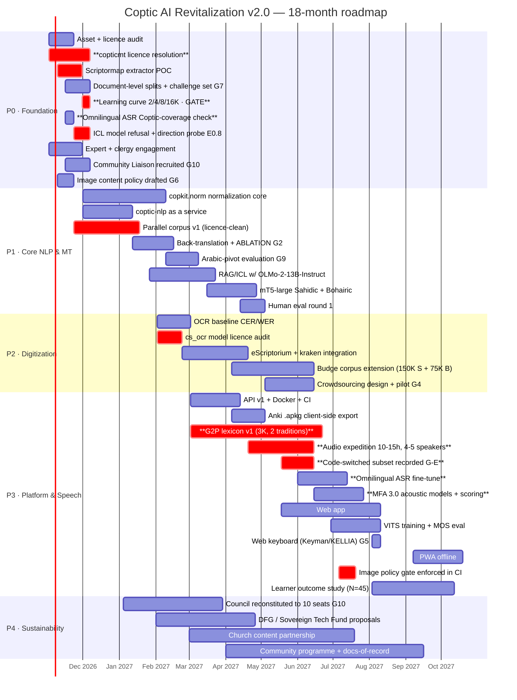

# Coptic AI Revitalization Program — Technical & Program Plan **v2.0**

**Supersedes:** v1.0 (2026-10-03). v1.0 retained as the audit record; §2 and Appendix B of v1.0 remain authoritative.
**Revision driver:** 10 new component gaps (G1–G10) + 8 internal inconsistencies.
**New assets verified live:** 2026-10-03.
**Audience:** technical founder, 3–4 developers, academic collaborators.
**Total effort after re-baseline: 72 person-months / 18 months = 4.0 FTE.**

---

## 1. Executive Summary (v2.0)

### 1.1 What changed from v1.0, in one table

| # | Change | Driver | Effort impact |
|---|---|---|---|
| 1 | **Team raised 2–3 dev → 4.0 FTE; scope cut 8.5 PM to pay for it** | Inconsistency #1 | **−8.5 PM (cut) / +9.0 PM (new work) = net +0.5 PM** |
| 2 | **ICL model committed: `allenai/OLMo-2-1124-13B-Instruct`** (Apache-2.0) | G3, Inconsistency #2 | +0.5 PM |
| 3 | **ASR added as a first-class deliverable**, sharing TTS audio | G1, Inconsistency #4 | +3.0 PM |
| 4 | **Back-translation added — but gated as an ablation, because the literature says it may hurt at our scale** | G2, Inconsistency #5 | +2.0 PM |
| 5 | **Mobile keyboard: cut to ~0.25 PM. Already exists under MIT.** | G5 | **−0.75 PM** |
| 6 | **Image content policy + Church review gate** | G6, Inconsistency #6 | +0.5 PM |
| 7 | **Document-level splits + frozen challenge set** | G7 | +0.5 PM |
| 8 | **Learning-curve experiment added to Phase 0 as a re-scope gate** | G8 | +0.25 PM |
| 9 | **Arabic-pivot evaluation added** | G9, Inconsistency #8 | +1.0 PM |
| 10 | **4th governance bloc: Community Liaison (10 seats total)** | G10 | +0.5 PM |

### 1.2 The six decisions that matter most

**D1 — We are now at exactly 4.0 FTE, and that required cutting 8.5 person-months of v1.0 scope.**
v1.0 said "72 PM / 3.5–4.0 FTE" while its audience was "2–3 developers." Those cannot both be true. **Resolution: commit to 4.0 FTE** (founder + 3 engineers + fractional linguist/audio/community), which matches the revised constraint, **and cut the 8.5 PM listed in §1.4.** The alternative — staying at 2–3 FTE — requires cutting ~35%, which would remove OCR, the Bohairic MT model, or the learner study. Those three are the program's actual value. **Decision made: 4.0 FTE, cut list in §1.4.**

**D2 — `allenai/OLMo-2-1124-13B-Instruct` is the committed ICL default. Not Qwen3, not Llama.**
Justification in §4.3.2. The three decisive factors are licensing cleanliness (Apache-2.0 on *weights and code*), **auditable training data** (olmo-mix-1124 / dolmino-mix-1124 are released, so we can *prove* contamination-free training — a substantive integrity argument for a heritage project), and **refusal behavior** (a lightly-tuned model that will translate the Psalms and the Crucifixion narrative; a heavily safety-tuned model that refuses is worthless for liturgical work). Its **4,096-token context is a real cost** and forces a compact-prompt design — which our use case actually tolerates.

**D3 — ASR is built, and it is a better idea than v1.0 assumed.**
New finding: **Meta Omnilingual ASR** (Apache-2.0, verified) supports 1,600+ languages and is *explicitly designed for adding new languages from a handful of paired examples* — architecturally a far better starting point than `whisper-small`, which is tuned for a different regime. Second new finding: **QwenCleo-ASR** (Apache-2.0) is Egyptian-Arabic + code-switching SOTA. **This matters enormously for Coptic**, because contemporary Coptic liturgical practice in Egypt is heavily Arabic–Coptic code-switched. Our audio corpus design and pronunciation scoring must handle this explicitly, and v1.0 did not consider it at all.

**D4 — Back-translation is being added as an *ablation*, not a plan. The evidence says it may make things worse.**
Three findings force this. (i) A high-quality English–Gujarati study found back-translated data **did not help and slightly degraded** results (43.8→43.0 BLEU, 58.3→57.4 chrF) — [arXiv:2506.21566](https://arxiv.org/abs/2506.21566). (ii) *Understanding Back-Translation at Scale* found that in **resource-poor settings** the BT model is too weak for sampling noise to be tolerable, and that gains scale hard with data size (13.5 BLEU @80K → 28.3 @5M) — [aclanthology.org/D18-1045](https://aclanthology.org/D18-1045.pdf). (iii) Cohn et al. showed BT systems trained on poor models **provide no benefit at all** over no-BT baselines — [W18-2703](https://aclanthology.org/anthology-files/pdf/W/W18/W18-2703.pdf). **At 20–40K pairs we are firmly in the regime where this can backfire.** We will run it as a controlled ablation, report the result either way, and treat a negative result as a publishable contribution to a literature that has no Coptic data.

**D5 — The mobile keyboard is already solved by someone else, under MIT.**
v1.0 budgeted 1 PM to build one. **Keyman ships `coptic_greek` and `coptic_qwerty`, MIT-licensed, maintained by Michael Everson** (a leading script-encoding expert), v2.4 updated 2025-05-22, covering Windows/macOS/Linux/Web/iOS/Android — [keyman.com/keyboards/coptic_greek](https://keyman.com/keyboards/coptic_greek). There is also a Coptic pack for **AnySoftKeyboard** on F-Droid whose layout is derived from **coptic-dictionary.org** (KELLIA, Apache-2.0), and ⲣⲉⲙⲛ̀Ⲭⲏⲙⲓ ships an iOS `Coptic.bundle`. **We build nothing.** We embed a web keyboard from the KELLIA mapping in our PWA, link to Keyman for native, and contribute improvements upstream (MIT = no friction). **Saves 0.75 PM.**

**D6 — AI-generated religious imagery is prohibited, not discouraged.**
Hard prohibition on AI-generated depictions of Christ, the Theotokos, saints, angels, or liturgical scenes, enforced by a Church-bloc review gate in the release pipeline. Permitted: public-domain historical illustration, commissioned iconography under clear terms, and non-figurative imagery (geometric ornament, manuscript borders, textile and astronomical subjects). Full policy in §6.4. This is a real harm vector for a living church and it is cheap to prevent.

### 1.3 What we are building (unchanged thesis)

Not a Coptic translator. A **transmission apparatus**: a normalization-resilient, dialect-aware, retrieval-grounded reading, speech, and learning layer over the existing corpus — with a fine-tuned mT5 as the offline fallback and lexicon + syntax scaffolds as the accuracy driver.

### 1.4 The cut list — 8.5 person-months removed to reach 4.0 FTE

| Cut | v1.0 | v2.0 | PM saved | Rationale & stated cost |
|---|---|---|---|---|
| **G2P lexicon scope** | 6–10 PM, 4–6K entries | **6 PM, top-3,000 liturgical lemmas + rule engine** | **2.5** | 3K rule-driven entries cover the liturgical core. Defer lexicographic expansion to post-18-month crowd sourcing. Cost: non-liturgical vocabulary is weakly covered — mitigated by fallback to romanization. |
| **Learner outcome study** | 4–6 PM, N≥60, 3 arms, +12wk retention | **N=45, 3 arms, +4wk retention** | **1.5** | Drops the 12-week retention point. Cost: we lose evidence about long-term decay. **This is the most scientifically costly cut in the plan** — flagged for the funder, not hidden. |
| **OCR corpus extension target** | 250K Sahidic words | **150K Sahidic + 75K Bohairic** | **1.5** | Still a meaningful corpus gain; 100K fewer words is not load-bearing. |
| **TTS voice count (Bohairic)** | 3 voices | **2 voices** | **1.0** | 1 clergyman + 1 choir director. Third voice deferred. Cost: less speaker variety. |
| **Crowdsourcing program** | 2 PM design + 0.5 FTE ops | **1 PM design + pilot only** | **1.0** | Design document + 1 pilot batch in Phase 2. Full program deferred. Cost: slower annotation throughput. |
| **API surface** | 8 endpoints + server-side `.apkg` | **7 endpoints + client-side `.apkg` export** | **0.5** | Dropped `/v1/srs/apkg` server-side generation. |
| **Arabic ASR interop** | implied full | **research spike only, not a deliverable** | **0.5** | QwenCleo-ASR evaluated in Phase 3 as a fallback; integration deferred. |
| Contingency reduction | 10% | 8% | 0.5 | — |
| | | **Total saved** | **8.5** | |

### 1.5 Targets (unchanged where not specified)

| Metric | Target | Note |
|---|---|---|
| Coptic→English chrF2 | **≥ 32** Sahidic / **≥ 26** Bohairic | Primary MT metric |
| Coptic→English BLEU | 8–14 | **Reported, never gated** |
| Bohairic TTS MOS | **≥ 3.4 / 5** | Panel includes clergy |
| ASR WER (Coptic-only utterances) | **≤ 35%** | Loosely gated; see §7.1 for why this number is soft |
| Printed-edition OCR CER | **≤ 4%** | Budge held-out |
| G2P phoneme accuracy | **≥ 90%** | Liturgical core |
| R@8 retrieval recall | **≥ 0.85** | |
| Learner D7 / D30 retention | **≥ 30% / ≥ 15%** | |

### 1.6 Budget re-baseline

| Line | 18-month cost |
|---|---|
| Personnel — 72 PM @ $9–13K blended (non-profit/academic rates) | **$648K – $936K** |
| Compute (MT, ASR, TTS, ICL — see §4.3.2) | $3K |
| Audio expedition (travel, studio, stipends, 5 speakers) | $30K |
| Participant stipends (human eval ×2 rounds, study N=45) | $25K |
| Infrastructure / hosting / CI, 18 mo | $25K |
| Legal & licence review (releases, model cards, consent forms) | $15K |
| Contingency (8%) | $60K |
| **Subtotal, fully loaded cash** | **$806K – $1.104M** |
| *Less* realistic in-kind academic + Church contribution (25–30%) | *(−$200K to −$310K)* |
| **Net cash requirement** | **~$500K – $800K** |

**Honest read:** v1.0's $310–520K was too low for the scope it described. This is a direct consequence of inconsistency #1 — v1.0 priced a 4-FTE program as a 3-FTE one. **Non-dilutive grants realistically cover 30–50%** (DFG, Sovereign Tech Fund, ELF/ELDP, Church/di diaspora), so **≥ $250K must be committed by Month 4** or Phase 1 must be descoped again. The P0 gates in §5.2 exist precisely to allow that descope cheaply.

---

## 2. Asset Registry (v2.0)

**§2 of v1.0 is unchanged and remains authoritative.** Corrections to it:

### 2.1 Additions (new this revision)

| Asset | URL | License | Format / size | Suitability |
|---|---|---|---|---|
| **Meta Omnilingual ASR** | [github.com/facebookresearch/omnilingual-asr](https://github.com/facebookresearch/omnilingual-asr) · [paper](https://arxiv.org/abs/2511.09690) | **Apache-2.0** (verified) | omniASR_CTC_300M (325M, 1.3 GB) → 7B; omniASR_LLM_300M → 7B. 1,600+ langs | ★★★★★ **ASR starting point.** *"enables new languages to be added with just a few paired examples"* — designed for our exact regime |
| Omnilingual ASR corpus | [facebook/omnilingual-asr-corpus](https://huggingface.co/datasets/facebook/omnilingual-asr-corpus) | per-language (CC-BY/CC0 mix) | streaming | ★★★★ cross-lingual audio pretraining |
| **QwenCleo-ASR** | [github.com/MohammedAly22/qwencleo-asr](https://github.com/MohammedAly22/qwencleo-asr) | **Apache-2.0** | Qwen3-ASR-1.7B base; WER 19.85 / CER 10.52 on Egyptian Arabic + AR↔EN code-switching | ★★★★★ **the code-switching problem.** Egyptian Arabic is the actual community register |
| **Montreal Forced Aligner 3.0** | [github.com/MontrealCorpusTools/Montreal-Forced-Aligner](https://github.com/MontrealCorpusTools/Montreal-Forced-Aligner) | **MIT** (verified) | Kaldi-based; per-speaker dicts, pronunciation probabilities, cross-language phone remapping | ★★★★★ **pronunciation scoring + gold alignments** |
| MFA 3.0 state-of-the-art paper | [arXiv:2606.18466](https://arxiv.org/abs/2606.18466) | CC-BY | — | ★★★★ current MFA capabilities |
| Multilingual MFA (low-resource) | [arXiv:2504.07315](https://arxiv.org/abs/2504.07315) | CC-BY | — | ★★★★ **adapting the English baseline helps unseen languages** — our recipe |
| **Keyman `coptic_greek` / `coptic_qwerty`** | [keyman.com/keyboards/coptic_greek](https://keyman.com/keyboards/coptic_greek) | **MIT**, Everson | v2.4, 2025-05-22; Win/macOS/Linux/Web/iOS/Android | ★★★★★ **keyboard solved. Build nothing.** |
| AnySoftKeyboard Coptic pack | [f-droid.org/packages/com.anysoftkeyboard.languagepack.coptic](https://f-droid.org/packages/com.anysoftkeyboard.languagepack.coptic) | FOSS | layout **derived from coptic-dictionary.org** (Apache-2.0) | ★★★★ second reference layout |
| E-Sid/Coptic | [github.com/E-Sid/Coptic](https://github.com/E-Sid/Coptic) | GPL-3.0 | CS→UTF-8, ASCII→Unicode converters | ★★★ legacy font conversion (arm's length) |
| **OLMo 2 13B Instruct** | [huggingface.co/allenai/OLMo-2-1124-13B-Instruct](https://huggingface.co/allenai/OLMo-2-1124-13B-Instruct) | **Apache-2.0** (weights + code) | 5T tokens, 40 layers, **ctx 4096**, GPT2Tokenizer, cutoff Dec-2023, data released | ★★★★★ **committed ICL default** |
| Qwen3 (secondary benchmark) | [huggingface.co/Qwen](https://huggingface.co/Qwen) | Apache-2.0 (8B/14B/32B) | longer context, stronger multilingual | ★★★★ secondary |
| Unicode 17.0 Coptic block | [unicode.org/charts/PDF/U2C80.pdf](https://www.unicode.org/charts/PDF/U2C80.pdf) | — | 2C80–2CFF; **Bohairic letters + Old Coptic/dialect letters** | ★★★★ normalization must span both sub-blocks |
| Anki FSRS | [docs.ankiweb.net](https://docs.ankiweb.net/) | GPL-3.0 client, open format | FSRS scheduler (Anki-native since 23.10) | ★★★★★ use Anki's own FSRS, don't reimplement |

### 2.2 Corrections and clarifications

| Item | v1.0 said | v2.0 says |
|---|---|---|
| **Shenute AI** (`georgtawadrous/thoth_app`) | "★★★★★ **steal the ingestion pipeline**" | **Reframed (Inconsistency #3).** The Space's code licence is not clearly stated. **Action: (a) contact the author asking to reuse under an explicit licence; (b) in parallel, independently implement CCL-TEI → chunk → embed against the CCL itself, which is CC BY-SA and unambiguously ours to use.** Both paths are clean; only the original phrasing was sloppy. Credit the Space in our docs either way. |
| `cs_ocr` models | "reuse the models" | Unchanged, but **each `.mlmodel`'s own licence field must be audited individually** — the repo's GPL-3.0 does not automatically bind the weights. |
| Coptic TTS | gap confirmed | Confirmed. Also: the iOS "Coptic Keyboard" app by Mina D. Makar documents the real feature set (auto-cap, auto-correct, **jinkim** ⲏⲓⲛⲕⲓⲙ expansion, Antinoou font) — use as a requirements spec if we ever do build (we won't). |
| Coptic pronunciation | "three traditions" | **Now specified.** Wikipedia/Britannica synthesis confirms **two** distinct Bohairic liturgical traditions from the 19th- and 20th-century *Coptic pronunciation reform*, and a documented vowel system: close-mid ⲏ/e/ ⲏⲏ/eː/ ⲱ/o/ ⲱⲱ/oː/; open-mid ⲉ/ɛ/ ⲉⲉ/ɛː/ ⲟ/ɔ/ ⲟⲟ/ɔː/; open ⲁ/a/ ⲁⲁ/aː/; close ⲉⲓ/i/ ⲟⲩ/u/. **ⲫ is the local equivalent of Cairene ɡ.** Contested: **ϫ** (older sources ⟨j⟩) and **ϭ** (⟨ɡ⟩ or ⟨č⟩). This is a *dialect-and-reform matrix*, not a single mapping — and it is exactly what MFA's per-speaker dictionaries are built for. |

### 2.3 Retained from v1.0 (abbreviated — see v1.0 §2 for full rows)

**Corpora:** Coptic Scriptorium v6.3.0 (2.38M words, CC BY/CC BY-SA mixed) · UD Coptic-Scriptorium (58,974 tokens, Sahidic) · **UD Bohairic** (30K+ word forms, Zeldes et al. 2025) · copticmt (**no licence** — quarantined) · CoptOT.
**Lexicon:** CCL v1.2 (CC BY-SA) · CDO/KELLIA (data CC BY-SA, interface Apache-2.0) · TLA · remnqymi dictionary pipeline (GPL-3.0).
**NLP:** coptic-nlp (Apache-2.0) · UD guidelines · UDPipe 2 · Annis.
**OCR:** kraken (Apache-2.0) · eScriptorium (**PSL-1.0**) · CopticScriptorium/OCR (GPL-3.0, models incl. Bohairic).
**MT/LLM:** ACL 2026 Findings 1803 · THOTH.AI (Middle Egyptian, not Coptic) · mT5 · M2M100 · NLLB-200 (**CC-BY-NC**, Coptic absent).
**Learning:** remnqymi · CopticLingo/Metremnkēme · copticlearn.me · LangLearn · OpenFlashcards · Anki.
**Excluded on licence:** XTTS-v2 (CPML-NC) · F5-TTS (CC-BY-NC) · Edge TTS (unlicensed).

---

## 3. Gap Analysis (v2.0, re-ranked by severity × effort)

**Ranking method:** severity (blocker / critical / important / nice) × (effort ÷ confidence that effort is accurate). Re-ranked against v1.0's G1–G13.

### 3.1 Tier 1 — Blockers

| ID | Gap | Sev | Effort | Owner | Changed in v2.0 |
|---|---|---|---|---|---|
| **G-A** | **`copticmt` has no LICENSE file.** Primary parallel corpus legally unusable | 🔴 Blocker | 3–5 wks outreach **or** 8 wks rebuild from Scriptorium alignments | Founder | was G1 |
| **G-B** | **No Coptic G2P / pronunciation lexicon.** Two Bohairic reform traditions + a contested consonant set (ϫ, ϭ) + ϫ/Cairene ɡ. Blocks TTS, ASR scoring, and transliteration | 🔴 Blocker | **6 PM** (capped, §1.4) | Linguist | was G2 |
| **G-C** | **No Coptic speech corpus; no native Coptic TTS or ASR exists.** Every "Coptic TTS" in the wild is Edge TTS with Arabic/Greek voices | 🔴 Blocker | 8 PM (TTS+ASR, shared data) | Audio eng | was G3, **+ASR** |
| **G-D** | **No Coptic ASR at all** — *newly promoted from a footnote to a deliverable* | 🔴 Blocker | *(in G-C)* | Audio eng | **new (was implicit)** |
| **G-E** | **Arabic–Coptic code-switching is unaddressed.** Contemporary liturgical practice is heavily Arabic-Coptic. An ASR/TTS/eval design that assumes pure Coptic utterances is wrong | 🔴 Blocker | **embedded in G-B/G-C + 0.5 PM spike** | Linguist + audio | **new — found via QwenCleo-ASR** |

### 3.2 Tier 2 — Critical

| ID | Gap | Sev | Effort | Owner | Changed |
|---|---|---|---|---|---|
| **G-F** | **No licensed Bohairic parallel data** | 🟠 Critical | 8–12 wks | NLP eng | was G4 |
| **G-G** | **NEH funding collapse → maintainer burnout on Scriptorium/KELLIA/coptic-nlp.** Our critical dependency is unfunded | 🟠 Critical | 2 wks to mitigate | Founder | was G5 |
| **G-H** | **Train/test contamination.** Coptic reuses the same biblical passages across `sahidica.mark`, `bohairic.mark`, `sahidica.nt`, `bohairic.nt`, UD treebanks, and multiple Budge editions. **Sentence-level splits leak catastrophically** | 🟠 Critical | **0.5 PM** | NLP eng | **new (G7)** |
| **G-I** | **Unicode normalization unsolved.** Unicode 17.0 Coptic block spans Bohairic letters *and* Old Coptic/dialect letters; combining marks break naive tokenizers, BM25, TTS, and OCR char classes. NFC insufficient | 🟠 Critical | 2–3 PM | NLP eng | was G6 |
| **G-J** | **No learner-appropriate modern Bohairic prose.** Liturgical saturation creates the *illusion* of data | 🟠 Critical | ongoing; partly content authoring | Church | was G8 |
| **G-K** | **Morphological ambiguity** — pervasive homograph bound-groups (ⲡⲣⲱⲙⲉ, ⲛⲁⲓ) | 🟠 Critical | 3–4 PM | NLP + linguist | was G7 |
| **G-L** | **Uncertainty about whether back-translation helps at 20–40K pairs** — literature says it may hurt | 🟠 Critical | **2 PM, ablation-gated** | NLP eng | **new (G2)** |
| **G-M** | **Expert linguistic labour unavailable / upstream burnout** | 🟠 Critical | ongoing | Founder | was G2/R2 |

### 3.3 Tier 3 — Important

| ID | Gap | Sev | Effort | Owner |
|---|---|---|---|---|
| **G-N** | **Community liaison absent from governance** — technical diaspora unrepresented | 🟡 Important | 0.5 PM | Founder |
| **G-O** | **No content policy for AI-generated religious imagery** | 🟡 Important | 0.5 PM | Council |
| **G-P** | **No published CER/WER baseline for Coptic OCR** | 🟡 Important | 2–3 wks | OCR eng |
| **G-Q** | **No learner-outcome evidence base** | 🟡 Important | 4 PM (reduced) | Community mgr |
| **G-R** | **Bohairic NLP immature** (~30K word forms, new guidelines) | 🟡 Important | ongoing | Academic collab |
| **G-S** | **Arabic-pivot MT unevaluated** — may outperform direct at this scale, may compound errors badly | 🟡 Important | 1 PM | NLP eng |
| **G-T** | **No crowdsourcing capability for OCR correction / transcription throughput** | 🟡 Important | 1 PM design | Community mgr |
| **G-U** | **Mobile input** | 🟢 **CLOSED** | **0.25 PM** | Frontend |
| **G-V** | **G2P lexicon coverage beyond top-3,000 lemmas** | 🟢 Deferred | post-18mo | Linguist |

### 3.4 Explicitly *not* gaps

Do not spend time here: POS tagging, lemmatization, dependency parsing, NER, dictionary infrastructure, concordance tooling, general MT infrastructure, SRS scheduling, **mobile keyboards (solved)**, Coptic Unicode font availability, TTS serving infrastructure (Piper exists).

---

## 4. Technical Architecture (v2.0)

### 4.1 System diagram

```mermaid
flowchart TB
    subgraph ING["1 · Ingestion"]
        IMG[Scanned / printed editions]
        ES[eScriptorium · PSL-1.0]
        KR[kraken HTR · Apache-2.0]
        CROWD[Crowdsourcing<br/>G4 · pilot]
        IMG --> ES --> KR
        CROWD -.corrects.-> ES
    end

    subgraph NORM["2 · Normalization Core · copkit.norm"]
        N1[NFC + grapheme canonical<br/>Unicode 17.0 · Bohairic + dialect blocks]
        N2[Laytonization]
        N3[Dialect routing · auto | S | B]
        N4[Smart Merging binder]
        N5[Display split]
    end

    subgraph LING["3 · Linguistic Services · coptic-nlp Apache-2.0"]
        L1[POS + Lemma flairbert-6.0.0]
        L2[Parse diabert-UD2.15]
        L3[MWE · NER · Wikification]
    end

    subgraph DATA["4 · Data Factory · G2 G7 G8 G9"]
        SP[Scriptormap<br/>licence-clean alignments]
        BT[Back-translation<br/>ABLATION-GATED]
        PIV[Arabic pivot<br/>cop→ar→en]
        SPLIT[Document-level splits<br/>+ frozen challenge set]
        SP --> SPLIT
        SPLIT --> BT
        LC[Learning curve<br/>2K/4K/8K/16K]
        SPLIT --> LC
        PROV[(Provenance ledger<br/>per-pair: source URN, licence,<br/>method, round-trip score)]
        SP --> PROV
        BT --> PROV
    end

    subgraph LEX["5 · Lexical Services"]
        CDO[CDO · CC BY-SA]
        CCL[CCL v1.2 · CC BY-SA]
        PG[(pgvector)]
        CDO --> PG
        CCL --> PG
    end

    subgraph MT["6 · Translation Engine"]
        ICL["ICL · PRIMARY<br/>OLMo-2-1124-13B-Instruct<br/>Apache-2.0 · ctx 4096"]
        FT[mt5-large fine-tune<br/>Apache-2.0]
        VERB[UD verbalizer]
        RAG[Retriever R@8]
        RAG --> ICL
        VERB --> ICL
        BT -.trains.-> FT
        FT --> ROUTE
        ICL --> ROUTE{Dialect · length · code-switch router}
        ROUTE --> OUT
    end

    subgraph SPCH["7 · Speech · SHARED audio corpus"]
        G2P["G2P Lexicon · G-B<br/>2 reform traditions<br/>per-speaker variants"]
        TTS[VITS · Piper]
        ASR["Omnilingual ASR CTC<br/>Apache-2.0 · Apache-2.0 fallback"]
        MFA["MFA 3.0 · MIT<br/>forced alignment + scoring"]
        ARASR[QwenCleo-ASR<br/>Egyptian Arabic / code-switch<br/>SPIKE ONLY]
        G2P --> TTS
        G2P --> ASR
        G2P --> MFA
        ARASR -.spike.-> ASR
    end

    subgraph API["8 · API Layer · FastAPI"]
        E1[/translate]
        E2[/lookup]
        E3[/transliterate]
        E4[/tts]
        E5[/pronounce-score]
        E6[/asr]
        E7[/parse]
    end

    subgraph WEB["9 · Learning Surfaces"]
        KB[Web keyboard<br/>KELLIA Apache-2.0 layout]
        PWA[PWA offline]
        ANKI[Anki .apkg · client-side]
        APKG_IMG[Image policy gate<br/>G6 · Church review]
    end

    (N4) --> LING
    LING --> LEX
    LING --> MT
    LING --> DATA
    LEX --> MT
    LEX --> SPCH
    NORM --> SPCH
    MT --> API
    SPCH --> API
    G2P --> API
    API --> KB --> PWA --> ANKI
    APKG_IMG --> PWA

    classDef gap fill:#3a1f1f,stroke:#e06c6c,color:#f0d0d0
    classDef reuse fill:#1f3a2f,stroke:#6cbf8a,color:#d0f0dd
    classDef gated fill:#3a3520,stroke:#c9b06c,color:#f0e6d0
    classDef new fill:#20303a,stroke:#6cb0e0,color:#d0e8f5
    class G2P,TTS,ASR gap
    class LING,CDO,CCL,Kraken,ES,ICL,KB reuse
    class BT,PIV gated
    class ARASR,CROWD,ASR,MFA new
```

### 4.2 Translation request path (production)



### 4.3 Component specifications

#### 4.3.1 Normalization Core — `copkit.norm` *(2–3 PM)* — unchanged from v1.0 §4.3.1, with one addition

New stage `n5_dialect_block`: map **both** the Bohairic letter sub-block (U+2C80–) and the **Old Coptic / dialect-P sub-block** to canonical Bohairic or Sahidic equivalents. Unicode 17.0 U+2C80–U+2CFF contains Ⲁ–ⲉ (Bohairic) *and* Ⲳ–ⲿ / 2CB2+ (Old Coptic, Dialect-P, Dialect-P Kapa/Ni, cryptogrammic forms). Editions and fonts disagree about which to use. This must be config-driven per profile.

**Gate:** ≥ 99.5% idempotence over all 2.38M Scriptorium words; ≥ 98% display round-trip.

#### 4.3.2 Translation Engine — `copkit.mt` *(5.5 PM)* — **ICL model committed**

##### ICL model decision: `allenai/OLMo-2-1124-13B-Instruct`

Verified characteristics: **Apache-2.0 on weights *and* code**; 5T training tokens; 40 layers / 5120 hidden; **context 4,096**; GPT2Tokenizer; `language: en`; date cutoff Dec 2023; trained on `olmo-mix-1124` + `dolmino-mix-1124`; **full checkpoints and training logs released**; Ollama `olmo2:13b` = 8.4 GB at Q4_K_M (fits a 24 GB GPU or a 16 GB laptop).

| Criterion | Assessment |
|---|---|
| **Licensing** | ★★★★★ **Decisive.** Apache-2.0 on weights and code, with an express patent grant. Compare: Llama 3.1 is the Llama Community License — **not OSI-approved**, carries branding and 700M-MAU clauses, and is a poor fit for a "fully open heritage stack." Qwen3 is Apache-2.0 for 8B/14B/32B, so it is close, but Qwen3's largest tiers have historically carried distinct terms. **OLMo 2 is the only option in this class with no ambiguity at all.** |
| **Auditable training data** | ★★★★★ **The integrity argument.** `olmo-mix-1124` / `dolmino-mix-1124` are released, so we can *demonstrate* our training prompts introduce no contamination. For a project whose thesis is open-source AI in service of a vulnerable heritage language, being able to prove what was in the base model's training data is a substantive commitment, not a technicality. Also makes our work reproducible by others. |
| **Refusal behaviour** | ★★★★ **Concretely decisive.** Our test corpus includes Psalm 22, the Crucifixion narrative, martyrdom Passions, and eschatological prophecy. A heavily safety-tuned model that declines to translate these is *useless for this project*. OLMo 2 Instruct is lightly tuned. **This is a hypothesis to be verified in the Phase 0 refusal probe (E0.8), not an assumption — if OLMo 2 refuses, Qwen3 becomes the default and we record why.** |
| **Context length** | ★★ **The real cost. 4,096 tokens.** Our natural prompt (system + dialect + k glosses with etymology and examples + UD verbalization + exemplars + source) runs 3,000–6,000 tokens and will truncate. **Mitigation: compact-prompt design** — k=4 retrieval; gloss payload truncated to `{lemma, POS, short gloss, dialect flags, corpus frequency}`; etymology and example sentences moved to a *follow-up* call or to the UI gloss panel rather than the prompt; 2 exemplars max. This is acceptable because our tasks are **short-sentence translation and word lookup, not document-level MT.** We explicitly do **not** do document-level translation with this model. |
| **Tokenizer behaviour on Coptic** | ★★ **Weakness, honestly stated.** OLMo 2 is English-only (`language: en`) with a GPT-2 BPE. Coptic script will be heavily subword-fragmented. **Consequence:** OLMo 2 is strong for **Coptic→English** (it only needs to *understand* the instruction and *read* Coptic as content — which dense retrieval largely supplies), but plausibly **weak for English→Coptic** (it must *emit* Coptic script). **Mitigation: split the model assignment** — OLMo 2 for cop→en, Qwen3 for en→cop pending measurement. This asymmetry is a testable prediction and is in the Phase 0 probe (E0.8). |
| **Throughput** | 13B Q4_K_M ≈ 8.4 GB → runs locally via vLLM (Apache-2.0) or Ollama. 7B Instruct is the low-resource/CPU fallback. |

**Secondary benchmark: Qwen3 (8B / 14B).** Longer context, substantially stronger multilingual/script coverage, Apache-2.0 at those sizes. Used to (a) test the en→cop direction, (b) provide a quality ceiling reference, (c) fall back if the refusal probe fails.

**Compact prompt budget (hard cap 3,000 tokens):**
```
[system]  Coptic Egyptologist. Sahidic|Bohairic. Bound groups separated by space.
[dialect] {dialect}
[glosses] k=4 × {lemma, POS, gloss, freq}   ← ~450 tok
[syntax]  verbalized UD subtrees (targeted) ← ~400 tok
[exemplar] 2 in-domain EN↔COP pairs        ← ~500 tok
[source]  input                             ← ~200 tok
```
Estimated total ≤ 2,600 tokens at typical input length. **CI test asserts the cap; over-budget requests fall back to `mt5-large`.**

##### Training data

Same hierarchy as v1.0 §4.3.2 — `copticmt` remains **quarantined** (no licence). Primary source remains **Scriptormap** extraction (est. 20–40K pairs, clean provenance).

##### Data augmentation (G2) — **ablation-gated, not assumed**

Three techniques, each behind a switch, all writing to the provenance ledger:

1. **Back-translation.** Train stage-1 `mt5-base` on real pairs → translate 2.38M-word monolingual Coptic corpus → pseudo-parallel. **Filters (all mandatory):** source/target length ratio ∈ [1/3, 3]; near-duplicate removal via MinHash/Jaccard; **round-trip consistency** (re-translate, compare to original, keep if chrF ≥ threshold); embedding cosine ≥ threshold via `intfloat/multilingual-e5-base`; named-entity preservation check.
2. **Synthesis via the ICL path** rather than only the BT model — the ACL-2026 recipe suggests retrieval-grounded generation beats pure BT for low-resource. Use OLMo 2 with the full gloss+syntax prompt to back-translate, which produces *more diverse* synthetic Coptic than a fine-tuned BT model alone.
3. **Code-switched / dialectal augmentation for Bohairic** using Sahidic as pivot (Sahidic resource → Bohairic-shaped inputs). **Must be flagged in every release** as synthetic and dialectally approximate.

> **The decision gate.** Per [arXiv:2506.21566](https://arxiv.org/abs/2506.21566) (BT did not help, slightly hurt, on high-quality English–Gujarati), [D18-1045](https://aclanthology.org/D18-1045.pdf) (BT gains scale hard with data: 13.5→28.3 BLEU from 80K→5M; sampling noise is actively harmful in resource-poor settings), and [W18-2703](https://aclanthology.org/anthology-files/pdf/W/W18/W18-2703.pdf) (weak BT models give no benefit at all), **we do not assume BT helps.** Run `mt5-base` on {real} vs {real + BT} vs {real + ICL-synth} vs {real + both}. **Adopt only the variant that improves held-out chrF2 by ≥ 1.0. If none do, ship without augmentation and publish the negative result.** Reporting "we tested back-translation for Coptic and it did not help at 20–40K pairs" is a genuine contribution — no such result exists.

##### Arabic-pivot evaluation (G9) — 1 PM

Build `cop → ar → en` and compare to direct `cop → en`, **per dialect**, on the frozen challenge set (§4.3.7).
- **Hypothesis H1 (pivot wins):** Arabic is high-resource and `ar→en` is strong; 8K AR pairs give `cop→ar` a reasonable anchor. Plausible for Sahidic.
- **Hypothesis H2 (pivot loses):** error compounding across two hops. `cop→ar` at chrF2 ~35 will destroy the semantics before `ar→en` sees it.
- **Measurement:** report chrF2 for both routes per dialect, plus a **per-hop error-attribution analysis** (where does the Coptic→Arabic hop fail?) and a **cascade-rate** metric. Also measure `cop→ar` directly as a system in its own right.
- **Decision rule:** if pivot wins by ≥ 2 chrF2 on Sahidic, make it the default route for that direction and say so. If it loses, we have a clean, publishable result plus the error analysis.

##### Compute budget

| Run | Hardware | Wall time | Cost |
|---|---|---|---|
| `mt5-base` learning curve ×4 (2/4/8/16K) — G8 | 1× A100 40 GB | ~4 h | $90 |
| `mt5-base` pilot + eval harness | 1× A100 40 GB | 4 h | $90 |
| Back-translation generation (~200K sents) | 1× A100 40 GB | 6 h | $110 |
| `mt5-large` Sahidic full | 1× A100 40 GB | 14 h | $260 |
| `mt5-large` Bohairic (seeded) | 1× A100 40 GB | 10 h | $190 |
| Arabic-pivot models ×2 | 1× A100 40 GB | 8 h | $150 |
| ICL pipeline dev + 6 eval sweeps | 1× A100 80 GB | 20 h | $450 |
| **Subtotal MT** | | **~66 h** | **~$1,340** |
| ASR: Omnilingual CTC-300M/1B fine-tune | 1× A100 40 GB | 12 h | $220 |
| TTS: VITS ×2 voices | 1× A100 40 GB | 16 h | $300 |
| MFA acoustic model training (Kaldi) | 1× A100 + CPU | 10 h | $130 |
| Eval sweeps (ASR/TTS/MFA) | 1× A100 | 6 h | $110 |
| **Subtotal Speech** | | **~44 h** | **~$760** |
| **Total compute** | | **~110 h** | **~$2,100** |

**Compute is 0.2% of budget. This remains the single most important fact in the plan.**

#### 4.3.3 Speech Stack — `copkit.speech` *(8 PM, shared TTS + ASR)*

**One corpus serves TTS, ASR, and MFA.** Three consumers, one recording expedition — this is why the 3–4 PM ASR budget in G1 is honest: the marginal cost is training and evaluation, not data.

##### TTS
**VITS (MIT)** fine-tuned from `silma-ai/silma-tts` (Apache-2.0) where a warm start helps; runtime **Piper**.
*Excluded on licence:* XTTS-v2 (CPML-NC), F5-TTS (CC-BY-NC), Edge TTS (unlicensed, and does not produce Coptic).
**Target: 2 voices** (cut from 3).

##### ASR — **this is a change of approach from the brief**

The brief proposed `whisper-small`. **We recommend against it** and will test both:
- **Primary: `facebook/omnilingual-asr`, `omniASR_CTC_300M` (325M params, 1.3 GB) → `omniASR_CTC_1B`.** Apache-2.0. Its design premise is precisely our situation: *"enables new languages to be added with just a few paired examples without requiring specialized expertise or large datasets."* The CTC head is a clean fine-tuning target for a 10–15 h corpus. The `omniASR_LLM_*` variants add language conditioning and context examples, which we can later exploit by passing our retrieved lexicon glosses as context.
- **Secondary (ablation): `openai/whisper-small`.** Cheap, well-understood, and a fair baseline. Expect poor Coptic WER; we report it for comparability with the wider literature.
- **Fallback for code-switched utterances: `mohammedaly22/QwenCleo-ASR`** (Apache-2.0; Egyptian Arabic + AR↔EN code-switching; WER 19.85 / CER 10.52 on its own test set). **Scored as a spike, not a deliverable** (0.5 PM saved).
- **Do not assume Coptic is in Omnilingual's pre-trained coverage.** The HF dataset exposes 348 language tags and the repo claims 1,600+; **`cop` was not found in the tags.** Verify in Week 1 (E1.3 below) with the one-liner the docs provide:
  ```python
  from omnilingual_asr.models.wav2vec2_llama.lang_ids import supported_langs
  print([k for k in supported_langs if k.lower().startswith("cop")])
  ```
  If absent → this is *fine*: Omnilingual CTC is designed to be adapted to new languages from few examples, which is our plan anyway. **Either answer is a good outcome; the check is what matters.**

##### Forced alignment + pronunciation scoring — `MFA 3.0` (MIT)

MFA earns its place three times over:
1. **Gold alignments** for evaluating both TTS and ASR at word level, not just aggregate WER.
2. **Per-speaker pronunciation dictionaries** — MFA supports exactly this natively, which is the *only* clean way to handle **two Bohairic reform traditions** (G-B/G-E): one dictionary per tradition per speaker, with **pronunciation probabilities** where variants are genuinely optional.
3. **Cross-language phone remapping + English/Arabic acoustic-model adaptation** — per [arXiv:2504.07315](https://arxiv.org/abs/2504.07315), adapting a large English baseline is the right recipe for previously unseen languages. Coptic has an unusually good adaptation target available: **Arabic**, given the liturgical register and the availability of GlobalPhone-derived acoustic models in MFA.

##### G2P lexicon (G-B) — the research project

Concrete specification enabled by this revision:

```
phonemes (IPA core): a aː ɛ ɛː e eː i o oː u ɔ ɔː  b p f v m n r l h ʁ ḥ ϣ ϫ ϭ ϩ ϯ ʃ ʒ t d k g ŋ s z ʕ t͡ʃ d͡ʒ
vowel matrix (from the reform traditions):
   close      ⲉⲓ /i/    ⲟⲩ /u/
   close-mid  ⲏ /e/ ⲏⲏ /eː/    ⲱ /o/ ⲱⲱ /oː/
   open-mid   ⲉ /ɛ/ ⲉⲉ /ɛː/    ⲟ /ɔ/ ⲟⲟ /ɔː/
   open       ⲁ /a/ ⲁⲁ /aː/
consonant notes:
   ϫ  contested — ⟨j⟩ in older sources, distinct in modern ecclesiastical
   ϭ  contested — ⟨ɡ⟩ or ⟨č⟩
   ϫ  local equivalent of Cairene /ɡ/   ← dialectal, not universal
traditions: bohairic_tradition_1 (19c reform) | bohairic_tradition_2 (20c reform)
            sahidic_reconstructed | arabic_transliteration (glide bridge)
```

Deliverable `g2p/coptic-g2p.yaml`: rule-based core + **3,000 audited lexicographic overrides** (cut from 4–6K). Every entry: `{form, phones, tradition, source, confidence, citation}` — auditable line-by-line by a linguist.
**The Arabic-transliteration tradition is not optional.** It is the bridge that lets us score and synthesize code-switched utterances, and it lets us reuse Arabic acoustic models via MFA phone remapping.

##### Data collection (consent-first, revised for 3 consumers)

1. **Record new (primary).** 4–5 native Bohairic speakers across **both pronunciation traditions** (essential — a single-tradition corpus cannot support per-speaker dictionaries). Target **10–15 h**, 48 kHz/24-bit, multiple mic positions, ≥ 2 h per speaker. Materials: *Hodos* prayer texts + hymnody (largely syllabic — helps TTS).
2. **License existing (fast, uncertain).** Coptic Reader (Diocese of Southern USA), Kemet Coptic Audio, monastic recitation video. Assume ~50% refusal. **Do not plan on it.**
3. **Code-switched subset — new in v2.0.** Explicitly script **and label** Arabic–Coptic code-switched passages (~15% of the corpus). Without labelled code-switch data, both the ASR and the pronunciation scorer will systematically fail on the speech learners actually produce.

**Voice consent:** release form with an explicit **voice-cloning clause**, a revocation process, and a statement that voices may not be used to synthesize liturgical text presented as authoritative.

#### 4.3.4 OCR — `copkit.ocr` *(4.5 PM, reduced)* — unchanged in design, reduced in target

`kraken` (Apache-2.0) + `eScriptorium` (PSL-1.0) + `cs_ocr` models (**per-model licence audit mandatory**, GPL-3.0 repo). **Scope unchanged: printed editions only; manuscript palaeography out of scope** with a published feasibility note.

#### 4.3.5 Learning Platform — `copkit.learn` *(8 PM, reduced)*

Unchanged architecture (FastAPI + Postgres + pgvector + Redis; Anki-first; PWA before native). Three changes:

**a) Mobile keyboard — G5, cut to 0.25 PM. Build nothing.**
- **Reuse Keyman `coptic_greek` / `coptic_qwerty`** ([keyman.com/keyboards/coptic_greek](https://keyman.com/keyboards/coptic_greek)) — **MIT**, Michael Everson, v2.4 (2025-05-22), covers Windows/macOS/Linux/**Web**/iOS/Android. Link to it for native platforms.
- **Embed a web keyboard in our PWA** built from the **KELLIA / coptic-dictionary.org layout** (Apache-2.0, so directly reusable), cross-checked against the AnySoftKeyboard F-Droid pack (also derived from that layout) and ⲣⲉⲙⲛ̀Ⲭⲏⲙⲓ's `keyboard/Coptic.bundle`.
- **Include jinkim expansion** (ⲏⲓⲛⲕⲓⲙ abbreviation marks) — required for typing liturgical text; documented as a feature of the Mina Makar iOS keyboard, so real users expect it.
- **Contribute improvements upstream to Keyman.** MIT means no arm's-length friction and it is the right thing to do for a shared community asset.

**b) Image content policy — G6.** Enforced at asset-ingest, not at display time (§6.4).

**c) Card schema.** LangLearn's six components (definition, script, romanization, audio, example sentence, image) — **component 6 is retained in *form* but sourced per the image policy.** remnqymi's image-per-sense pipeline is reused at arm's length (GPL-3.0), with its mandatory source-URL recording preserved.

#### 4.3.6 Data Factory — `copkit.data` *(3.5 PM, new in v2.0)*

| Component | PM | Gate |
|---|---|---|
| **Document-level splits (G7)** | 0.5 | `eval/splits.md` published |
| **Learning curve (G8)** | 0.25 | 4 runs, go/no-go |
| **Back-translation + ablation (G2)** | 2.0 | Adopt only if ≥ +1.0 chrF2 |
| **Arabic pivot (G9)** | 1.0 | Per-dialect comparison + error attribution |
| *(Learning-curve and pivot overlap the MT budget; shown here for logical grouping)* | | |

##### Train/test hygiene (G7) — why sentence-level splits are disqualifying

Coptic reuses the same canonical passages across many editions and corpora. **The Gospel of Mark alone appears in `sahidica.mark`, `bohairic.mark`, `sahidica.nt`, `bohairic.nt`, the UD treebank, and multiple Budge editions.** Sentence-level random splitting would place near-identical text in both train and test, inflating every metric in this plan. Policy:

1. **Split at document level**, stratified by dialect and genre, with a canonical-passage key.
2. **Canonical passage registry.** Map every sentence to `{work, chapter, verse}` (CTS URN where available). **All instances of a canonical passage go to exactly one split.** This is the single most important line in this section.
3. **Near-duplicate detection.** MinHash/SimHash over 8-gram shingles across train/test; any pair above threshold is resolved to the same split.
4. **Frozen challenge set.** ~500 liturgical sentences, never trained on, distributed as **SHA-256 hashes only** (prevents training-set membership leakage via the published text), with a public leaderboard. Answer key released 12 months after freeze.
5. **CI gate.** Any new corpus ingest that would place a canonical passage in two splits **fails the build**.
6. **Provenance ledger.** Every pair records `{source_urn, licence, extraction_method, dialect, roundtrip_score, synthetic: bool/false, parent_pair_id}`.

##### Learning curve (G8) — Phase 0 decision gate

Train `mt5-base` on 2K / 4K / 8K / 16K pairs; measure held-out chrF2; report **marginal value of extraction effort** (Δ chrF2 per additional 2K pairs, and the implied cost per chrF2 point).

> **GATE:** *if 8K pairs yields chrF2 < 20, **stop and re-scope to content authoring + retrieval-grounded reading assistance before committing Phase 1 MT engineering.*** The extraction, splits, and learning curve cost ~1 week and ~$90. It is the cheapest possible insurance against spending 4 months on a model that cannot work.

#### 4.3.7 API Layer *(2.5 PM)* — one endpoint added, one removed

| Method | Path | Purpose | Δ |
|---|---|---|---|
| `POST` | `/v1/translate` | `{text, src, tgt, dialect, mode}` → translation, glosses, parse, confidence, **provenance** | — |
| `GET` | `/v1/lookup?w=&dialect=` | CDO/CCL lookup + corpus frequencies + URN-linked examples | — |
| `POST` | `/v1/transliterate` | script ⇄ transliteration; `scheme`, `target: ipa\|ascii\|arabic`; **`tradition`** for pronunciation variant | extended |
| `GET` | `/v1/tts` | `?text=&voice=&tradition=` → audio | extended |
| `POST` | `/v1/asr` | `POST` audio → transcript + per-word confidence + code-switch spans | **NEW** |
| `POST` | `/v1/pronounce` | `POST` audio + `target_form` → **phoneme-level score + alignment** (MFA) + per-segment diff | **NEW** |
| `POST` | `/v1/parse` | raw coptic-nlp output | — |
| ~~`POST`~~ | ~~`/v1/srs/apkg`~~ | **CUT** → client-side `.apkg` export | **−0.5 PM** |

**Cross-cutting:** provenance on every response (lexicon, URN, checkpoint, licence); rate limiting; request logging with a **per-request opt-out for text that must not be logged**; OpenAPI at `/docs`.

### 4.4 Effort summary (re-baselined to 72 PM)

| Component | v1.0 | v2.0 | Δ |
|---|---|---|---|
| Normalization Core | 2–3 | 2–3 | — |
| MT: data pipeline (licence-clean) | 3–4 | 3–4 | — |
| MT: model training + ICL + **augmentation** + **pivot** | 3–4 | **5.5** | +2.0 |
| Speech: G2P lexicon | 6–10 | **6** | −2.5 |
| Speech: TTS + **ASR** + MFA + collection | 4–5 | **8** | +3.5 |
| OCR | 5–6 | **4.5** | −1.5 |
| Learning platform (+ **keyboard**) | 10–12 | **8** | −3.75 |
| API + infra | 2–3 | **2.5** | −0.25 |
| Data factory (splits, learning curve, augmentation) | — | **3.5** | +3.5 |
| Evaluation + studies | 4–5 | **4** | −0.5 |
| Community + governance (+ **liaison**) | 4–6 | **4.5** | +0.5 |
| Crowdsourcing design | — | **1** | +1.0 |
| **Subtotal** | **43–58** | **52.5** | |
| Program mgmt, fundraising, content authoring | ~29 | ~19.5 | |
| **Total** | **~72** | **72** | **0** |

**Feasibility check: 72 PM ÷ 18 months = 4.0 FTE sustained, with zero slack.** This is executable at 4 FTE *only* with the §1.4 cuts in place and *only* if the Phase 0 gates hold. **Any slip in G2P (the 6 PM critical path) or a failed G8 gate invalidates this table** — the contingency is a re-scope, not overtime.

---

## 5. Phased Implementation Plan (v2.0)

### 5.1 Gantt — 18 months



### 5.2 Phase 0 — Foundation *(Weeks 1–5)*

Renamed from "Asset Audit & Community Engagement" to **Foundation**, because it now contains three hard go/no-go gates.

| # | Deliverable | Acceptance criterion | New |
|---|---|---|---|
| D0.1 | Machine-checked asset registry; per-asset licence + provenance | Every `?` resolved or quarantined | |
| D0.2 | **`copticmt` licence resolution** | Written CC BY-SA 4.0, **or** documented drop | |
| D0.3 | **Scriptormap extraction POC** | ≥ 5,000 pairs recovered with URNs + per-doc licences | |
| D0.4 | Signed LOIs from ≥ 3 domain experts | Named, scoped, paid | |
| D0.5 | Signed LOI from ≥ 1 Church body | Text + audio access | |
| D0.6 | Baseline benchmark suite | `mt5-base`, `m2m100_418M`, raw-LLM zero-shot | |
| D0.7 | Public Apache-2.0 repo + `LICENSES.csv` | Live | |
| **D0.8** | **`eval/splits.md` + frozen challenge set** *(G7)* | Document-level splits; canonical-passage registry; MinHash near-dup check; ~500-sentence challenge set, SHA-256 published, answer key withheld 12 mo | **NEW** |
| **D0.9** | **Learning-curve experiment** *(G8)* | 4 runs; marginal Δ chrF2 per 2K pairs reported | **NEW** |
| **D0.10** | **🔴 GATE:** if 8K pairs → chrF2 < 20, **re-scope before Phase 1** | Written decision memo | **NEW** |
| **D0.11** | **Omnilingual ASR Coptic-coverage check** *(G1)* | `supported_langs` queried; result recorded either way | **NEW** |
| **D0.12** | **ICL refusal + direction probe** *(G3)* | OLMo-2-13B-Instruct tested on: Psalm 22, Crucifixion narrative, martyrdom Passions, eschatology → **refusal count recorded**; and on **cop→en vs en→cop** → **direction asymmetry measured** | **NEW** |
| **D0.13** | **Community Liaison recruited** *(G10)* | Named, from Coptic Devs Discord / diaspora dev community, seated on Council | **NEW** |
| **D0.14** | **Image content policy drafted** *(G6)* | Reviewed by Church bloc; prohibitions and permitted sources enumerated | **NEW** |

> **D0.12 is the most under-rated item in the plan.** It costs ~2 days and it tests two assumptions that, if wrong, invalidate the production translation path: that our committed model will translate liturgical content at all, and that one model can serve both translation directions. **Run it before writing any pipeline code.**

**Team:** founder (program/licensing) · NLP engineer ×2 · community manager 0.25 → 0.5 (D0.13) · Coptic linguist 0.5.
**Risks:** authors unresponsive → drop copticmt (D0.2) · extraction thin → D0.3 catches it wk 1 · **OLMo 2 refuses or fails en→cop → Qwen3 becomes default, documented** · **8K pairs insufficient → D0.10 forces re-scope**.
**Success metrics:** D0.2, D0.3, D0.10 resolved · ≥ 3 expert LOIs · ≥ 1 Church LOI · 1 Council liaison seated · **zero `?` licences in the training path**.

### 5.3 Phase 1 — Core NLP & Translation Engine *(Months 2–5)*

| # | Deliverable | Gate | New |
|---|---|---|---|
| D1.1 | `copkit.norm` | ≥ 99.5% idempotence over 2.38M words; dialect sub-block mapping | |
| D1.2 | `coptic-nlp` service | Both dialects; p95 < 2 s / 1K chars | |
| D1.3 | Parallel corpus v1 | ≥ 20K EN, ≥ 4K AR, ≥ 2K Bohairic | |
| D1.4 | UD verbalizer | Reproduces ACL-2026-Findings prompt format | |
| D1.5 | `mt5-base` pilot | chrF2 ≥ baseline + 5 | |
| **D1.6** | **Back-translation + ablation** *(G2)* | **Variant adopted only if held-out chrF2 improves ≥ 1.0; negative result published if not** | **NEW** |
| **D1.7** | **Arabic-pivot evaluation** *(G9)* | `cop→ar→en` vs direct, **per dialect**, + per-hop error attribution + cascade rate | **NEW** |
| D1.8 | ICL path w/ **OLMo-2-1124-13B-Instruct** *(G3)* | Prompt cap ≤ 3,000 tokens enforced in CI; human-DA adequacy ≥ 3.5/5 | extended |
| D1.9 | `mt5-large` Sahidic | chrF2 **≥ 30** | |
| D1.10 | `mt5-large` Bohairic (seeded) | chrF2 ≥ 24; UAS ≥ 78 | |
| D1.11 | Human eval round 1 | 3 clergy + 2 linguists, 300 sentences, paid; Krippendorff α ≥ 0.67 | |

**Not gated on BLEU.** chrF2 + human DA are the gates. A BLEU ≥ 30 gate here would require leaking test data or using a metric uncorrelated with Coptic translation quality at this scale.

**Team:** NLP engineer ×2 · Coptic linguist 0.5 · community manager 0.5.
**Risks:** Bohairic starvation → seeded transfer + pivot augmentation · retrieval misses → k-sweep + lemma-form query expansion · LLM refuses on liturgical → *mitigated upstream by D0.12* · augmentation hurts → *mitigated by D1.6 ablation* · **model direction asymmetry → split assignment per D0.12**.
**Metrics:** chrF2 per dialect/genre · COMET · human DA · parse UAS/LAS both dialects · 200-term glossary accuracy · **BT ablation delta** · **pivot cascade rate**.

### 5.4 Phase 2 — OCR & Digitization *(Months 3–8)*

| # | Deliverable | Gate | New |
|---|---|---|---|
| D2.1 | Published OCR baseline | CER/WER per Budge edition, held-out, reproducible | |
| D2.2 | `cs_ocr` model licence audit | Every `.mlmodel` cleared | |
| D2.3 | eScriptorium + kraken in CI | Reproducible from image | |
| D2.4 | Post-correction | ≥ 20% relative CER reduction | |
| D2.5 | Budge corpus extension | **≥ 150K Sahidic** words *(cut from 250K)* | reduced |
| D2.6 | Bohairic printed extension | ≥ 75K words | |
| D2.7 | Manuscript-HTR feasibility note — **published** | Scope exclusion + partner list | |
| **D2.8** | **Crowdsourcing design + pilot batch** *(G4)* | Onboarding flow; ≤ 90 s bounded tasks; immediate feedback; 5% QA double-annotation; public leaderboard; GitDox → `cs_ocr` PR integration; ≥ 25 pilot contributors | **NEW** |

**Crowdsourcing design (D2.8) — 1 PM, design + pilot only:**

| Element | Specification |
|---|---|
| **Platform** | eScriptorium (PSL-1.0) — **do not build a task UI.** Reuse its annotation, model-training, and review affordances. |
| **Onboarding** | 15-min interactive: 8 Coptic letters + jinkim → 3 annotated sample lines with feedback → guideline summary (link to Scriptorium transcription guidelines) → 1 calibration task scored against gold. |
| **Task design** | Bounded to **one image region or one page of diplomatic transcription**, target **30–90 s**. Never "transcribe this codex." Tasks pre-generated from kraken output so the human is **correcting a model prediction, not transcribing from scratch** — this is the single most important design choice for volunteer throughput. |
| **Feedback** | Immediate post-submit diff against the model prediction + gold where available. Contributors must see their effect within seconds or they will not return. |
| **Rewards** | Points + badges + **named credit in the published corpus metadata** (Scriptorium's model already has an `annotators` field — fit, don't invent) + periodic swag. **Consider a small paid tier** for sustained contributors (≥ 100 tasks) — unpaid expert labour on a heritage project is an ethics problem. |
| **QA** | **5% random sample re-annotated blind**; disagreement > threshold triggers a third adjudication. Report inter-annotator agreement publicly. |
| **Leaderboard** | Public, opt-in, monthly. Points weighted by difficulty + QA agreement, so gaming is self-limiting. |
| **Integration** | Submitted work → GitDox → PR to `CopticScriptorium/OCR` (their stated workflow) → becomes training data for the next kraken model. **This closes the flywheel.** |
| **Deferred** | Full multi-work program, native mobile task client, contributor certification. Post-18-month. |

**Team:** OCR engineer 0.5 · NLP engineer 0.5 · Coptic linguist 0.25 (QC) · **community manager 0.5** *(reduced from 0.75 per §1.4)* · volunteers via eScriptorium.
**Risks:** GPL contamination → subprocess isolation + relicensing · scope creep into manuscripts → D2.7 makes the exclusion public · **volunteer burnout → immediate feedback + credit + capped task size** · QA debt → 5% sampling is non-negotiable, not aspirational.
**Metrics:** CER/WER · words digitized *(reduced target)* · **volunteer tasks completed** · inter-annotator agreement · QA disagreement rate · PR throughput.

### 5.5 Phase 3 — Platform, Speech & Pronunciation *(Months 6–12)*

| # | Deliverable | Gate | New |
|---|---|---|---|
| D3.1 | API v1 + Docker + CI | Contract tests green; provenance on every response | |
| D3.2 | Anki `.apkg` (client-side) with audio | 1,000-card deck imports cleanly | |
| **D3.3** | **G2P lexicon v1** *(G-B)* | **3,000 entries; both Bohairic traditions; Arabic-transliteration bridge; 100% liturgical core; every entry cited** | reduced |
| D3.4 | Audio corpus | **≥ 10 h, 4–5 speakers, both traditions, 100% voice-cloning consents** | |
| **D3.5** | **Code-switched subset** *(G-E)* | **≥ 1.5 h, labelled Arabic–Coptic spans** | **NEW** |
| D3.6 | Web app | 500 beta users; D7 ≥ 30% | |
| **D3.7** | **TTS: VITS × 2 voices + Piper** | **MOS ≥ 3.4/5, clergy on panel** | reduced |
| **D3.8** | **ASR: Omnilingual CTC fine-tune** *(G1)* | **WER ≤ 35% on Coptic-only; whisper-small reported as ablation** | **NEW** |
| **D3.9** | **MFA 3.0 acoustic models + per-speaker dicts** | **Word-boundary error < 50 ms on held-out; both traditions scoreable** | **NEW** |
| **D3.10** | **`/v1/pronounce` endpoint** | **Phoneme-level score + per-segment diff + alignment visualization** | **NEW** |
| **D3.11** | **Web keyboard** *(G5)* | **Shipped in PWA; jinkim support; Keyman linked; upstream contribution filed** | **NEW** |
| **D3.12** | **Image policy CI gate** *(G6)* | **No image reaches production without provenance record + Church review token; build fails otherwise** | **NEW** |
| D3.13 | PWA offline | Fully functional offline | |
| D3.14 | Learner outcome study | §7.3 — **N=45, 3 arms, +4wk retention** | reduced |

**Team:** backend ×1 · frontend ×1 · NLP 0.5 · **audio engineer 0.5** · **Coptic linguist 0.75 (G-B is the critical path)** · community manager 0.5 · content author 0.5.
**Risks:** G2P slips → ship lexicographic-only for top 2,000 lemmas; a lookup table beats a broken rule engine · no speaker consent → research-preview TTS on licensed material only, clearly labelled · **single-tradition corpus collected → D3.4 gate requires both traditions; a single-tradition corpus is a re-record, not a patch** · **code-switch data missing → D3.5 makes it a gate, because without it ASR and the pronunciation scorer both systematically fail on real learner speech** · ASR WER overshoots → score only *relative* improvement vs. baseline; **do not gate on an absolute WER for a language with no prior ASR baseline** (see §7.1).
**Metrics:** D7/D30 retention · MOS · **ASR WER + code-switch span F1** · **pronunciation score correlation with expert rating (must validate — an unvalidated score is worse than no score)** · **G2P phoneme accuracy** · audio hours · **keyboard installs**.

### 5.6 Phase 4 — Community, Governance & Sustainability *(ongoing from Month 1)*

See §6.3. Adds: **Council reconstituted to 10 seats with the Community Liaison**; fiscal sponsorship; `LICENSES.csv` + DOI-archived releases; 2+ multi-year funding agreements; 20+ external contributors; **Crowdsourcing program at full scope (deferred from D2.8)**; documented succession.

**The single most important Phase 4 deliverable remains the maintainer subsidy** to `coptic-nlp` / Coptic Scriptorium (G-G). 0.2–0.5 FTE of maintenance funding is the cheapest resilience available and it protects the dependency everything rests on.

---

## 6. Licensing & Governance (v2.0)

### 6.1 Licence scheme — unchanged from v1.0 §6.1, plus ASR/speech

| Artifact | Licence | Note |
|---|---|---|
| Our code | **Apache-2.0** | Aligns with `coptic-nlp`, CDO interface; patent grant; safe to embed |
| Our corpora, annotations, **G2P lexicon**, **audio transcripts**, TTS/ASR training data | **CC BY-SA 4.0** | Matches Coptic Scriptorium's per-document terms |
| Our model weights | **OpenRAIL-M + Coptic Addendum** | See v1.0 §6.1 for the 5 clauses; **two new ones below** |
| **Audio recordings themselves** | **Separate licence, not CC** | Recordings are **not** CC BY-SA — see 6.1.1 |
| Third-party integrations | **Subprocess/CLI unless permissive** | `cs_ocr` (GPL-3.0), remnqymi (GPL-3.0) |

##### 6.1.1 Audio licensing — a distinction v1.0 missed

**We cannot unilaterally license the recordings as CC BY-SA.** They are **recordings of human voices, typically of clergy celebrating religious liturgy**, obtained under a recording consent that exists to enable TTS/ASR research. Redistributing them under a Share-Alike open licence would extend permissions the speakers never granted.

**Correct scheme:**
- **Recordings:** released under a **bespoke `Coptic-Speech-Licence`** (non-commercial, research + education + internal model training permitted, no redistribution of raw audio without separate consent, mandatory attribution, revocable-by-speaker for voice-cloned outputs). Draft with counsel; do not improvise.
- **Transcripts + segment timings + TextGrids + speaker metadata:** **CC BY-SA 4.0.** This is what makes MFA re-alignment and third-party research possible without redistributing anyone's voice.
- **Derived model weights:** OpenRAIL-M + Coptic Addendum.

If we want genuinely open audio later, that requires **separate, explicit, informed consent from each speaker** — it cannot be retrofitted. Raise this at recording time or not at all.

##### 6.1.2 Two additional model-card clauses (beyond v1.0's five)

6. **Synthetic-liturgical-content clause:** synthetic Coptic liturgical text must be labelled as machine output everywhere it appears, must not be presented as liturgically authoritative, and must not be used to generate liturgical books or service orders without Church-bloc review.
7. **Dialect-fidelity clause:** models and G2P lexicons must state which dialect and which **pronunciation tradition** they encode. Given the documented 19th/20th-century reform divergence (G-B), shipping a single unattributed "Coptic pronunciation" would be a correctness failure, not just a documentation gap.

### 6.2 Licensing conflicts — v1.0 §6.2 carried forward, plus:

| Sev | Conflict | Resolution |
|---|---|---|
| 🔴 | **Audio consent vs. open-data ambition** (new) | Bespoke licence for audio; CC BY-SA only for transcripts/alignments; explicit consent at recording time (§6.1.1) |
| 🔴 | `copticmt` no LICENSE | D0.2 / D0.3 |
| 🔴 | NLLB-200 CC-BY-NC; XTTS-v2 CPML; F5-TTS CC-BY-NC | Excluded; mT5 + VITS + Omnilingual (all Apache-2.0/MIT) |
| 🟠 | **Shenute AI licence unclear** (replaces the v1.0 "steal" framing) | Ask the author for explicit reuse terms; **in parallel** implement CCL-TEI → chunk → embed independently (CC BY-SA grants us this). Credit regardless. |
| 🟠 | Coptic Scriptorium per-doc vs. footer licence conflict | Per-document `LICENSES.csv`; honour the stricter value |
| 🟠 | KELLIA/dictionary no top-level LICENSE | Cite DOIs; per-entry provenance |
| 🟠 | remnqymi GPL-3.0 / `cs_ocr` GPL-3.0 | Arm's length. **Exception: Keyman MIT (G5) allows direct upstream contribution — no arm's-length needed.** |
| 🟡 | UCL textbook CC BY-NC | Isolated non-commercial layer |
| 🟡 | Edge TTS unlicensed | Never build on it |
| 🟢 | **Omnilingual ASR (Apache-2.0) + MFA (MIT) + Keyman (MIT)** | ✅ **Clean. No action.** |

### 6.3 Governance — **now 10 seats with a fourth bloc (G10)**

| Bloc | Seats | Who | Role |
|---|---|---|---|
| **Coptic Church** | 3 | Clergy, choir director, Coptic educator | Liturgical accuracy, content consent, **image policy approval**, community legitimacy, audio access |
| **Academic linguistics** | 3 | Scriptorium / UD / lexicon maintainers | Annotation standards, G2P adjudication, evaluation validity |
| **Open-source community** | 3 | Contributors, learners, downstream users | Technical governance, roadmap, accessibility |
| **Community Liaison** 🆕 | **1** | **Coptic Devs Discord / diaspora developer community** | **Bridge between the diaspora builders and the Council; surfaces grassroots needs the academic and church blocs do not hear; owns the Crowdsourcing program (D2.8)** |

**Why this seat matters concretely.** The other three blocs are all institutionally senior — academics, clergy, senior contributors. The people who actually file issues, translate decks, run parish study groups, and would catch a broken keyboard layout are not represented. A single liaison seat is the cheapest possible correction and it also gives the Crowdsourcing program a named owner.

**Design decisions carried forward from v1.0:**
- **2-of-3-bloc deadlock break**, extended: decisions need ≥ 2/3 of any two blocs; the Community Liaison is **required** for anything touching crowdsourcing, the keyboard, or learner-facing UX.
- **Neutral data custody** — GitHub + Zenodo DOIs. No single funder or institution controls the assets. This is the direct lesson of the NEH defunding (G-G).
- **Fiscal sponsorship** (501(c)(3) or German *Verein*) from Month 1.
- **Transparent provenance** — `LICENSES.csv` + public credits on every artifact.
- **Succession** — every role has a documented deputy; bus factor > 1 by construction.

### 6.4 Image content policy (G6) — binding, enforced in CI

**The rule, stated plainly: we do not generate AI images of Christ, the Theotokos, saints, angels, or liturgical scenes.** This is not a style preference; for a living church with a 1,700-year iconographic tradition, synthetic depictions of sacred figures are a category error at best and an offense at worst.

**Prohibited (no exceptions, no "stylized" variants):**
- AI-generated depictions of Christ, the Virgin Mary / Theotokos, any saint, archangel, or any liturgical/rite scene
- AI generation, inpainting, or "restoration" of any figure from a historical Coptic artwork
- Any AI image used in a devotional, catechetical, or liturgical context

**Permitted:**
1. **Public-domain historical illustration** — pre-1900 engravings, lithographs, and reproductions of genuinely PD manuscripts. **Jurisdiction caveat:** 2D PD works are freely reproducible in the US and UK (Bridgeman v. Corel) but museum-repository rules differ, and Islamic-heritage and Ethiopian/Eritrean contexts have stricter regimes. **Per-item rights review, recorded in the provenance file, not a blanket assumption.**
2. **Commissioned iconography** by a licensed Coptic iconographer under an explicit written licence that grants derivative digital use. Slower and more expensive; the correct path for anything devotional.
3. **Non-figurative imagery** — Coptic geometric and textile ornament, manuscript borders and colophons, cross and ankh motifs, astronomical and natural-history subjects, architectural and map elements.
4. **remnqymi's existing image-per-sense set**, reused at arm's length (GPL-3.0), **preserving its mandatory source-URL recording discipline** — that discipline is the reason it is safe to reuse.

**Enforcement (D3.12):**
- Every image carries a provenance record: `{source, licence, rights_basis, review_token, reviewer, date}`
- **A Church-bloc review token is required before any image reaches production.** CI build fails without it.
- AI-generated images are permitted **only** in the "decorative non-figurative" class and must be tagged `synthetic: true` in the UI.
- The learner-facing UI visually distinguishes human-sourced, machine-OCR, and machine-translated text — extending v1.0's R14 mitigation to imagery.

### 6.5 Funding — v1.0 §6.4 carried forward with two updates

Unchanged priority order: **Sovereign Tech Fund** (best structural fit) → **DFG** (most reliable large funder; German-Coptic DH is world-class) → **Church/diocese/diaspora institutions** (most under-tapped asset) → ERC / COST → **ELF** (ideal for the audio expedition) → ELDP → FEL → MSCA DN → Wikimedia.

**Update 1 — ASR/G2P costs are new line items.** Grant budgets must now explicitly cover: microphone/recording equipment, studio time, speaker stipends, **explicit voice-cloning consent drafting**, Kaldi/MFA compute, and code-switched corpus scripting. ELF and ELDP are natural funders for exactly this. *Budget line: $30K audio + $330 speech compute.*

**Update 2 — in-kind contribution is now a planning assumption, not a hope.** University partners (Scriptorium, KELLIA, UD maintainers) and Church bodies will not realistically contribute cash. They can contribute **expert time, corpus access, and legitimacy.** Model that explicitly at 25–30% of personnel cost (§1.6), and **do not present it as co-funding to a foundation — present it as capacity you are buying with the cash.** Presenting in-kind as co-funding is how projects lose credibility with funders.

---

## 7. Evaluation Framework (v2.0)

### 7.1 Quantitative metrics

| Component | Primary | Secondary | Target (Month 12) | Δ |
|---|---|---|---|---|
| MT cop→en | **chrF2** per dialect/genre | COMET, BLEU (reported not gated) | ≥ 32 Sahidic / ≥ 26 Bohairic | |
| MT en→cop | chrF2 | COMET, glossary accuracy | ≥ 24 | |
| MT ar↔cop | chrF2 | — | ≥ 20 | |
| **MT pivot vs direct (G9)** | **chrF2 delta + cascade rate** | **per-hop error attribution** | **Reported; pivot adopted if ≥ +2.0** | **NEW** |
| **MT augmentation (G2)** | **Δ chrF2, real+BT vs real** | Δ for ICL-synth, Δ for both | **≥ +1.0 or not adopted** | **NEW** |
| MT human | **Direct Assessment adequacy + fluency** | MQM error typology | adequacy ≥ 3.5/5 | |
| **MT prompt budget (G3)** | **token count ≤ 3,000** | truncation rate | **CI-enforced** | **NEW** |
| **ICL robustness (G3)** | **refusal rate on liturgical set** | cop→en vs en→cop asymmetry | **0 refusals; asymmetry documented** | **NEW** |
| **ASR — Coptic-only** *(G1)* | **WER** | word-level accuracy via MFA alignment | **≤ 35% (soft, see below)** | **NEW** |
| **ASR — code-switched** *(G-E)* | **code-switch span F1** | WER on Coptic spans only | **≥ 0.60** | **NEW** |
| **Pronunciation scoring** *(G1)* | **phoneme-level accuracy vs. MFA alignment** | **correlation with expert human rating** | **≥ 0.85; r ≥ 0.6 vs. experts** | **NEW** |
| **MFA alignment** *(G1)* | **word-boundary error** | phone-boundary error | **< 50 ms / < 25 ms held-out** | **NEW** |
| TTS | **MOS 5-pt, clergy on panel** | ASR round-trip WER* | ≥ 3.4 | |
| G2P | phoneme accuracy vs. expert audit | per-tradition accuracy | ≥ 90% liturgical core | reduced scope |
| Segmentation | F1 (bound groups) | — | ≥ 95 | |
| POS | UPOS / full-tag acc | McNemar | ≥ 93 / ≥ 88 | |
| Lemma | Accuracy | — | ≥ 95 Sahidic / ≥ 85 Bohairic | |
| Parse | UAS / LAS | — | ≥ 82 Sahidic / ≥ 72 Bohairic | |
| NER | Entity F1 (10 classes) | — | ≥ 85 | |
| Normalization | Idempotence | display round-trip | ≥ 99.5% / ≥ 98% | |
| **Split hygiene (G7)** | **cross-split near-dup rate** | **canonical-passage collisions** | **0 / 0, CI-enforced** | **NEW** |
| OCR | **CER** | WER | ≤ 4% Budge held-out | |
| Retrieval (RAG) | Recall@k | MRR | ≥ 0.85 @ k=4 (compact prompt) | |
| Platform | D7 / D30 retention | cards/user | ≥ 30% / ≥ 15% | |
| **Crowdsourcing (G4)** | **inter-annotator agreement** | **QA disagreement rate** | **≥ 0.8; < 5% escalated** | **NEW** |
| Study | retained vocabulary @ 4wk | comprehension, morphology | d ≥ 0.5 | reduced |

**Three metric-discipline notes:**

**(a) ASR WER for Coptic must be treated as soft.** No Coptic ASR baseline exists anywhere, so a fixed WER gate is anchored to nothing. **Gate on relative improvement over our own baselines** (`whisper-small` zero-shot, Omnilingual zero-shot-if-supported, QwenCleo for Arabic spans) and report absolute numbers with the caveat stated. Related: our ASR test set is our own 10–15 h corpus, so **WER is in-domain and optimistic**; say so every time.

**(b) The pronunciation score must be validated against humans before learners see it.** An unvalidated pronunciation score is *worse than none* — it will confidently mis-score learners and destroy trust in the whole platform. **Gate: correlation r ≥ 0.6 against expert ratings on a 50-utterance panel.** If validation fails, ship the alignment visualization (which is informative and unopinionated) but suppress the numeric score.

**(c) \*ASR round-trip as a TTS proxy remains imperfect** — no Coptic ASR existed until we build one, and even our own model is in-domain. Use it as a regression signal only.

**Tokenization discipline (carried from v1.0):** every MT number publishes its tokenization/detokenization config and uses a fixed, committed `sacrebleu` setup. Coptic segmentation is non-standardized and can swing chrF by several points on identical text. **Without this, our numbers are not comparable to copticmt or ACL-2026-Findings, and no cross-paper comparison is meaningful.**

### 7.2 Human translation evaluation protocol — unchanged from v1.0 §7.2, plus

- **Panel:** 3 native liturgical readers (clergy/choir, **Bohairic**) + 2 academic Coptic linguists (Sahidic). **All compensated.**
- **Conditions:** ICL/RAG (production) · `mt5-large` · pivot (if adopted) · `real+BT` (if adopted) · plus zero-shot `mt5-base`, `m2m100_418M`, raw-LLM. **Each rater sees ≤ 300 sentences total to avoid fatigue effects.**
- **Design A** Direct Assessment 1–5 (adequacy then fluency), per-rater reported. **Design B** pairwise A/B with the fixed Coptic error taxonomy (add: *code-switch error*). **Design C** 200-term glossary checklist.
- **Analysis:** Krippendorff's α (target ≥ 0.67; below, report with an unreliability flag). Stratified by dialect and genre. Publish rater-level results including dissent.
- **New:** because translation direction may need *different models* (G3), **direct assessment must be reported separately for cop→en and en→cop.** A model good at reading Coptic may be poor at writing it; averaging hides that.

### 7.3 Learner outcome study — **reduced** (per §1.4)

**Design:** pre-registered, randomized, 3-arm, **N = 45** (cut from 60).

| Arm | Intervention |
|---|---|
| **A** | Platform (lessons + FSRS + AI lookup + TTS + **pronunciation feedback**) |
| **B** | **Anki-only control** (decks from the same corpus) — isolates *SRS* from *our* value-add |
| **C** | Unstructured control (free access to existing Coptic material) |

Arm B remains the scientifically essential comparison; without it a positive result is uninterpretable.

**Instruments** (Coptic-specific; none validated exist — we build them and must say so):
- **Vocabulary:** Coptic→meaning (100, 4-choice) · English→Coptic production (50) · **morphology** subtest (30, bound-group and auxiliary parsing — the actual difficulty of the language)
- **Reading comprehension:** 2 short liturgical passages × 12 questions, plus a **cloze test** predicting a missing bound-group from context (tests productive grammatical knowledge, which multiple choice cannot)
- **Pronunciation (new):** record-and-compare on 20 prompts, scored by `/v1/pronounce`. **Formative only** — measurement validity is not established (§7.1b), so this is reported descriptively and **never used as a study outcome.**

**Schedule:** T0 pre-test → 8 weeks (min. 4×/week) → immediate post → **+4-week retention (primary)**. ~~+12-week~~ **cut.**
**Primary outcome:** retained vocabulary at 4 weeks. **Target d ≥ 0.5** (A vs. C).
**Governance:** ethics-board review before publication; informed consent; right to withdraw; **publish null results.**

**Stated scientific cost of the cut (repeated here deliberately):** dropping the 12-week retention means we cannot characterize long-term decay. Any claim we make about durable learning is therefore weaker than it would be at full scope. **Funders should see this stated, not discovered later.**

### 7.4 Alignment-free QA protocol (new, cheap, and high value)

A **20-minute automated check** run on every corpus and model release:
1. **Idempotence** on normalization over the full corpus
2. **Round-trip G2P** on all 3,000 lexicon entries
3. **Cross-split near-dup scan** (MinHash/8-gram) — must be 0
4. **Canonical-passage collision check** — must be 0
5. **Licence manifest completeness** — every artifact has a licence verdict
6. **Prompt-budget assertion** — ICL prompts ≤ 3,000 tokens
7. **Refusal probe** — 20 liturgical sentences, 0 refusals
8. **Diacritic-corruption scan** — detect `ⲛⲁⲓ` → `ⲛⲁⲓ` style damage introduced by processing

This catches the failure modes that actually occur in Coptic pipelines, and it costs almost nothing. **Make it a release gate, not a checklist item.**

---

## 8. Risks & Mitigations (v2.0)

v1.0 risks R1–R16 carried forward (renumbered where merged), plus new ones.

### 8.1 Carried-forward risks

| # | Risk | L | I | Mitigation |
|---|---|---|---|---|
| R1 | `copticmt` licence never resolved | M | **C** | D0.3 Scriptormap extraction removes the dependency entirely |
| R2 | Expert labour unavailable / upstream burnout | **H** | **C** | Named LOIs early; paid honoraria; **fund coptic-nlp maintenance**; document every expert decision |
| R3 | 20–40K pairs insufficient | **H** | H | Accept early. Pivot to grounded reading assistant. **D0.10 gate forces this decision before Phase 1 rather than after.** |
| R4 | G2P lexicon slips → TTS, ASR scoring, and transliteration all blocked | **H** | H | Lexicographic-only fallback (top 2,000, no rules); ship transliteration before synthesis; 16-wk buffer |
| R5 | Church declines audio/text access | M | H | Multi-track; worst case = research preview on licensed material only |
| R6 | GPL contamination (`cs_ocr`, remnqymi) | M | M | Arm's length; licence audit gate; CI blocks non-permissive linkage |
| R7 | UCL textbook CC BY-NC blocks commercialization | M | M | Isolated non-commercial layer; commission original content |
| R8 | Upstream NEH-defunded resource degrades | **H** | H | Mirror + DOI-archive; patch upstream; **maintainer subsidy** |
| R9 | Scope creep into manuscript HTR | **H** | H | Published exclusion (D2.7); feasibility note |
| R10 | Unicode normalization defects surface late | M | H | 2–3 PM up front; idempotence CI gate |
| R11 | No distribution / no users | **H** | M | Parish + diaspora distribution; Anki as zero-friction on-ramp |
| R12 | LLM-dependency / non-open-weights creep | M | M | Default tier fully local; hosted = opt-in. **OLMo 2's released training data also lets us *prove* non-contamination.** |
| R13 | Volunteer annotator burnout | M | M | eScriptorium as retention mechanism; ≤ 90 s tasks; immediate feedback; credit; capped session sizes |
| R14 | Synthetic liturgical content misrepresented | L | **H** | Model-card clause §6.1.2(6); UI labelling; Church review gate |
| R15 | Funding collapses | L | H | Apache-2.0 + CC BY-SA, no lock-in — nothing becomes unusable |
| R16 | Contested liturgical content between priests | M | M | 2-of-3-bloc deadlock break; document variants (Scriptorium's translation-span model) |

### 8.2 New risks (v2.0)

| # | Risk | L | I | Mitigation |
|---|---|---|---|---|
| **R17** | **Back-translation degrades MT quality.** Literature says it may at 20–40K pairs | **M-H** | H | **Ablation-gated (D1.6): adopt only if ≥ +1.0 chrF2.** Heavy filtering. Negative result published |
| **R18** | **OM committed model refuses to translate liturgical content**, or fails on the Crucifixion narrative | M | **H** | **Probed at D0.12 before any pipeline work.** Qwen3 fallback, documented. **Cheap to test, expensive to discover late** |
| **R19** | **Direction asymmetry:** model reads Coptic well but writes it badly (GPT-2 BPE on an English-only model) | **M-H** | H | D0.12 measures it; split model assignment (OLMo 2 cop→en, Qwen3 en→cop); mT5 fallback is script-agnostic |
| **R20** | **4,096-token context truncates prompts**, degrading retrieval quality | **H** | M | Compact-prompt design (k=4, truncated gloss payload); CI cap; graceful fallback to `mt5-large` when over budget |
| **R21** | **Code-switching breaks ASR, TTS, and evaluation** — real Coptic liturgical speech is Arabic-Coptic mixed | **H** | H | **D3.5 makes a labelled code-switched subset a gate.** QwenCleo-ASR spike for Arabic spans. Arabic G2P tradition in the lexicon |
| **R22** | **Single-tradition audio corpus collected** (one of the two Bohairic reforms) | M | **H** | **D3.4 requires both traditions.** A single-tradition corpus requires re-recording, not patching. Blocked at the gate |
| **R23** | **ASR WER is uninterpretable** — no prior Coptic baseline exists | **H** | M | Gate on *relative* improvement vs. our own baselines; state in-domain optimism every time (§7.1a) |
| **R24** | **Pronunciation score mis-scores learners** and destroys platform trust | M | **H** | **Validate r ≥ 0.6 vs. expert panel before learner exposure**; else ship alignment viz, suppress the number |
| **R25** | **Benchmark contamination inflates every metric in this plan** (same passages across editions) | **H** | **C** | Document-level splits; canonical-passage registry; MinHash near-dup scan; frozen SHA-256 challenge set; **CI gate (§4.3.6)** |
| **R26** | **AI-generated religious imagery offends the community** and causes reputational damage | L | **H** | **Hard prohibition + Church-bloc review token + CI gate (§6.4).** Near-zero cost, so no further mitigation needed |
| **R27** | **Community Liaison seat is symbolic** — recruited but not empowered | M | M | Liaison holds **required veto** on crowdsourcing, keyboard, and learner UX. A seat without a veto is a token |
| **R28** | **4.0 FTE has zero schedule slack**; any slip cascades | **H** | H | Zero-slack is an explicit acknowledgement, not optimism. Contingency is **re-scope**, not overtime. G2P is the pacing item; weekly burndown on the 6 PM budget |
| **R29** | **Audio consent does not cover redistribution**, blocking open release of a flagship asset | M | M | Bespoke `Coptic-Speech-Licence` (§6.1.1); transcripts/alignments CC BY-SA; **explicit redistribution consent requested at recording time** |
| **R30** | **Reduced study (N=45, no 12-wk retention) is underpowered** | M | M | Pre-register; treat as pilot; state the limitation in every output; power calculation published |

---

## 9. Immediate Next Actions (v2.0) — First 7 Days

**Reordered by information value. The first three items cost under two days combined and can invalidate the entire plan.**

| Day | Action | Deliverable | Owner |
|---|---|---|---|
| **1** | **Count the `<translation>` spans in `CopticScriptorium/corpora`.** Twenty minutes. Answers: is there enough licence-clean parallel data to train on? | **A number.** ≥ 5,000 → proceed · < 2,000 → re-scope to content authoring before writing any MT code | NLP eng |
| **1** | **Email UBC-NLP authors + BeminDawoud fork** requesting retroactive CC BY-SA 4.0, 14-day deadline. Separately, ask Coptic Scriptorium to harmonize per-document vs. footer licence discrepancy. | 2 emails; `LICENSES.csv` schema created | Founder |
| **1** | **Run the Omnilingual ASR language-coverage check** — `supported_langs` query for `cop`. Five minutes, and it determines our entire ASR starting point. | Printed list. *Either answer is fine; the check is what matters* | NLP eng |
| **1** | Stand up the Apache-2.0 repo skeleton: `LICENSES.csv`, `PROVENANCE.md`, `NOTICE`, `CONTRIBUTING`, `CODE_OF_CONDUCT`. | Live repo | Founder |
| **2** | **🔴 D0.12 — the ICL refusal + direction probe.** Load `allenai/OLMo-2-1124-13B-Instruct`; test 20 liturgical sentences (Psalm 22, Crucifixion narrative, martyrdom Passions, eschatology) for **refusals**; then test **cop→en vs en→cop** separately to measure **direction asymmetry**. Also measure a real prompt's token count against the 3,000 cap. | `eval/probe_d012.md` — **refusal count, direction asymmetry, token counts, and a go/no-go on OLMo 2 as default** | NLP eng |
| **2** | Contact the 5 named Coptic linguists (Schroeder, Zeldes, Wagner, Speransky, Claassen) with a **specific, narrow, paid** ask. Propose a 2-day G2P workshop — **explicitly covering both Bohairic pronunciation traditions** and the Arabic-transliteration bridge. | 5 individual emails | Founder |
| **2** | Contact 2 Church bodies (Diocese of the Southern USA; St Shenouda Society) requesting text reuse, **audio recording access**, and **an image-policy reviewer** for the Council. | 2 emails | Founder / community mgr |
| **2** | **Draft the image content policy (G6) and send it to Church contacts for review** — in parallel with the licensing ask. It costs nothing to get early and it demonstrates good faith. | `policy/imagery.md` draft | Founder |
| **3** | **Build the document-level splitter + canonical-passage registry (G7).** The single highest-leverage hour in Phase 0: it establishes that "train on Mark" and "test on Mark" are impossible. | `eval/splits.md` v0 + first contamination report | NLP eng |
| **3** | **Audit every `.mlmodel` licence in `CopticScriptorium/OCR`.** Script it. Decides whether Phase 2 is clean integration or a relicensing negotiation — far cheaper to learn now than in Month 4. | `audit/ocr_models.csv` | Founder + eng |
| **3** | Contact the **Shenute AI** author asking to reuse their CCL-ingestion approach under an explicit licence — **and** note that we are independently implementing the same logic against CC BY-SA CCL either way. | 1 courteous email | Founder |
| **4** | **Recruit the Community Liaison (G10).** Post in the Coptic Devs Discord and equivalent diaspora channels. Offer a **named seat with a real veto** on crowdsourcing/keyboard/learner UX — not an advisory role. | 1–3 candidates; 1 seated | Founder |
| **4** | **Scope G2P with the linguist contact (D0.9 enabler).** Build the reform-tradition matrix, the vowel table, the contested-consonant list (ϫ, ϭ, ϫ/Cairene ɡ), and identify the **top 500 liturgical lemmas** as v0. This is the 6 PM critical path and it starts now. | `g2p/scoping.md` | Linguist + eng |
| **4** | **Identify 5 candidate speakers across BOTH Bohairic pronunciation traditions** and draft the **recording + voice-cloning + redistribution consent form** for legal review. The redistribution clause must be requested now — it cannot be retrofitted (§6.1.1). | Draft form + candidate list | Community mgr |
| **5** | Set up the `coptic-nlp` wrapper container; expose `/parse`; confirm **both dialects**; measure p95 latency. De-risk the foundation before building on it. | Running container + latency numbers | NLP eng |
| **5** | Investigate remnqymi and copticlearn.me for collaboration. remnqymi already holds ~60–70% of our content pipeline **and a MIT-licensed alternative keyboard path already exists** — an upstream contribution beats a rebuild. | 2 outreach emails | Founder |
| **6** | Write the 1-page project brief for funders/partners from §1 and §6.5. **State the re-baselined budget honestly** and lead with the reuse inventory, not with capability claims. | 1-page PDF | Founder |
| **6** | Establish the fiscal sponsorship route (501(c)(3) or German *Verein*). Slow and unglamorous; it is the difference between a project and an organization. | Application started | Founder |
| **7** | **Go/no-go review.** Present: D0.1 pair count · Omnilingual coverage · **D0.12 refusal + direction + token results** · licence status · funding leads · **the honest four: R2 expert labour, R3 data scarcity, R19 direction asymmetry, R25 contamination**. **Decide: full plan, or pivot to content authoring + grounded reading assistance.** Write it down. | Decision memo | Whole team |

### The two things to do first

**Hour 1: count the `<translation>` spans.** Twenty minutes. If there is not enough licence-clean parallel data, this is not an MT problem — it is a corpus-creation and content-authoring problem, and the plan must be re-scoped before any GPU is rented.

**Day 2: run the refusal + direction probe on OLMo 2.** One day. It tests whether our committed production model will translate the Crucifixion narrative and whether it can *write* Coptic at all. Both assumptions are load-bearing, both are free to test, and discovering either is false after building a pipeline would cost a month.

---

## Appendix A — Verified URLs (v2.0 additions marked 🆕)

**ASR / Speech**
- 🆕 Meta Omnilingual ASR — https://github.com/facebookresearch/omnilingual-asr · https://arxiv.org/abs/2511.09690 · https://ai.meta.com/research/publications/omnilingual-asr-open-source-multilingual-speech-recognition-for-1600-languages
- 🆕 Omnilingual ASR corpus — https://huggingface.co/datasets/facebook/omnilingual-asr-corpus
- 🆕 QwenCleo-ASR — https://github.com/MohammedAly22/qwencleo-asr · https://huggingface.co/mohammedaly22/QwenCleo-ASR
- 🆕 Montreal Forced Aligner 3.0 — https://github.com/MontrealCorpusTools/Montreal-Forced-Aligner · https://montreal-forced-aligner.readthedocs.io/ · https://arxiv.org/abs/2606.18466 · https://arxiv.org/abs/2504.07315
- 🆕 openai/whisper — https://github.com/openai/whisper
- 🆕 Piper — https://github.com/OHF-Voice/piper1-gpl · VITS — https://github.com/jaywalnut310/vits · SILMA — https://huggingface.co/silma-ai/silma-tts

**Keyboards**
- 🆕 Keyman Coptic (MIT, Everson) — https://keyman.com/keyboards/coptic_greek (related: `coptic_qwerty`)
- 🆕 AnySoftKeyboard Coptic (F-Droid) — https://f-droid.org/packages/com.anysoftkeyboard.languagepack.coptic/
- 🆕 E-Sid/Coptic converters — https://github.com/E-Sid/Coptic
- 🆕 Unicode 17.0 Coptic block — https://www.unicode.org/charts/PDF/U2C80.pdf

**LLM**
- 🆕 OLMo 2 13B Instruct — https://huggingface.co/allenai/OLMo-2-1124-13B-Instruct · https://arxiv.org/abs/2501.00656 · https://ollama.com/library/olmo2:13b
- mT5 — https://huggingface.co/google/mt5-large · Qwen3 — https://huggingface.co/Qwen

**MT methodology**
- 🆕 Back-translation saturation (negative result) — https://arxiv.org/abs/2506.21566
- 🆕 Understanding Back-Translation at Scale — https://aclanthology.org/D18-1045.pdf
- 🆕 Iterative Back-Translation (Cohn et al.) — https://aclanthology.org/anthology-files/pdf/W/W18/W18-2703.pdf
- 🆕 Data Augmentation for Low-resource NMT — https://aclanthology.org/2025.findings-ijcnlp.30
- ACL 2026 Findings (our architecture) — https://aclanthology.org/2026.findings-acl.1803/
- UD Bohairic treebank — https://arxiv.org/abs/2504.18386 · https://aclanthology.org/2025.udw-1.7/

**v1.0 registry (unchanged)** — see v1.0 Appendix A.

## Appendix B — Licence verification log (2026-10-03, v2.0 additions)

| Artifact | Method | Result |
|---|---|---|
| 🆕 Montreal Forced Aligner | `curl` raw `LICENSE` | **MIT** (permissive) |
| 🆕 Omnilingual ASR | `curl` raw `LICENSE` | **Apache-2.0** |
| 🆕 OLMo 2 (weights + code) | HF model card + repo | **Apache-2.0** on both |
| 🆕 QwenCleo-ASR | Repo metadata | **Apache-2.0** |
| 🆕 Keyman `coptic_greek` | keyman.com keyboard detail page | **MIT**, author Michael Everson, v2.4, 2025-05-22 |
| 🆕 Omnilingual ASR corpus Coptic coverage | HF dataset language tags | **`cop` NOT found** among 348 tags (repo claims 1,600+ langs) → **must verify via `supported_langs`; E0/Day-1 action.** Not a blocker: CTC is designed for few-shot new-language adaptation |
| 🆕 Coptic pronunciation traditions | Wikipedia/Britannica synthesis | **Two** Bohairic liturgical traditions (19c + 20c reform); documented vowel matrix; **contested ϫ, ϭ**; **ϫ = Cairene ɡ** |
| v1.0 log (copticmt no LICENSE, KELLIA no LICENSE, coptic-nlp A2.0, eScriptorium PSL-1.0, cs_ocr GPL-3.0, remnqymi GPL-3.0, FLORES-200 has no `cop_Copt`, NLLB CC-BY-NC, THOTH.AI = Middle Egyptian, remnqymi = 6,849 commits / Metremnkēme = web prototype) | — | Carried forward unchanged; see v1.0 Appendix B |

---

*End of v2.0. v1.0 (2026-10-03) retained as the audit record. Effort re-baselined to 72 PM / 4.0 FTE; the 8.5 PM cut list in §1.4 is what makes that arithmetic work, and it is load-bearing — if any cut is quietly reinstated, the plan is no longer executable at this team size.*
