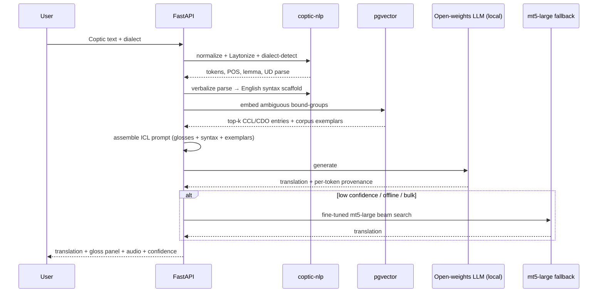
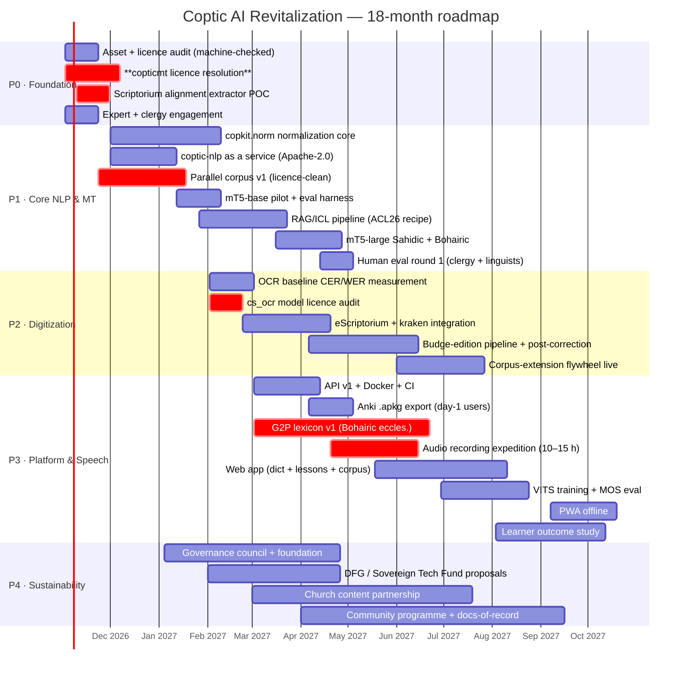

# Coptic AI Revitalization Program — Technical & Program Plan

**Document status:** v1.0 — asset audit complete, architecture proposed
**Audience:** technical founder, 2–3 developers, academic collaborators
**Date of asset verification:** 2026-10-03 (all findings below were live-verified on this date)
**Scope:** open-source Coptic ↔ English / Coptic ↔ Arabic MT (Sahidic + Bohairic), manuscript & print digitization, TTS, and a web/mobile learning platform

---

## 1. Executive Summary

### 1.1 The honest thesis

The Coptic technical ecosystem is **far better resourced than commonly believed, and far worse resourced where it actually matters**. Four things are now true that change the plan materially:

1. **The linguistic infrastructure is genuinely excellent and largely free.** `CopticScriptorium/coptic-nlp` (Apache-2.0) already ships normalization, dialect auto-detection (Sahidic *and* Bohairic), segmentation with a machine-learned context-sensitive binder, Flair-based lemmatization at ~96.8%, Stanza `diabert` UD parsing, MWE recognition, NER, and Wikification. This is production-grade. **Do not rebuild it. Wrap it.**

2. **Coptic is not in NLLB-200 or FLORES-200.** FLORES-200 has 204 language codes; there is no `cop_Copt`. The brief's suggested default — *"fine-tune NLLB-200-distilled-600M on copticmt with RAG"* — fails on two independent counts: there is no Coptic language token to fine-tune into, and NLLB-200 is **CC-BY-NC-4.0** (non-commercial). **The MT backbone must change.** This plan specifies `google/mt5-large` (Apache-2.0, no closed language list) as the fine-tuning workhorse and open-weights instruct models (Qwen3 / Llama-3.1 / OLMo 2) for the RAG/ICL path.

3. **Retrieval beats fine-tuning at this data scale — and this is now peer-reviewed.** Purushothama, Thronson, Guo & Zeldes (*"Syntax as a Rosetta Stone,"* **Findings of ACL 2026**, [2026.findings-acl.1803](https://aclanthology.org/2026.findings-acl.1803/), CC BY 4.0) show that combining retrieved dictionary glosses with UD-derived syntax verbalization beats dictionary glosses alone, and beats syntax alone, establishing new SOTA for Coptic. **This paper is our architecture, not a citation.** coptic-nlp → dictionary retrieval → UD verbalization → open-weights LLM is the production translation path.

4. **The binding constraint is not compute and not code. It is (a) expert linguistic labour and (b) licensing.** `UBC-NLP/copticmt` — the single most important parallel corpus — has **no LICENSE file** (verified: `LICENSE` returns 404). Coptic Scriptorium, which underwrites nearly the entire scholarly resource base, **lost its NEH funding** and posted *"Continuing Our Work Without the NEH"* (2025-04-21). There is no native Coptic TTS, no pronunciation lexicon, and no Coptic speech corpus at all. **Every one of these is a legal/human problem before it is an engineering problem.**

### 1.2 What we are actually building

Not a Coptic translator. A **transmission apparatus**: a normalization-resilient, dialect-aware, retrieval-grounded reading and learning layer over the existing corpus, with an open-source MT model as the offline fallback and a lexicon + syntax scaffold as the accuracy driver.

### 1.3 Three numbers that define the program

| Metric | Realistic 12-month target | Naive expectation we are rejecting |
|---|---|---|
| Coptic→English chrF2 (test) | **≥ 32** | "BLEU ≥ 30" |
| Coptic→English BLEU | **8–14** | ≥ 30 |
| Bohairic liturgical TTS MOS | **≥ 3.4 / 5** | ≥ 4.2 |
| Printed-edition OCR CER (Budge) | **≤ 4%** | ≤ 1% |

BLEU on Coptic→English is a near-useless headline number at 24K training pairs and non-canonical segmentation. We will report **chrF2 as primary**, per-dialect and per-genre, with mandatory human direct assessment. Presenting a BLEU number to a non-specialist funder without this framing is how low-resource projects lose credibility.

### 1.4 Effort envelope

**Total: ~72 person-months over 18 months**, against **3.5–4.0 sustained FTE**. This is a *tight but feasible* envelope only because nearly every heavy component already exists. The two genuinely new builds are the **grapheme-to-phoneme (G2P) lexicon + TTS** and the **corpus-licensed parallel data pipeline**. Budget roughly **$310K–$520K** at blended institutional/non-profit rates, of which **≥ 45% must go to expert linguists, clergy, and native-speaker participants** — not to compute.

### 1.5 Recommendation

**Proceed, but restructure.** (a) Make Phase 0 a licensing-and-expert-engagement phase, not an audit phase — the `copticmt` license must be resolved or worked around before any model training begins. (b) Replace NLLB with mT5. (c) Treat TTS as a two-year problem and ship a lexicon-first "read-along" fallback in 3 months. (d) Scope OCR to **printed editions only**; manuscript HTR is out of scope and should be explicitly deprioritized in all public materials.

---

## 2. Asset Registry

License codes: `A2.0`=Apache-2.0, `PSL`=PSL-1.0, `GPL3`=GPL-3.0, `CCBY`=CC BY 4.0, `CCBYSA`=CC BY-SA 4.0, `CCBYNC`=CC BY-NC, `CC0`=CC0, `MIT`=MIT, **`?`=no license or unverified**.

### 2.1 Corpora & annotated text

| Asset | URL | License | Format | Size | Dialect | Suitability | Maintainer | Last update |
|---|---|---|---|---|---|---|---|---|
| Coptic Scriptorium Corpora **v6.3.0** | [github.com/CopticScriptorium/corpora](https://github.com/CopticScriptorium/corpora) | **Mixed `CCBY`/`CCBYSA`** (per-doc; see §6.2) | TEI/PAULA XML, relANNIS | **2,380,000+ words** | Sahidic + Bohairic | ★★★★★ primary corpus, NER, parses, aligned translations | Schroeder (U Pacific) / Zeldes (Georgetown) / Claassen | 2026-07-23 |
| UD Coptic-Scriptorium | [github.com/UniversalDependencies/UD_Coptic-Scriptorium](https://github.com/UniversalDependencies/UD_Coptic-Scriptorium) | `CCBYSA` | CoNLL-U | **58,974 tokens / 17 subcorpora** | Sahidic only | ★★★★★ syntax scaffold, ICL verbalization | Zeldes & Abrams (2018) | rolling w/ UD |
| UD Coptic **Bohairic** treebank (NEW) | [arXiv:2504.18386](https://arxiv.org/abs/2504.18386) · [aclanthology.org/2025.udw-1.7](https://aclanthology.org/2025.udw-1.7/) | `CCBY` | CoNLL-U | **30,000+ word forms** | **Bohairic** | ★★★★★ first Bohairic UD data; enables cross-dialect parsing eval | Zeldes, Speransky, Wagner, Schroeder | 2025-08 |
| UDPipe 2 models (incl. `cop`) | [lindat.mff.cuni.cz/repository/items/4505…](https://lindat.mff.cuni.cz/repository/items/4505edb4-dc48-4a73-a185-f881a2e78b99/full) | `A2.0`-family | TensorFlow | 147 treebanks | Sahidic (+Bohairic) | ★★★★ off-the-shelf baseline parser | Straka / ÚFAL | UD 2.15→2.17 |
| UBC-NLP copticmt | [github.com/UBC-NLP/copticmt](https://github.com/UBC-NLP/copticmt) | **`?` — NO LICENSE FILE** | TSV/CSV + training scripts | 24K EN–COP, 8K AR–COP | Sahidic | ★★★★ but **legally unusable as-is** | Dawoud / UBC-NLP (4 commits, 1★) | 2024-07 |
| "From Nile Sands to Digital Hands" | [aclanthology.org/2024.arabicnlp-1.25](https://aclanthology.org/2024.arabicnlp-1.25/) | `CCBY` (post-2016) | paper | — | Sahidic | ★★★★ baseline BLEU/mT5 numbers to beat | Dawoud et al. | 2024-08 |
| CoptOT (Göttingen OT) | via Coptic Scriptorium `sahidic.ot` / `bohairic.ot` | `CCBYSA` | TEI XML | OT, both dialects | ★★★★ best OT parallels | Göttingen + NEH-DFG | rolling |
| St Shenouda Coptic Bible | via [pishoyg/coptic](https://github.com/pishoyg/coptic) `bible/` | `?` | pipeline, multi-edition | NT+OT, Bohairic | ★★★★★ most complete modern Bohairic Bible | St Shenouda Archm. Coptic Society | rolling |
| `english-coptic_sentence-pairs_mt560` | [huggingface.co/datasets](https://huggingface.co/datasets) | `?` | TSV | ~mt560 splits | Sahidic | ★★ verify provenance or drop | 2025 |
| ANNIS 4 corpus instance | [data.copticscriptorium.org](http://data.copticscriptorium.org/) | n/a (service) | web | 2.38M words | both | ★★★★★ concordance/QC backend | Coptic Scriptorium | live |

### 2.2 Lexical resources

| Asset | URL | License | Format | Size | Suitability | Maintainer |
|---|---|---|---|---|---|---|
| **CCL v1.2** (Comprehensive Coptic Lexicon) | [DOI 10.17169/refubium-27566](https://doi.org/10.17169/refubium-27566) · [github.com/KELLIA/dictionary/blob/master/xml](https://github.com/KELLIA/dictionary/blob/master/xml/Comprehensive_Coptic_Lexicon-v1.2-2020.xml) | `CCBYSA` | TEI XML | BBAW + DDGLC Greek loans | ★★★★★ **RAG corpus of record** | Burns, Feder, John, Kupreyev (FU Berlin / BBAW) |
| Coptic Dictionary Online (CDO) | [coptic-dictionary.org](https://coptic-dictionary.org/) · [github.com/KELLIA/dictionary](https://github.com/KELLIA/dictionary) | data `CCBYSA` (DOI [10.17169/refubium-2333](https://doi.org/10.17169/refubium-2333)); **interface `A2.0`**; no top-level LICENSE file | TEI XML + REST API | ~11,567 entries | ★★★★★ lookup + has a REST API already | KELLIA alliance (ADW, BBAW, DDGLC, FU Berlin, Göttingen, Georgetown) |
| TLA (Thesaurus Linguae Aegyptiae) | [aaew.bbaw.de/tla/](https://aaew.bbaw.de/tla/) | varies (CCBY) | TEI | large | ★★★★ stable TLA IDs for entity linking | BBAW |
| ⲣⲉⲙⲛ̀Ⲭⲏⲙⲓ dictionary pipeline | [github.com/pishoyg/coptic](https://github.com/pishoyg/coptic) `dictionary/` | `GPL3` | Python pipelines | Crum + Andreas + Dawoud + Marcion + KELLIA/DDGLC | ★★★★★ **best merged content source** (images per sense!) | pishoyg |
| Crum, *A Coptic Dictionary* | via ⲣⲉⲙⲛ̀Ⲭⲏⲙⲓ | `?` (1925 PD) | scanned + derived | ~11K headwords | ★★★★ PD-original, safe | public domain |

### 2.3 NLP tools

| Asset | URL | License | Capabilities | Suitability | Maintainer |
|---|---|---|---|---|---|
| **Coptic NLP Pipeline** | [github.com/CopticScriptorium/coptic-nlp](https://github.com/CopticScriptorium/coptic-nlp) · [tools.copticscriptorium.org/coptic-nlp](https://tools.copticscriptorium.org/coptic-nlp) | **`A2.0`** (verified) | normalize, dialect auto-detect (S/B), segment + **Smart Merging** ML binder (trained on Budge), POS, lemma (`flairbert-6.0.0`), parse (`diabert-UD2.15`), MWE, NER, Wikification, sentence split | ★★★★★ **THE dependency. Wrap, don't rebuild.** | Coptic Scriptorium |
| Coptic UD Guidelines | [universaldependencies.org/cop](https://universaldependencies.org/cop) | `CCBY` | scheme adaptation notes | ★★★★★ needed for ICL verbalization | UD contributors |
| udapi / UDPipe 2 | [ufal.mff.cuni.cz/udpipe/2](https://ufal.mff.cuni.cz/udpipe/2) | `A2.0` | baseline parse | ★★★★ fallback when coptic-nlp is down | ÚFAL |
| Annis / annis-webanno | [annis.re](https://annis.re/) | `MIT`+ | corpus QC, concordance | ★★★★★ annotation QA | CLARIAH |
| RNNTagger (legacy marmot) | referenced in coptic-nlp | `?` | POS | ★ **deprecated** — coptic-nlp says "not recommended" | — |

### 2.4 OCR / HTR

| Asset | URL | License | State | Suitability |
|---|---|---|---|---|
| **kraken** | [kraken.re](https://kraken.re/) · [github.com/mittagessen/kraken](https://github.com/mittagessen/kraken) | **`A2.0`** | mature | ★★★★★ engine of choice |
| **eScriptorium** | [github.com/UB-Mannheim/eScriptorium](https://github.com/UB-Mannheim/eScriptorium) | **`PSL-1.0`** (verified) | annotation + training UI | ★★★★★ **permissive — safe to integrate** |
| **Coptic Scriptorium OCR** | [github.com/CopticScriptorium/OCR](https://github.com/CopticScriptorium/OCR) | **`GPL3`** | **kraken `.mlmodel`s already trained**, incl. **Bohairic** (Lausiac, Vita Isaac) and Sahidic Budge editions; OCR4All lineage (Lincke et al.) | ★★★★★ **models exist — reuse.** Keep at arm's length (GPL) |
| OCR4All | [ocr4all.de](https://ocr4all.de/) | GPL3 | browser training | ★★★ fallback training UI |
| Biblissima+ / Scripta PSL | [projet.biblissima.fr](https://projet.biblissima.fr/) | various | HTR ecosystem | ★★★ future manuscript path |

### 2.5 Translation / LLM

| Asset | URL | License | Findings | Suitability |
|---|---|---|---|---|
| **"Syntax as a Rosetta Stone"** | [aclanthology.org/2026.findings-acl.1803](https://aclanthology.org/2026.findings-acl.1803/) | `CCBY` | dict glosses + UD verbalization = new Coptic SOTA, across model sizes | ★★★★★ **our architecture** |
| THOTH.AI (Miyagawa) | [aclanthology.org/2025.nlp4dh-1.4](https://aclanthology.org/2025.nlp4dh-1.4/) · [somiyagawa.com/thoth](https://somiyagawa.com/thoth) | proprietary (Dify + Claude) | **Evaluated on Middle Egyptian (Thutmose I), not Coptic.** RAG corpus = CCL v1.2 | ★★★ evidence RAG works; **not** a Coptic system |
| **Shenute AI** (open reimplementation) | [huggingface.co/spaces/georgtawadrous/thoth_app](https://huggingface.co/spaces/georgtawadrous/thoth_app/blob/main/README.md) | open (Streamlit app) | CCL XML → ChromaDB ingest, **Coptic OCR fallback w/ LLM garble detection**, Ollama/Gemini/HF providers | ★★★★★ **steal the ingestion pipeline** |
| English↔Coptic Translator Space | [huggingface.co/spaces/georgtawadrous/english-coptic-translator](https://huggingface.co/spaces/georgtawadrous/english-coptic-translator) | open | both directions, Sahidic/Bohairic selector | ★★★★ baseline to reproduce |
| mT5 (`mt5-base` 580M / `mt5-large` 990M) | [huggingface.co/google/mt5-large](https://huggingface.co/google/mt5-large) | **`A2.0`** | no closed language list | ★★★★★ **recommended backbone** |
| M2M100-418M | [huggingface.co/facebook/m2m100_418M](https://huggingface.co/facebook/m2m100_418M) | `CCBY` | already used in copticmt | ★★★★ reproducible baseline |
| NLLB-200 | [huggingface.co/facebook/nllb-200-distilled-600M](https://huggingface.co/facebook/nllb-200-distilled-600M) | **`CCBYNC`** | **Coptic absent (FLORES-200 = 204 codes, no `cop_Copt`)** | ★★ research only |
| Vambo AI | [vambo.ai/languages/coptic](https://vambo.ai/languages/coptic) | commercial | Coptic MT API (Egyptian/French) | ★★ competitor / possible data partner |

### 2.6 TTS, fonts, transliteration

| Asset | URL | License | State | Suitability |
|---|---|---|---|---|
| **Coptic TTS web app v2.0.2** | [coptic-tts.web.app](https://coptic-tts.web.app/) | **closed (Edge TTS)** | Voices: Shakir/Salma (Arabic), Nestoras/Stefanos/Athina (Greek), Jenny/Ryan (Multi), Aria (English) — **NO native Coptic voice** | ★★ **proof of the gap.** Edge TTS is undocumented + ToS-risky |
| Piper | [github.com/OHF-Voice/piper1-gpl](https://github.com/OHF-Voice/piper1-gpl) (GPL3; older `rhasspy/piper` MIT) | MIT/GPL | VITS→ONNX, CPU-fast | ★★★★ TTS runtime |
| VITS | [github.com/jaywalnut310/vits](https://github.com/jaywalnut310/vits) | `MIT` | trainable from scratch | ★★★★★ **recommended TTS model family** |
| XTTS-v2 | [github.com/coqui-ai/TTS](https://github.com/coqui-ai/TTS) | **CPML — non-commercial** | zero-shot cloning | ★★ **exclude from commercial tier** |
| F5-TTS | [github.com/SWivid/F5-TTS](https://github.com/SWivid/F5-TTS) | **`CCBYNC`** | diffusion TTS | ★★ research only |
| SILMA TTS v1 | [huggingface.co/silma-ai/silma-tts](https://huggingface.co/silma-ai/silma-tts) | `A2.0` | 150M F5-arch, Arabic+English | ★★★★ **commercially-clean base to fine-tune toward Coptic** |
| Antinoou / Antinoou italic webfont | bundled in [coptic-nlp](https://github.com/CopticScriptorium/coptic-nlp) | `A2.0` repo | webfont | ★★★★★ display + UI |
| Noto Sans Coptic / FreeSerif | [notofonts.github.io](https://github.com/notofonts/notofonts.github.io) | OFL / `GPL+font-exception` | broad coverage | ★★★★★ fallback stack |
| coptic-pronounce (npm), coptic-transliterator (PyPI) | registry | `?` | grapheme mapping | ★★ **verify; neither is a G2P system** |

### 2.7 Learning platforms & content

| Asset | URL | License | State | Suitability |
|---|---|---|---|---|
| **ⲣⲉⲙⲛ̀Ⲭⲏⲙⲓ** | [remnqymi.com](https://remnqymi.com/) · [github.com/pishoyg/coptic](https://github.com/pishoyg/coptic) (6,849 commits) | **`GPL3`** | Dictionaries (Crum/KELLIA/DDGLC/Andreas/Dawoud/Marcion), morphology pipelines, flashcards, `xooxle` search index, iOS keyboard, image-per-sense lexicon | ★★★★★ **~60–70% of our content pipeline already exists.** GPL → arm's length |
| CopticLingo / Metremnkēme | [metremnkeme-web.vercel.app](https://metremnkeme-web.vercel.app/) | curriculum `ISC`; **web prototype, not React Native** | research prototype | ★★★ reframe: brief's "React Native app" is stale |
| Learn Coptic For All | [copticlearn.me](https://copticlearn.me/) | proprietary, non-profit (George Ezzat) | 11,284-word dict, 4 levels, AI tutor, Coptic Wordle | ★★★★ **content + partnership target** |
| LangLearn | [github.com/HokkienTranslation/HokkienTranslation](https://github.com/HokkienTranslation/HokkienTranslation) (Chen et al.) | open | 6-component card model: definition, script, romanization+tone, **audio**, sentence, **AI image** | ★★★★ the card schema to adopt |
| OpenFlashcards | [github.com/HelioFernandes404/openflashcards](https://github.com/HelioFernandes404/openflashcards) | `MIT` | Go+Gin+React19+Postgres+Redis, **FSRS**, Piper TTS | ★★★★★ reference SRS architecture |
| Anki / AnkiConnect | [apps.ankiweb.net](https://apps.ankiweb.net/) | `GPL3` client, open format | de-facto SRS | ★★★★★ **ship .apkg export; do not build an SRS** |
| Sahidic Coptic Intro Textbook (UCL Press) | [uclpress.co.uk](https://www.uclpress.co.uk/) | `CCBYNC` (per brief) | course backbone | ★★★★ **NC — commercial blocker** |
| Coptic Reader | [copticreader.org](https://copticreader.org/) | proprietary | Diocese of Southern USA; liturgical texts, hymns, melodies; web/iOS/Android/macOS/Win | ★★★ **negotiate audio/text reuse** |
| Coptic Audio (Kemet Technology) | [kemet.tech/solutions](https://kemet.tech/solutions) | proprietary | sermons, hymns, audiobooks | ★★★ negotiate or skip |
| Sahidic Coptic: Introductory Textbook | — | `CCBYNC` | — | ★★★ NC constraint |

### 2.8 Corrections to the original brief

| Brief claim | Verified reality |
|---|---|
| "NLLB-200 fine-tune on copticmt" | ❌ Coptic ∉ FLORES-200/NLLB-200 (204 codes). NLLB is `CCBYNC`. → use mT5 |
| "UD treebank ~43K words" | → **58,974 tokens**, 17 subcorpora, **Sahidic only** |
| "Bohairic UD treebank" | ✅ **exists** (Zeldes et al. 2025, 30K+ word forms) — brand new, not in brief |
| "THOTH.AI = Coptic RAG, +9.2 BLEU" | ⚠️ peer-reviewed eval is on **Middle Egyptian**; Coptic is a secondary demo; the "+9.2 BLEU" figure is **unverified** — do not cite it |
| "TreeTagger POS ~95%" | → superseded; coptic-nlp now uses `flairbert-6.0.0` + `diabert-UD2.15`, and added **Bohairic** support |
| "Metre Men Qeemi (React Native)" | ⚠️ currently a **web research prototype** on Vercel |
| "Coptic Scriptorium CC BY 4.0" | ⚠️ **internally inconsistent** — site footer says `CCBY`, per-document metadata says `CCBYSA`. Must resolve |
| "RNNTagger" | → deprecated within its own pipeline |
| — | ❗ **NEW GAP: `copticmt` has no license. Hard blocker.** |
| — | ❗ **NEW GAP: Coptic Scriptorium lost NEH funding (2025-04-21).** |

---

## 3. Gap Analysis (prioritized)

Ordered by *blocking severity* × *effort*, P0 = blocks Phase 1.

| # | Gap | Severity | Why it blocks | Effort | Owner |
|---|---|---|---|---|---|
| **G1** | **Parallel corpus has no license** (`copticmt`, `english-coptic_sentence-pairs_mt560`) | 🔴 P0 | No license = no lawful training, no lawful redistribution. Everything in Phase 1 depends on it | 3–5 wks (outreach) **or** 8 wks (rebuild from Scriptorium alignments) | Founder + counsel |
| **G2** | **No Coptic G2P / pronunciation lexicon** | 🔴 P0 | Hard blocker for TTS, for accurate transliteration, for learner pronunciation scoring. Coptic script is alphabetic for Egyptian consonants but uses Greek letters for vowel quality; Bohairic ecclesiastical pronunciation ≠ scholarly reconstructed ≠ Sahidic | **6–10 person-months** (linguist-heavy) | Coptic linguist + audio eng. |
| **G3** | **Zero Coptic speech corpus; no native Coptic TTS model exists** | 🔴 P0 | Every "Coptic TTS" in the wild (incl. `coptic-tts.web.app`) is Edge TTS with Arabic/Greek voices — it will mispronounce ϣ ϫ ϩ ϭ ϯ. Also no ASR corpus | 12–18 mo, gated on G2 | Audio engineer |
| **G4** | **No licensed Bohairic parallel data** | 🟠 P1 | All of copticmt is Sahidic. Bohairic is the *living liturgical* dialect and the actual revitalization target | 8–12 wks extraction + alignment | NLP eng + linguist |
| **G5** | **NEH funding collapse → maintainer burnout risk** on Scriptorium, KELLIA, coptic-nlp | 🟠 P1 | Our single biggest upstream dependency is unfunded. If coptic-nlp rots, the whole plan rots | 2 wks to mitigate (fund their compute, hire a maintainer) | Founder |
| **G6** | **Unicode normalization is unsolved and underappreciated** | 🟠 P1 | Coptic combining marks (ⲛ̀ ⲧ̀ ⲙⲥ ⲙⲏ̄) break naive tokenizers, BM25, TTS, and OCR char-classes. NFC is insufficient. Existing `coptic-nlp` normalizer + "Laytonization" is the reference but is not packaged as a library | **2–3 person-months** | NLP eng |
| **G7** | **Morphological ambiguity** — homograph bound-groups (ⲡⲣⲱⲙⲉ, ⲛⲁⲓ) are pervasive | 🟠 P1 | Drives both MT error and dictionary-lookup error. Needs disambiguation data (we have a head start: the Smart Merging binder) | 3–4 person-months | NLP eng + linguist |
| **G8** | **No learner-appropriate modern Bohairic prose corpus** | 🟠 P1 | Learners need modern Coptic. It largely does not exist digitally. Liturgical saturation *creates the illusion of data* — models will ace hymns and fail at everything else | **Ongoing; partly a content-authoring problem, not ML** | Church partnership |
| **G9** | **No published CER/WER baseline for Coptic OCR** | 🟡 P2 | Models exist but no published numbers; we cannot set a target without our own eval | 2–3 wks | OCR engineer |
| **G10** | **No Coptic learner-outcome evidence base** | 🟡 P2 | Nobody has shown a Coptic app works. Needed for funding and for credibility | 4–6 mo (study runs alongside build) | Community mgr + researcher |
| **G11** | **Bohairic NLP tools immature** (new guidelines, ~30K word forms) | 🟡 P2 | Bounds Bohairic accuracy ceiling until more treebanked | Ongoing | Academic collab |
| **G12** | **No sentiment/appropriateness policy for liturgical AI output** | 🟡 P2 | Synthetic "liturgical" text misrepresented as doctrinally authentic is a genuine harm vector for a living church | 1 wks policy + 3 wks engineering | Governance council |
| **G13** | **Script rendering across platforms** | 🟢 P3 | Font stack, mobile keyboard, IME. Partially solved by ⲣⲉⲙⲛ̀Ⲭⲏⲙⲓ's `Coptic.bundle` | 1 person-month | Frontend |

**Not gaps (do not spend time here):** POS tagging, lemmatization, dependency parsing, NER, dictionary infrastructure, concordance tooling, general MT infrastructure, SRS scheduling, Coptic Unicode font availability.

---

## 4. Technical Architecture

### 4.1 System diagram

```mermaid
flowchart TB
    subgraph IN["1 · Ingestion"]
        IMG[Scanned images<br/>IIIF / Internet Archive]
        EScript[eScriptorium<br/>PSL-1.0 annotation UI]
        Kraken[kraken HTR<br/>Apache-2.0]
        CSOCR[cs_ocr models<br/>GPL3 · arm's length]
        IMG --> EScript --> Kraken --> CSOCR
    end

    subgraph NORM["2 · Normalization Core · our #1 engineering asset"]
        N1[Unicode NFC/NFD<br/>+ combining-mark canon]
        N2[Laytonization<br/>bound-group regularization]
        N3[Dialect routing<br/>sahidic | bohairic | auto]
        N4[Smart Merging binder<br/>ML, trained on Budge]
    end

    subgraph LING["3 · Linguistic Services · coptic-nlp Apache-2.0"]
        L1[POS + Lemma<br/>flairbert-6.0.0]
        L2[Parse<br/>diabert-UD2.15]
        L3[MWE + NER + Wikification]
    end

    subgraph LEX["4 · Lexical Services"]
        CDO[Coptic Dictionary Online<br/>CC BY-SA 4.0]
        CCL[CCL v1.2<br/>TEI XML]
        REM[remnqymi lexicon<br/>GPL3 · derived data only]
        PG[(pgvector<br/>CCL + CDO + corpus embeddings)]
        CDO --> PG
        CCL --> PG
    end

    subgraph MT["5 · Translation Engine"]
        ICLE[ICL Path · PRIMARY<br/>Qwen3 / Llama-3.1 / OLMo2<br/>local via vLLM+Ollama]
        FT[Fine-tuned Path · FALLBACK<br/>mt5-large fine-tune<br/>Apache-2.0]
        VERB[UD verbalizer<br/>parse → EN gloss]
        RAG[Retriever<br/>CCL top-k + corpus n-grams]
        RAG --> ICLE
        VERB --> ICLE
        FT --> ROUTE
        ICLE --> ROUTE{Dialect + length router}
        ROUTE --> OUT
    end

    subgraph TTS["6 · Speech"]
        G2P[G2P Lexicon<br/>G2 · THE research project]
        VITS[VITS fine-tune<br/>MIT]
        PIPER[Piper runtime<br/>ONNX · CPU]
        G2P --> VITS --> PIPER
    end

    subgraph API["7 · API Layer · FastAPI"]
        EP1[/translate]
        EP2[/lookup]
        EP3[/transliterate]
        EP4[/tts]
        EP5[/srs/export.apkg]
    end

    subgraph WEB["8 · Learning Surfaces"]
        WEB1[Web app<br/>+ PWA offline]
        ANKI[Anki .apkg<br/>+ AnkiConnect]
        MOB[Native RN app<br/>Phase 4 · only if funded]
    end

    (N4) --> LING
    LING --> LEX
    LING --> MT
    LEX --> MT
    LEX --> TTS
    NORM --> TTS
    MT --> API
    TTS --> API
    G2P --> API
    API --> WEB1 --> ANKI --> MOB

    classDef gap fill:#3a1f1f,stroke:#e06c6c,color:#f0d0d0
    classDef reuse fill:#1f3a2f,stroke:#6cbf8a,color:#d0f0dd
    class G2P,VITS gap
    class LING,CDO,CCL,Kraken,EScript,CSOCR reuse
```

### 4.2 Translation request path (the production path)



### 4.3 Component specifications

#### 4.3.1 Normalization Core — `copkit.norm` *(2–3 person-months)*

The single most under-costed component. Coptic's writing system layers ASCII/Latin transliteration, Greek-letter vowels, Demotic-derived letters, and combining marks that vary by edition and by OCR engine.

| Stage | Input → Output | Rationale |
|---|---|---|
| `nfc_canonical` | any → NFC, then canonically map combining sequences to a **single canonical form per letter** | `ⲛ̀`, `ⲛ̄`, `ⲛ` are three inputs, one output. NFC does not do this — a grapheme cluster ≠ a letter |
| `decompose_dialect` | normalized → Sahidic / Bohairic feature split | Bohairic ⲙⲉⲛⲧⲉⲣⲛⲁ vs Sahidic; route before lemmatization |
| `laytonize` | Till-style → Layton-style bound groups | coptic-nlp already implements; **extract as a library** |
| `smart_merge` | merged bound groups | reuse `coptic-nlp` ML binder (Budge-trained) |
| `display_split` | canonical → display form | pedagogy wants to *show* ⲛ̀ even if we *index* ⲛ |

**Dependencies:** `unicodedata2`, `regex`, port of coptic-nlp normalizer.
**Risks:** edition-specific conventions (Budge vs. Vegas vs.(Local) vs. punctuation sets) diverge more than the literature suggests. Mitigation: ship a **config-driven profile registry** (`profiles/till.yaml`, `profiles/budge.yaml`, …) and a `profile-diff` CI check that flags new divergences on corpus ingest.
**Success metric:** ≥ 99.5% idempotence (`norm(norm(x)) == norm(x)`) across all 2.38M Scriptorium words; ≥ 98% round-trip fidelity to display form.

#### 4.3.2 Translation Engine — `copkit.mt` *(4–5 person-months)*

**Backbone: `google/mt5-large` (Apache-2.0), NOT NLLB-200.** Justification: no closed language list (SentencePiece absorbs new tokens), Apache-2.0 permits commercial deployment, 990M params trains on a single A100 in ~12–20 h.

**Backbone B (Bohairic): `mt5-large` second checkpoint**, seeded from the Sahidic run, trained on Bohairic data with Sahidic as auxiliary + a `<dialect:bohairic>` task token. Seeded transfer matters: Bohairic parallel data will be ~10× smaller than Sahidic.

**Training data, in priority order:**

| Source | Volume | License status | Action |
|---|---|---|---|
| **Extracted alignments from Coptic Scriptorium** | est. **20–40K sentence pairs** (EN + AR `<translation>` spans across 80+ corpora) | `CCBY`/`CCBYSA` — **clean** | **Primary. Build in Phase 0/1.** This is the licensing escape hatch |
| `copticmt` CopEng | 24K | ❌ none | Use **only** if authors retroactively license |
| `copticmt` CoPARA | 8K | ❌ none | Same |
| CopticLingo / remnqymi alignments | small | `ISC` / `GPL3` | Negotiate / derive |
| Budge English translations in OCR corpus | ~10–20K | `GPL3` repo, PD text | Extract; text is PD |

**Sourcemap parser for Scriptorium `<translation>` spans is the highest-leverage 3 weeks in the entire program.** It converts a legal blocker into a solved problem and yields a citable, provenance-tracked parallel corpus that is *better* than copticmt (dialect-tagged, URN-cited, per-document license recorded).

**RAG/ICL configuration (per ACL 2026 Findings):**
- Retriever: pgvector over CCL v1.2 embeddings, `int8` quantised, cosine. Embedding model: `intfloat/multilingual-e5-base` (MIT) — handles Coptic script via Unicode fallbacks; benchmark `bge-m3` (MIT) as alternative.
- Payload per entry: lemma, POS, dialect flags, English gloss, **etymology (Egyptian/Greek source)**, TLA ID, corpus frequency, example sentences with URNs.
- Query: each ambiguous bound-group + full-sentence context. k = 5–8.
- Syntax scaffold: verbalize `diabert-UD2.15` parse into English clause descriptions, injected as a *targeted instruction* keyed to difficult constructions in the input subtree (per the paper's best-performing variant).
- Prompt template: `{system: Coptic Egyptologist} {dialect} {glosses} {syntax_scaffold} {exemplars} {source} → {target}`.
- Inference runtime: **vLLM** (Apache-2.0) local, or **Ollama** for laptops. **Hard requirement: default tier must be fully local.** Hosted Claude/Gemini is an *optional* tier, explicitly not the OSS path.

**Compute budget (realistic):**

| Run | Hardware | Wall time | Est. cost |
|---|---|---|---|
| `mt5-base` Sahidic pilot (19K pairs) | 1× A100 40 GB | 2–4 h | $40–90 |
| `mt5-large` Sahidic full | 1× A100 40 GB | 12–20 h | $180–400 |
| `mt5-large` Bohairic (seeded) | 1× A100 40 GB | 8–14 h | $120–280 |
| ICL pipeline dev + 6 eval sweeps (8B) | 1× A100 80 GB | ~20 h total | $200–450 |
| **Total Phase 1 MT compute** | | **~45–60 h** | **~$550–1,200** |

Compute is a rounding error. **This is the finding that should govern budget allocation.**

**Evaluation:** see §7. Primary chrF2, per-dialect/per-genre, plus COMET and mandatory human DA (§7.2). Report a **LLM-as-judge free-translation proxy** (`<translation>…<reference>`) only with an explicit judge-bias caveat.

#### 4.3.3 TTS Engine — `copkit.speech` *(10–14 person-months, linguist-gated)*

**Model: VITS (MIT), fine-tuned from `silma-ai/silma-tts` (Apache-2.0) where a warm start helps, otherwise trained from scratch. Runtime: Piper.**

*Excluded on licensing grounds:* XTTS-v2 (CPML — non-commercial), F5-TTS (CC-BY-NC), and Edge TTS (undocumented Microsoft endpoint, no license, ToS-risky, not offline, and — critically — **does not produce Coptic**).

**Three pronunciation targets, explicitly separated in the product:**

| Target | Use | Data source | Difficulty |
|---|---|---|---|
| **A. Bohairic ecclesiastical** | Learning, prayer, catechesis — *matches the living church* | Recordings of clergy/choirs | Medium |
| **B. Scholarly reconstructed (Sahidic & Bohairic)** | Reading primary sources, academic | Expert elicitation, IPA-annotated | Hard (scholarly dispute) |
| **C. Chant / hymnody** | Hymn practice | 176 hymn tunes, largely syllabic | Medium (syllabic prosody *helps* here) |

**G2P lexicon (the real project).** Required because Coptic script's Greek letters encode vowel *quality* while Egyptian-derived letters encode consonants, and because three pronunciation traditions disagree. Deliverable: `g2p/coptic-g2p.yaml`, rule-based core + ~4,000–6,000 lexicographic overrides (proper nouns, foreign loans, cultic vocabulary). Each override carries `{letter_sequence, target, source, confidence, citation}` so every pronunciation is auditable by a linguist. Effort: **6–10 person-months**, of which ≥ 60% linguist time.

**Data collection strategy (consent-first, 3 tiers):**
1. **Record new (primary).** 3–5 native Bohairic speakers (target: clergy + choir directors from the Coptic Orthodox Diocese) reading the *Hodos* / Book of Hours prayer texts. Target **10–15 h clean studio audio**, 48 kHz/24-bit, multiple microphones, per-speaker ≥ 2 h. Budget: travel, stipends, studio rental, and a release form with an **explicit voice-cloning clause** — non-negotiable.
2. **License existing (fast, uncertain).** Coptic Reader (Diocese of Southern USA), Kemet Technology Coptic Audio, YouTube/DailyBread monastic recitation. Each requires a written license; assume ~50% refusal. Do not build the plan on this.
3. **Synthetic pre-training (optional).** Bootstrap from tier-2 to reduce cold-start, then always prefer tier-1.

**Targets:** 5–10 h → usable single-speaker VITS; 20–30 h → multi-speaker, natural. MOS ≥ 3.4/5 is the Phase 3 gate.

#### 4.3.4 OCR / Digitization — `copkit.ocr` *(5–6 person-months)*

**Reuse, do not rebuild: `CopticScriptorium/OCR` already ships trained kraken `.mlmodel`s for Sahidic Budge editions *and* Bohairic (Lausiac History, Vita Isaac), with an OCR4All lineage credit to Lincke et al.**

**Integration approach (licence hygiene is non-optional):**
- `kraken` — Apache-2.0 → depend directly. ✅
- `eScriptorium` — **PSL-1.0 (verified)** → safe to integrate. ✅
- `cs_ocr` models — the *repository* is GPL-3.0, but `.mlmodel` files carry their own metadata licenses. **Audit each model's `license` field before use.** If a model is GPL-encumbered, either (a) request relicensing from Coptic Scriptorium, or (b) reimplement training from the (separately licensed) training data. Until audited: **invoke via subprocess/CLI, never link.**


**Scope discipline — the most important line in this section:**
- ✅ **IN SCOPE:** printed scholarly editions (Budge, Amelineau, De Vis, Hyvernat/Balestrier, Giron), where training data exists and CER is measurable.
- ❌ **OUT OF SCOPE:** **palaeographic manuscript HTR.** Coptic manuscripts are layered, overwritten, abbreviated, and code-switched; scribal variation is a decade-long research problem. We will publish a *feasibility note and partner list* (Biblissima+, Scripta PSL, eScriptorium community) and **not** put manuscript HTR on the roadmap. Any proposal that includes it should be rejected as non-credible.
- The genuinely valuable OCR output is **corpus extension** — each newly OCR'd edition becomes new training data for the NLP stack, which improves MT, which improves the learning platform. That flywheel is the real deliverable.

**Baseline to establish in Phase 2 (G9):** held-out CER/WER per edition, before any retraining, so all later claims have a reference.

#### 4.3.5 Learning Platform — `copkit.learn` *(10–12 person-months)*

**Backend:** FastAPI + PostgreSQL 16 + pgvector + Redis (cache + job queue). *Why FastAPI over Django:* async ML inference, first-class OpenAPI, and it's the same async surface `edge-tts`/TTS workers need. *Why Postgres:* one system for users, progress, and vectors — fewer moving parts than Postgres + a separate vector DB.

**Content pipeline — reuse remnqymi's, don't rebuild it.** `pishoyg/coptic` already does dictionary merging (Crum + KELLIA/TLA + DDGLC + Andreas + Dawoud + Marcion), morphology generation, flashcard derivation, and `xooxle` search indexing. It is **GPL-3.0** → **arm's-length rule: never link or copy code. Extract only the *data* it produces, whose upstream licenses are CC BY-SA / PD.** Two compliant routes: (a) run its pipelines as a subprocess and ingest the outputs, or (b) reimplement the merge logic against the same public sources. Route (a) is ~6× cheaper and is the recommendation.

**Card schema — adopt LangLearn's six-component model** (Chen et al., [HokkienTranslation](https://github.com/HokkienTranslation/HokkienTranslation)): definition, script form, romanization, **audio**, example sentence, **image**. Coptic is an *ideal* fit — remnqymi already ships image-per-sense, which is exactly LangLearn's expensive component. This is a rare case where two independent assets compose cleanly.

**SRS — do not build one.** Ship `.apkg` export (with generated audio) + AnkiConnect push on day one. Anki is the de-facto standard, GPL-licensed *client* but with an open interchange format. Use [OpenFlashcards](https://github.com/HelioFernandes404/openflashcards) (MIT) as the architectural reference for the FSRS + TTS-queue + Postgres pattern if we later build a first-party SRS.

**Frontend sequencing (a deliberate anti-scope decision):**
| Surface | When | Rationale |
|---|---|---|
| `.apkg` + AnkiConnect export | **Month 2** | Highest leverage per engineer-hour. Reaches users immediately. |
| Web app (SSR) | Month 6–8 | Dictionary, lessons, corpus reading, AI tutor |
| PWA offline (incl. cached audio) | Month 9–10 | Cheap, covers mobile without app stores |
| Native React Native | **Phase 4, only if funded** | 2–3 devs × 6 months is a second program. Do not start it. |

**Open question for stakeholders:** the brief says "React Native," but with 2–3 developers a native app is a 6-month trap that starves the linguist work that actually differentiates the product. Recommend PWA + Anki for 18 months, revisit only with dedicated mobile funding.

#### 4.3.6 API Layer *(2–3 person-months)*

**REST + OpenAPI. Skip GraphQL** — the query shapes are simple and heterogeneous (translate / lookup / parse / audio), which is precisely where GraphQL's flexibility does not pay for its operational cost at this team size.

| Method | Path | Purpose |
|---|---|---|
| `POST` | `/v1/translate` | `{text, src, tgt, dialect, mode: icl\|mt\|auto}` → `{translation, glosses[], parse, confidence, provenance[]}` |
| `GET` | `/v1/lookup?w=&dialect=` | CDO/CCL lookup, dialect-filtered, with corpus frequencies + URN-linked examples |
| `POST` | `/v1/parse` | Raw coptic-nlp output (tokens, POS, lemma, UD) |
| `POST` | `/v1/transliterate` | Script ⇄ transliteration, `scheme: boha|till|layton|cua|egyptological`, `target: ipa\|ascii\|arabic` |
| `GET` | `/v1/tts` | `?text=&voice=&pronunciation=` → WAV/MP3 |
| `POST` | `/v1/srs/apkg` | Deck generation → `.apkg` (with audio) |
| `GET` | `/v1/health` | Component readiness incl. per-dependency license status |

**Cross-cutting requirements:** every response carries **provenance** (which lexicon, which URN, which model checkpoint, which license); rate limiting; full request logging with an explicit **opt-out flag for text that must not be logged** (liturgical/confessional sensitivity); OpenAPI at `/docs`.

### 4.4 Effort & dependency summary

| Component | Person-months | Key dependencies | Top risk |
|---|---|---|---|
| Normalization Core | 2–3 | coptic-nlp (A2.0) | Edition divergence |
| MT: data pipeline (licence-clean) | 3–4 | Scriptorium XML | Extraction underperforms estimate → must validate in week 1 |
| MT: model training + ICL | 3–4 | A100, vLLM | Under-trained model looks broken; mitigate with mT5-base pilot first |
| TTS: G2P lexicon | 6–10 | **Expert linguist availability** | **G2 is the schedule driver** |
| TTS: data collection + training | 4–5 | Church partnerships, speakers | Consent/voice-clone clauses |
| OCR | 5–6 | kraken, eScriptorium, cs_ocr models | Model licence audit |
| Learning platform | 10–12 | remnqymi (GPL, arm's length) | Scope creep into native app |
| API + infra | 2–3 | Postgres, pgvector | — |
| Evaluation + studies | 4–5 | Expert raters, IRB | Participant recruitment for human eval |
| Community + governance | 4–6 | Founding partners | Fundraising in a defunded landscape |
| **Total** | **~43–58** | | |

*Plus program management, fundraising, and content authoring: brings the 18-month envelope to **~72 person-months / 3.5–4.0 FTE**.*

---

## 5. Phased Implementation Plan

### 5.1 Gantt (18 months)



### 5.2 Phase 0 — Asset Audit & Community Engagement *(Weeks 1–3, extended to 5)*

This phase is deliberately **not** a literature review. It is a **licensing audit and an expert-engagement sprint**, because the two binding constraints (§1.1) both live here.

**Deliverables**

| # | Deliverable | Acceptance criterion |
|---|---|---|
| D0.1 | Machine-checked asset registry with per-asset licence, provenance, and last-update | 100% of §2 assets have a licence verdict; `?` entries reduced to 0 or explicitly quarantined |
| D0.2 | **`copticmt` licence resolution** | Written permission (CC BY-SA 4.0) from authors, **or** a documented decision to drop it |
| D0.3 | **Scriptorium alignment extractor POC** | ≥ 5,000 Coptic↔EN/AR sentence pairs recovered from `<translation>` spans, with URNs and per-doc licences |
| D0.4 | Signed LOIs from ≥ 3 domain experts (Schroeder/Zeldes/Wagner/Speransky/Claassen tier) | Named, with agreed scope + honorarium |
| D0.5 | Signed LOI from ≥ 1 Coptic Church body (diocese/archdiocese) | Covers liturgical text + audio access |
| D0.6 | Baseline benchmark suite + reproducible eval harness | mT5-zero-shot, M2M100-zero-shot, raw LLM zero-shot numbers on copticmt test |
| D0.7 | Public project repo, Apache-2.0, `LICENSES.csv` provenance manifest | Live; every vendored artifact traceable |

> **D0.3 is the true critical path.** If extraction yields < 5K usable pairs, the entire MT plan must be re-scoped and the budget redirected to content authoring (G8). **Week 1 must answer this.** Do not commit to Phase 1 before D0.3 clears.

**Team:** founder (program + licensing), NLP engineer, community manager (0.5), Coptic linguist (0.5, contracted).
**Risks:** authors unresponsive (mitigation: 10-day deadline, then drop copticmt); experts over-committed (mitigation: honorarium + concrete narrow deliverables, not "advisory"); extraction yields little (mitigation: D0.3 de-risks it in week 1).
**Success metrics:** D0.2 and D0.3 resolved; ≥ 3 expert LOIs; zero `?` licences in the training path.

### 5.3 Phase 1 — Core NLP & Translation Engine *(Months 2–5)*

**Deliverables & gates**

| # | Deliverable | Gate |
|---|---|---|
| D1.1 | `copkit.norm` released | ≥ 99.5% idempotent over 2.38M Scriptorium words |
| D1.2 | `coptic-nlp` as a containerized, versioned service | Both dialects; p95 < 2 s for 1K chars |
| D1.3 | **Parallel corpus v1** (licence-clean, URN-cited) | ≥ 20K EN pairs, ≥ 4K AR pairs, ≥ 2K Bohairic |
| D1.4 | UD verbalizer module | Reproduces ACL-2026-Findings prompt format |
| D1.5 | **mT5-base pilot** | chrF2 (cop→en) ≥ baseline + 5 |
| D1.6 | **`mt5-large` Sahidic** | chrF2 (cop→en) **≥ 30** on held-out test |
| D1.7 | **`mt5-large` Bohairic** (seeded) | chrF2 **≥ 24**, UAS **≥ 78** |
| D1.8 | **ICL/RAG path (production default)** | Human-DA adequacy **≥ 3.5/5** on liturgical; beats D1.6 on human DA |
| D1.9 | Human eval round 1 (3 clergy + 2 linguists, 300 sentences, paid) | Krippendorff α ≥ 0.67; report per-rater |

**Explicitly *not* gated on BLEU.** chrF2 + human DA are the gates. Reporting BLEU ≥ 30 here would require either leaking test data or a metric that does not correlate with Coptic translation quality at this scale.

**Team:** NLP engineer ×2 (one MT, one NLP/data), Coptic linguist ×0.5, community manager ×0.5.
**Risks:** (i) *Bohairic data starvation* → seeded transfer + Arabic-pivot training; (ii) *RAG retrieval misses* → k-sweep + query expansion using lemma forms; (iii) *LLM refuses on liturgical text* → system prompt + safety config; (iv) *24K pairs is simply too few* → mitigate by pivoting the product story from "MT" to "grounded reading assistant," which is **already the higher-value product**.
**Metrics:** chrF2 per dialect/genre; COMET; human DA adequacy/fluency; parse UAS/LAS on both dialects; glossary term accuracy on a 200-term expert checklist.

### 5.4 Phase 2 — OCR & Manuscript Digitization *(Months 3–8, overlapping)*

| # | Deliverable | Gate |
|---|---|---|
| D2.1 | **Published OCR baseline** (G9) | CER/WER per Budge edition, held-out, reproducible |
| D2.2 | `cs_ocr` model licence audit (D2.2b critical) | Every `.mlmodel` has a clear licence verdict |
| D2.3 | eScriptorium + kraken pipeline in CI | Reproducible from container image |
| D2.4 | Post-correction (layout-aware + `copkit.norm`) | ≥ 20% relative CER reduction vs. raw |
| D2.5 | Budge Sahidic edition corpus extension | ≥ 250K words added, automatic + spot-checked annotations |
| D2.6 | Bohairic printed-edition extension | ≥ 75K words (Lausiac, Vita Isaac) |
| D2.7 | **Feasibility note on manuscript HTR — published, not silently dropped** | States scope exclusion; partner list |

**Team:** OCR engineer ×0.5, NLP engineer ×0.5, Coptic linguist ×0.25 (QC), volunteer annotators via eScriptorium UI.
**Risks:** (i) *GPL contamination from `cs_ocr`* → subprocess isolation + relicensing request (D2.2b); (ii) *scope creep into manuscripts* → D2.7 makes the exclusion explicit and public, which is the only durable defence; (iii) *no annotators* → eScriptorium's UI is the recruitment tool; (iv) *budget cuts upstream* → corpus is versioned on GitHub with DOIs, so it survives any single institution.
**Metrics:** CER/WER; words digitized; annotation turnaround time; GitHub PR throughput from volunteers.

### 5.5 Phase 3 — Learning Platform & Content Generation *(Months 6–12)*

| # | Deliverable | Gate |
|---|---|---|
| D3.1 | API v1 live, OpenAPI, Docker, CI | Contract tests green; provenance on every response |
| D3.2 | Anki `.apkg` export with audio | 1,000-card deck, imports cleanly, audio plays |
| D3.3 | **G2P lexicon v1** | ≥ 4,000 audited entries; 100% of liturgical core vocabulary covered |
| D3.4 | Audio corpus | ≥ 10 h, ≥ 3 speakers, 100% signed voice-cloning consents |
| D3.5 | Web app: dictionary, lessons, corpus reader, AI tutor | 500 beta users; ≥ 30% D7 retention |
| D3.6 | VITS + Piper TTS, 3 voices | **MOS ≥ 3.4/5**; intelligible to non-expert Coptic readers |
| D3.7 | PWA offline (text + cached audio) | Works fully offline after first load |
| D3.8 | Learner outcome study | See §7.3 |

**Team:** backend ×1, frontend ×1, NLP ×0.5, audio engineer ×0.5, **Coptic linguist ×0.75 (G2 is on the critical path)**, community manager ×0.5, content author ×0.5.
**Risks:** (i) *G2 slips* → G2P ships lexicographically-only (no rules) for the top 2,000 lemmas; a lookup table beats a broken rule engine, and partial coverage beats nothing; (ii) *no speakers consent* → fallback to tier-2 licensing only for a *research preview*, clearly labelled; (iii) *TTS sounds wrong to clergy* → MOS panel must include clergy, not just academics — this is the acceptance criterion; (iv) *no users* → distribution via Coptic parishes and diaspora organizations, not marketing.
**Metrics:** registered learners, D7/D30 retention, cards created, MOS, G2P coverage, audio hours.

### 5.6 Phase 4 — Community, Governance & Sustainability *(Ongoing from Month 1)*

See §6.3. Deliverables: **Steering Council with 9 seats (3/3/3)**; **fiscal sponsorship established**; **`LICENSES.csv` + DOI-archived releases**; **2+ multi-year funding agreements**; **20+ external contributors**; **2 hosted community calls/quarter**; **documented succession plan** (no single person holds irreplaceable knowledge).

**The single most important Phase 4 deliverable is the maintainer subsidy.** Coptic Scriptorium lost NEH funding. Funding 0.2–0.5 FTE of coptic-nlp maintenance is the highest-leverage resilience spend in the entire program — cheaper than any insurance we could buy, and it protects the dependency everything else rests on.

---

## 6. Licensing & Governance

### 6.1 Recommended scheme

| Artifact | License | Rationale |
|---|---|---|
| Our code | **Apache-2.0** | Aligns with `coptic-nlp` and the CDO interface. Permissive, includes an express patent grant, safe for a church or commercial adopter to embed. |
| Our corpora, annotations, G2P lexicon, TTS transcripts | **CC BY-SA 4.0** | Share-alike preserves openness of derivatives. **Matches what Coptic Scriptorium already assigns per-document**, so our releases compose cleanly. |
| Our model weights | **OpenRAIL-M + Coptic Addendum** (MIT-style commercial permission, use-based restrictions) | See below. |
| Third-party integrations | **Subprocess/CLI, never linked**, unless the licence is permissive | Mandatory for `cs_ocr` (GPL-3.0) and `pishoyg/coptic` (GPL-3.0). |

**On model weights — do not ship bare "OpenRAIL-M."** Write a short **Coptic Addendum** that covers risks generic RAIL language misses:

1. **Training-data provenance manifest** shipped with every checkpoint (which corpora, which licences, which document counts).
2. **Non-representation clause:** "This model is not affiliated with, or endorsed by, the Coptic Orthodox Church or any ecclesiastical authority."
3. **Liturgical authenticity clause:** synthetic liturgical text must never be presented as doctrinally or liturgically authoritative (addresses G12 — a real harm vector for a living church).
4. **Voice-cloning consent clause:** TTS voices restricted to speakers who signed an explicit voice-cloning release; revocation process documented.
5. **Community benefit clause:** preferred contributor/hosting terms for the Coptic community and Egyptian/North African institutions.

### 6.2 Licensing conflicts found (must be resolved, ranked)

| Sev | Conflict | Resolution |
|---|---|---|
| 🔴 | **`UBC-NLP/copticmt` has no LICENSE file** (verified 404). The primary Coptic parallel corpus is legally unusable. | Written authorization from authors → CC BY-SA 4.0. **Do not train on it before this resolves.** D0.3 extraction from Scriptorium is the fallback that removes the dependency entirely. |
| 🔴 | **NLLB-200 is CC-BY-NC-4.0** and cannot be used in a commercial tier. | Use `mt5-large` (Apache-2.0) as the backbone; NLLB only in internal research comparisons. Document the distinction in any grant report. |
| 🔴 | **XTTS-v2 is CPML (non-commercial); F5-TTS is CC-BY-NC.** | Excluded from the product. VITS (MIT) + Piper + Silma (Apache-2.0) instead. |
| 🟠 | **Coptic Scriptorium licence is internally inconsistent** — site footer says `CC BY 4.0`, per-document metadata says `CC BY-SA 4.0` (verified on e.g. Ecclesiastes 6 vs. Theodosius Alex Michael). | Emit a machine-readable `LICENSES.csv` **per document**, honour the stricter per-document value, and ask the project to harmonize. Never assume the footer. |
| 🟠 | **KELLIA/dictionary has no top-level LICENSE file** (verified 404); terms live only in the README (lexicon `CC BY-SA 4.0`, interface `A2.0`). | Cite the DOIs ([10.17169/refubium-2333](https://doi.org/10.17169/refubium-2333), [10.17169/refubium-27566](https://doi.org/10.17169/refubium-27566)) and record provenance per entry. Ask for a top-level LICENSE. |
| 🟠 | **`pishoyg/coptic` is GPL-3.0** (verified). Linking it contaminates an Apache-2.0 project. | Arm's-length rule (§4.3.5): subprocess + ingest outputs, or reimplement against the same public data. |
| 🟠 | **`CopticScriptorium/OCR` is GPL-3.0** (verified) while `kraken` is Apache-2.0 and `eScriptorium` is **PSL-1.0** (verified). | Audit each `.mlmodel`'s own licence field. Relicense-or-subprocess. Document the boundary in our NOTICE. |
| 🟡 | **Sahidic Coptic UCL Press textbook is CC BY-NC** (per brief) — blocks any commercial pathway for it. | Non-commercial layer only, clearly separated in the repo layout. Seek a separately-licensed derivative or commission original content. |
| 🟡 | **Edge TTS (used by `coptic-tts.web.app`)** is an undocumented Microsoft endpoint. | Do not build on it, even as interim. Note in the registry so nobody "just ships it." |
| 🟡 | **ACL Anthology pre-2016 material is CC BY-NC-SA 3.0**; post-2016 is CC BY 4.0. | We may quote post-2016 ACL freely. Verify year per citation before reproducing text. |
| 🟡 | Coptic Reader / Kemet Coptic Audio are proprietary. | Written licences required. Assume refusal; never build the plan on them. |

### 6.3 Governance

**Steering Council — 9 seats, deliberately balanced, no single bloc can act alone:**

| Bloc | Seats | Who | Role |
|---|---|---|---|
| **Coptic Church** | 3 | Clergy, choir director, Coptic educator | Liturgical accuracy, content consent, community legitimacy, audio access |
| **Academic linguistics** | 3 | Coptic linguists (Scriptorium/UD/lexicon maintainers) | Annotation standards, G2P adjudication, evaluation validity |
| **Open-source community** | 3 | Contributors, learners, downstream users | Technical governance, roadmap, accessibility |

**Design decisions that matter:**
- **Deadlock-breaking:** council decisions require ≥ 2/3 of any two blocs. A bloc cannot unilaterally ship liturgical content, and developers cannot unilaterally set annotation standards.
- **Data custody is neutral.** All corpora, models, and code go to a neutral repository (GitHub + Zenodo DOIs) — **not** to a church or a university. This directly answers G5/the NEH lesson: no single funder or institution can ever lock up or delete the assets.
- **Fiscal sponsorship.** A 501(c)(3) or German *Verein* holds the trademark and receives donations, insulating the work from any single grant cycle. Launch in Phase 0; it is slow and unglamorous and it is what survives.
- **Transparent provenance.** Every artifact ships a `LICENSES.csv` and a human-readable credits page. Coptic Scriptorium's own model — explicit source credit — is the standard here.
- **Succession.** Every governance role has a documented deputy. Bus factor > 1 by construction.

### 6.4 Funding strategy

**Reality check first: do not plan on NEH.** Coptic Scriptorium itself published *"Continuing Our Work Without the NEH"* (2025-04-21). The most productive funding strategy is to **route money toward the unfunded maintainers who already hold the expertise** — this both funds us and directly stabilizes our critical dependency.

| Priority | Funder | Fit | Ask | Notes |
|---|---|---|---|---|
| ★★★ | **Sovereign Tech Fund** (DE) | Explicitly funds open digital infrastructure & commons | €50–200K | **Best structural fit.** Values open-source + governance; not text-dependent |
| ★★★ | **DFG** | German DH is world-class in Coptic (Göttingen, Münster, FU Berlin, BBAW, Bavarian Academy) | €150–400K | **Most reliable large funder.** NEH–DFG bilateral precedent exists (KELLIA). Route via a German PI |
| ★★★ | **Coptic Church / diaspora institutions** | They own the liturgical corpus, the audio, and the legitimacy | $20–80K | Patronage for clergy and choir time. Most under-tapped asset in the plan |
| ★★ | **ERC Starting/Consolidator Grant** | PI-based; DH + ML is fundable | €150–1.5M | Requires a PI with the right host; long lead time |
| ★★ | **COST Action** | Cheap networking/infrastructure grants | €50–150K | Low-cost entry point; good for a consortium |
| ★★ | **Endangered Languages Fund (ELF)** | Small, fast, exactly on-mission | $1–10K | **Ideal for the audio recording expedition** — speed matters here |
| ★★ | **Endangered Languages Documentation Programme (ELDP)** | Documentation grants; liturgical-variety recording fits squarely | £15–60K | Strong fit for G2/G3 |
| ★★ | **Foundation for Endangered Languages (FEL)** | Grant-making for language work | £1–10K | Small but fast and sympathetic |
| ★★ | **EU Horizon / MSCA Doctoral Network** | Fund a PhD student (salary + overhead, ~€150K all-in) | €100–200K | Cheapest way to add a trained linguist-engineer |
| ★★ | **Wikimedia Foundation grants** | Open knowledge | $30–100K | Good fit for free linguistic data |
| ★ | **Living Tongues Institute** | Comparative + grants | $10–50K | Comparative Coptic–Egyptian angle |
| ★ | **Anonymous Was / Templeton / church foundations** | Preservation-with-religious-context framing | $10–100K | Long, relationship-driven |
| ★ | **Google/Meta/Open Source credits** | Non-dilutive compute | compute | Our compute need (~$1.2K) is trivially small; ask anyway |

**Realistic 18-month revenue:** ~$350–600K, of which ~$150–250K must be *already committed* before the end of Phase 1. **Non-negotiable: at least one multi-year commitment secured by Month 4.** A program with 2–3 people cannot survive on grants alone.

---

## 7. Evaluation Framework

### 7.1 Quantitative metrics by component

| Component | Primary | Secondary | Target (Month 12) |
|---|---|---|---|
| **MT (cop→en)** | **chrF2**, per-dialect & per-genre | COMET, BLEU (reported, not gated) | chrF2 ≥ 32 Sahidic; ≥ 26 Bohairic |
| **MT (en→cop)** | chrF2 | COMET, glossary-term accuracy | chrF2 ≥ 24 |
| **MT (ar↔cop)** | chrF2 | — | chrF2 ≥ 20 |
| **MT — human** | **Direct Assessment, adequacy + fluency (1–5)** | MQM error typology | adequacy ≥ 3.5/5 |
| **Segmentation** | F1 (bound groups) | — | ≥ 95 on Laytonized input |
| **POS** | UPOS acc / full-tag acc | McNemar vs. baseline | ≥ 93 / ≥ 88 |
| **Lemma** | Accuracy | — | ≥ 95 Sahidic; ≥ 85 Bohairic |
| **Parse** | UAS / LAS / LF | — | UAS ≥ 82 Sahidic; ≥ 72 Bohairic |
| **NER** | Entity F1 (10 classes) | — | ≥ 85 |
| **Normalization** | Idempotence rate | Display round-trip | ≥ 99.5% / ≥ 98% |
| **OCR** | **CER** (primary), WER | — | ≤ 4% Budge held-out |
| **TTS** | **MOS 5-pt, panel incl. clergy** | ASR round-trip WER* | MOS ≥ 3.4 |
| **G2P** | Phoneme accuracy vs. expert audit | — | ≥ 90% on liturgical core |
| **Retrieval (RAG)** | Recall@k of correct lemma | MRR | ≥ 0.85 @ k=8 |
| **Platform** | D7 / D30 retention | cards/user, session length | ≥ 30% / ≥ 15% |

\* **ASR round-trip is an imperfect proxy** — no Coptic ASR exists, and Whisper will mangle Coptic. Use it as a *regression signal* (did this change make TTS worse?), never as an absolute quality claim. State this caveat every time it appears.

**Metric discipline for MT.** Coptic segmentation is not standardized (Till vs. Layton vs. bound-group conventions), which can swing BLEU/chrF by several points on identical text. **Every MT number must publish its tokenization and detokenization settings** and use `sacrebleu` with a fixed, committed tokenizer config. Without this, our numbers will not be comparable to the published copticmt or ACL-2026-Findings baselines, and cross-paper comparison becomes meaningless.

### 7.2 Human translation evaluation protocol

**Panel (5 raters, all compensated):**
- **3 native liturgical readers** — Coptic Orthodox clergy and/or choir directors (Bohairic). These are the *acceptance authority*: if clergy reject a rendering, the system is wrong regardless of chrF2.
- **2 academic linguists** — Coptic specialists (Sahidic).

**Design:**
- **300 sentences** = 2 dialects × 3 genres (biblical / patristic / liturgical-hymn) × 50.
- **Two conditions per sentence:** (A) ICL/RAG path (production), (B) `mt5-large` fine-tune. **Plus baseline:** zero-shot `mt5-base`, `m2m100_418M`, and raw-LLM zero-shot.
- **Design A — Direct Assessment:** rate each output 1–5 on *adequacy* then *fluency*. Mandatory per-rater scores; report the mean **and** the spread.
- **Design B — Pairwise A/B:** system X vs. reference translation, forced choice + optional error tag (from a fixed Coptic-specific taxonomy: **bound-group mistranslation, tense/aspect error, auxiliary mis-analysis, dialectal substitution Sahidic↔Bohairic, Greek/Egyptian loanword mishandling, terminological inconsistency, hallucinated span, untranslated span, diacritic corruption**). A/B is the more reliable human signal at low data volume; run both.
- **Design C — Terminology:** a 200-term expert checklist; measure glossary-term accuracy. This catches exactly the liturgical-consistency failures BLEU is blind to.

**Analysis:** Krippendorff's α for agreement (report; target ≥ 0.67 — below that, report scores but flag them as unreliable rather than pretending to precision). Stratified by dialect and genre. **Publish rater-level results**, including dissent — a rubric that hides disagreement is not producing information.

**Compensation is an ethics requirement, not a budget line.** Liturgical readers are supplying scarce expert labour for a project about their own religious tradition. Pay them properly and publish their names with their consent.

### 7.3 Learner outcome study

**Research questions:** (1) Does the platform improve retained Coptic vocabulary vs. unstructured study? (2) Does AI-assisted lookup + TTS improve reading comprehension of liturgical text? (3) Which dialect should be taught first — a genuine research question given G8.

**Design:** pre-registered, randomized, 3-arm, N ≥ 60.

| Arm | Intervention |
|---|---|
| **A** | Platform (lessons + FSRS + AI lookup + TTS) |
| **B** | **Anki-only control** (decks exported from the same corpus) — isolates *SRS* from *our* value-add |
| **C** | **Unstructured control** (free access to YouTube/texts) |

Arm B is the scientifically essential comparison: it separates "spaced repetition works" from "our platform works." Without it, any positive result is uninterpretable.

**Instruments (all Coptic-specific, no validated Coptic instruments exist — we are building them, and should say so):**
- **Vocabulary:** Coptic→meaning (4-choice, 100 items); English→Coptic production (50 items); **morphology** subtest (30 items on bound-group and auxiliary parsing — the actual difficulty of the language).
- **Reading comprehension:** 2 short liturgical passages, 12 comprehension questions each, plus a **cloze test** (predict the missing bound-group from context — tests productive grammatical knowledge, which multiple choice cannot).
- **Pronunciation (optional):** record-and-compare on 20 prompts using our G2P output as reference. Report as formative, not a gate — measurement validity here is unestablished.

**Schedule:** T0 pre-test → 8 weeks of structured study (min. 4×/week) → immediate post-test → **+4-week delayed retention** → **+12-week retention**. **The delayed retentions are the primary outcomes.** Immediate post-test gains in language learning are notoriously transient; a study reporting only T0→T+8 weeks would be measuring nothing.

**Primary outcome:** retained vocabulary at 4 weeks. **Target effect: Cohen's d ≥ 0.5** for A vs. C. Secondary: reading comprehension, morphology, retention curve slope.
**Governance:** informed consent, ethics-board review before publication, right to withdraw, results published **including null results**.

---

## 8. Risks & Mitigations

| # | Risk | Likelihood | Impact | Mitigation | Owner |
|---|---|---|---|---|---|
| R1 | **`copticmt` licence never resolved** | Medium | **Critical** | D0.3 Scriptorium extraction removes the dependency entirely. This is *why* it runs in week 1 | Founder |
| R2 | **Expert linguistic labour unavailable / upstream burnout** | **High** | **Critical** | Named LOIs early; paid honoraria with narrow deliverables; **fund coptic-nlp maintenance** (G5 mitigation); document every expert decision so knowledge is not single-point | Founder |
| R3 | **24K parallel pairs simply insufficient** | **High** | High | Accept early. Pivot product narrative to *grounded reading assistant* (retrieval + syntax), which works at this data scale and is already the better product. ICL path is resilient where fine-tuning is not | NLP eng |
| R4 | **G2P lexicon slips → TTS and transliteration both blocked** | **High** | High | Lexicographic-only fallback (top 2,000 lemmas, no rules); ship transliteration before synthesis; 16-week buffer in Gantt | Linguist |
| R5 | **Church declines audio/text access** | Medium | High | Multi-track (diocese → archdiocese → diaspora orgs → individual parishes). Worst case: research-preview TTS on licensed-only material, clearly labelled | Community mgr |
| R6 | **GPL contamination** (`cs_ocr`, `pishoyg/coptic`) | Medium | Medium | Arm's-length rule: subprocess only. Licence audit as an explicit Phase 2 gate (D2.2). CI check that blocks linking a non-permissive dep | Backend eng |
| R7 | **`CC BY-NC` constraint on the UCL textbook blocks commercialization** | Medium | Medium | Non-commercial layer isolated in repo layout; commission original CC BY-SA content; explicit note in every grant application | Founder |
| R8 | **Upstream (NEH-defunded) resource degrades** | **High** | High | Mirror + DOI-archive everything we depend on; contribute patches upstream; maintainer subsidy | Founder |
| R9 | **Scope creep into manuscript HTR** | **High** | High | Published scope exclusion (D2.7); published feasibility note; reject any proposal containing manuscript HTR | PM |
| R10 | **Unicode normalization defects surface late** | Medium | High | 2–3 person-months allocated up front; idempotence test as a CI gate on every corpus ingest | NLP eng |
| R11 | **No distribution / no users** | **High** | Medium | Parish and diaspora distribution, not marketing. Anki export as the zero-friction on-ramp. Accept a small audience; this is a heritage language, not a consumer app | Community mgr |
| R12 | **LLM-dependency / non-open-weights creep** | Medium | Medium | Default tier must run fully local (Ollama/vLLM). Hosted models are an opt-in tier, documented as such | Backend eng |
| R13 | **Volunteer annotator burnout / QA debt** | Medium | Medium | eScriptorium's UI *is* the retention mechanism; batch small; public contributor recognition; QA sampling at 5% | Community mgr |
| R14 | **Synthetic liturgical text misrepresented as authentic** | Low | **High (reputational)** | Model-card clause (§6.1); UI must visually distinguish human, machine-OCR, and machine-translated text; clergy review gate before anything liturgical ships | Governance council |
| R15 | **Funding collapses entirely** | Low | High | Architecture is Apache-2.0 + CC BY-SA with no lock-in; nothing becomes unusable if we stop. That is the point of the licensing strategy | Founder |
| R16 | **Contested liturgical content** (a translation one priest accepts, another rejects) | Medium | Medium | Council mechanism with 2-of-3-bloc deadlock break; document variants rather than silently picking one; the corpus already shows Scriptorium models this (translation-span provenance) | Governance council |

---

## 9. Immediate Next Actions — First 7 Days

**Sequenced. Days 1–3 are the only ones that can invalidate the plan.**

| Day | Action | Concrete deliverable | Owner |
|---|---|---|---|
| **1** | **Probe the corpus-license blocker.** Email UBC-NLP authors + BeminDawoud fork; request retroactive CC BY-SA 4.0 with a 14-day deadline. Simultaneously ask Coptic Scriptorium to harmonize their per-document vs. footer licence discrepancy. | Two emails sent; `LICENSES.csv` schema created | Founder |
| **1** | **Run D0.3 immediately — the Scriptorium alignment extraction spike.** Clone `CopticScriptorium/corpora`, grep `<translation>` spans, count them, and attempt to recover **1,000** pairs. | **A number.** ≥ 5,000 available → plan is safe. < 2,000 → re-scope to content authoring before writing another line of MT code | NLP eng |
| **1** | **Stand up the repo skeleton** (`coptic-ai/`, Apache-2.0) with `LICENSES.csv`, `PROVENANCE.md`, `NOTICE`, `CONTRIBUTING`, `CODE_OF_CONDUCT`. Ten minutes of work, and it makes every later licensing decision cheaper. | Live repo | Founder |
| **2** | **Contact the five named Coptic linguists** (Schroeder, Zeldes, Wagner, Speransky, Claassen) with a **specific, narrow, paid** ask — not "can we consult." Propose a 2-day workshop + ongoing honorarium. | 5 emails, individually written | Founder |
| **2** | **Contact two Church bodies** (Coptic Orthodox Diocese of the Southern USA; St Shenouda Archm. Coptic Society) requesting (a) a meeting, (b) liturgical text reuse, (c) **audio recording access for the G2P/TTS project.** Lead with G2 — audio is the scarcest asset and the one thing only they can provide. | 2 emails | Founder / community mgr |
| **2** | **Establish the evaluation baseline (D0.6).** Run `mt5-base` and `m2m100_418M` zero-shot on copticmt test with a fixed `sacrebleu` config. Also run `coptic-nlp` over the UD treebanks and record its current POS/lemma/UAS/LAS **for both dialects** — a published, reproducible baseline is what makes every later claim credible. | `eval/baseline.json` + `eval/README.md` | NLP eng |
| **3** | **Audit the licences of every `.mlmodel` in `CopticScriptorium/OCR`.** Script the audit. This decides whether Phase 2 is a clean integration or a relicensing negotiation, and it is far cheaper to learn now than in Month 4. | `audit/ocr_models.csv` | Founder + eng |
| **3** | **Set up the coptic-nlp wrapper spike.** Dockerize `coptic_nlp.py`, expose `/parse`, confirm both dialects work, measure p95 latency. This is the foundation of the entire architecture — de-risk it before building anything above it. | Running container + latency numbers | NLP eng |
| **4** | **Write the one-page project brief** (problem, reuse-not-rebuild inventory, 18-month plan, budget, asks) for funders and partners. Reuse §1 and §6.4 of this document. | 1-page PDF | Founder |
| **4** | **Register the project publicly** — a GitHub org, a public roadmap derived from §5, and a public issues board. Transparently stating *"we will not attempt manuscript HTR"* and *"BLEU is not our metric"* builds more credibility with expert reviewers than any claim of capability. | Public roadmap | Founder |
| **5** | **Begin the G2P scoping document** with the linguist contact: enumerate the three pronunciation targets, list the Greek-vowel-letter and Demotic-consonant classes, and identify the top 500 highest-frequency liturgical lemmas as v0. This is the 16-week critical path and it starts *now*, not in Month 6. | `g2p/scoping.md` | Linguist + eng |
| **5** | **Identify 5 candidate native speakers** for audio recording (clergy/choir), and draft a **voice-consent + voice-cloning release form** for legal review. Getting this form right *before* recording avoids re-consenting 15 hours of audio. | Draft form + candidate list | Community mgr |
| **6** | **Investigate `remnqymi` and `copticlearn.me` for collaboration.** ⲣⲉⲙⲛ̀Ⲭⲏⲙⲓ already contains most of our content pipeline; an upstream contribution or a data-sharing agreement is worth more than rebuilding it. Reach out to pishoyg and to George Ezzat. | 2 outreach emails | Founder |
| **6** | **Identify a fiscal sponsorship route** (501(c)(3) or German *Verein*) and start the application. Slow, unglamorous, and it is the difference between a project and an organization. | Application started | Founder |
| **7** | **Hold the go/no-go review.** Present: D0.3 pair count, licence status, expert responses, funding leads, and the two real risks (R2 expert labour, R3 data scarcity). **Decide: full plan, or pivot to a reading-assistant + content-authoring program.** Write the decision down. | Decision memo | Whole team |

### The one thing to do first

**Day 1, hour 1: count the `<translation>` spans in `CopticScriptorium/corpora`.**

It takes twenty minutes. It answers the only question that materially changes the shape of this program: *is there enough licence-clean parallel data to train on?* If yes, proceed as written. If no, the honest answer is that this is not an MT problem — it is a **corpus-creation and content-authoring problem**, and the plan should be re-scoped around that reality before any GPU is rented.

That twenty-minute check is worth more than the entire 18-month plan if it is not done first.

---

### Appendix A — Verified URLs

**Corpora & NLP**
- Coptic Scriptorium (site) https://copticscriptorium.org/ · corpora https://github.com/CopticScriptorium/corpora · data+URN https://data.copticscriptorium.org/
- coptic-nlp https://github.com/CopticScriptorium/coptic-nlp · service https://tools.copticscriptorium.org/coptic-nlp
- UD Coptic https://github.com/UniversalDependencies/UD_Coptic-Scriptorium · guidelines https://universaldependencies.org/cop
- UD Bohairic https://arxiv.org/abs/2504.18386 · https://aclanthology.org/2025.udw-1.7/
- UDPipe 2 models https://lindat.mff.cuni.cz/repository/items/4505edb4-dc48-4a73-a185-f881a2e78b99/full
- copticmt https://github.com/UBC-NLP/copticmt · paper https://aclanthology.org/2024.arabicnlp-1.25/ · mirror https://github.com/BeminDawoud/copticmt

**Lexicon**
- CDO https://coptic-dictionary.org/ · https://github.com/KELLIA/dictionary · DOI https://doi.org/10.17169/refubium-2333
- CCL v1.2 https://doi.org/10.17169/refubium-27566
- TLA https://aaew.bbaw.de/tla/ · DDGLC https://dioskoros.org/

**OCR**
- kraken https://kraken.re/ · eScriptorium https://github.com/UB-Mannheim/eScriptorium · Coptic OCR https://github.com/CopticScriptorium/OCR

**MT / LLM**
- ACL 2026 Findings https://aclanthology.org/2026.findings-acl.1803/
- THOTH.AI https://aclanthology.org/2025.nlp4dh-1.4/ · https://somiyagawa.com/thoth
- Shenute AI https://huggingface.co/spaces/georgtawadrous/thoth_app
- Translator Space https://huggingface.co/spaces/georgtawadrous/english-coptic-translator
- FLORES-200 langcodes https://github.com/facebookresearch/flores/blob/main/flores200/README.md
- mT5 https://huggingface.co/google/mt5-large · M2M100 https://huggingface.co/facebook/m2m100_418M · NLLB-200 https://huggingface.co/facebook/nllb-200-distilled-600M

**TTS / fonts**
- Coptic TTS web https://coptic-tts.web.app/
- VITS https://github.com/jaywalnut310/vits · Piper https://github.com/OHF-Voice/piper1-gpl · Coqui https://github.com/coqui-ai/TTS · SILMA https://huggingface.co/silma-ai/silma-tts · F5-TTS https://github.com/SWivid/F5-TTS
- Noto Coptic https://github.com/notofonts/notofonts.github.io

**Learning**
- ⲣⲉⲙⲛ̀Ⲭⲏⲙⲓ https://remnqymi.com/ · https://github.com/pishoyg/coptic
- CopticLingo/Metremnkēme https://metremnkeme-web.vercel.app/ · Learn Coptic For All https://copticlearn.me/
- LangLearn https://github.com/HokkienTranslation/HokkienTranslation · OpenFlashcards https://github.com/HelioFernandes404/openflashcards · Anki https://apps.ankiweb.net/
- Coptic Reader https://copticreader.org/ · Kemet https://kemet.tech/solutions

### Appendix B — Licence verification log (2026-10-03)

| Artifact | Method | Result |
|---|---|---|
| `UBC-NLP/copticmt` LICENSE | `curl` raw `LICENSE` | **404 — no licence** |
| `KELLIA/dictionary` LICENSE | `curl` raw `LICENSE` | **404 — README-only terms** |
| `CopticScriptorium/coptic-nlp` LICENSE | `curl` raw `LICENSE` | **Apache-2.0** |
| `UB-Mannheim/eScriptorium` LICENSE | `curl` raw `LICENSE` | **PSL-1.0** (permissive — not GPL, contrary to common assumption) |
| `CopticScriptorium/OCR` LICENSE | Repo metadata | **GPL-3.0** |
| `pishoyg/coptic` LICENSE | Repo metadata | **GPL-3.0** |
| FLORES-200 language codes | Full 204-entry list inspection | **No `cop_Copt`** — Coptic absent |
| NLLB-200 licence | Model card | **CC-BY-NC-4.0** |
| Coptic Scriptorium per-doc vs. site | Metadata comparison | **Inconsistent: `CC-BY-SA 4.0` and `CC BY 4.0` both in use** |
| UD Coptic-Scriptorium size | Repo README stats | **58,974 tokens** (brief's "~43K words" is low) |
| THOTH.AI evaluation language | Paper abstract + results | **Middle Egyptian**, not Coptic |
| ⲣⲉⲙⲛ̀Ⲭⲏⲙⲓ status | Repo inspection | Live, active, **6,849 commits**; Metremnkēme is a **web prototype**, not React Native |

---

*End of document. Every claim in §2 was verified live on 2026-10-03. Items marked `?` require follow-up and are quarantined from the training path until resolved.*
