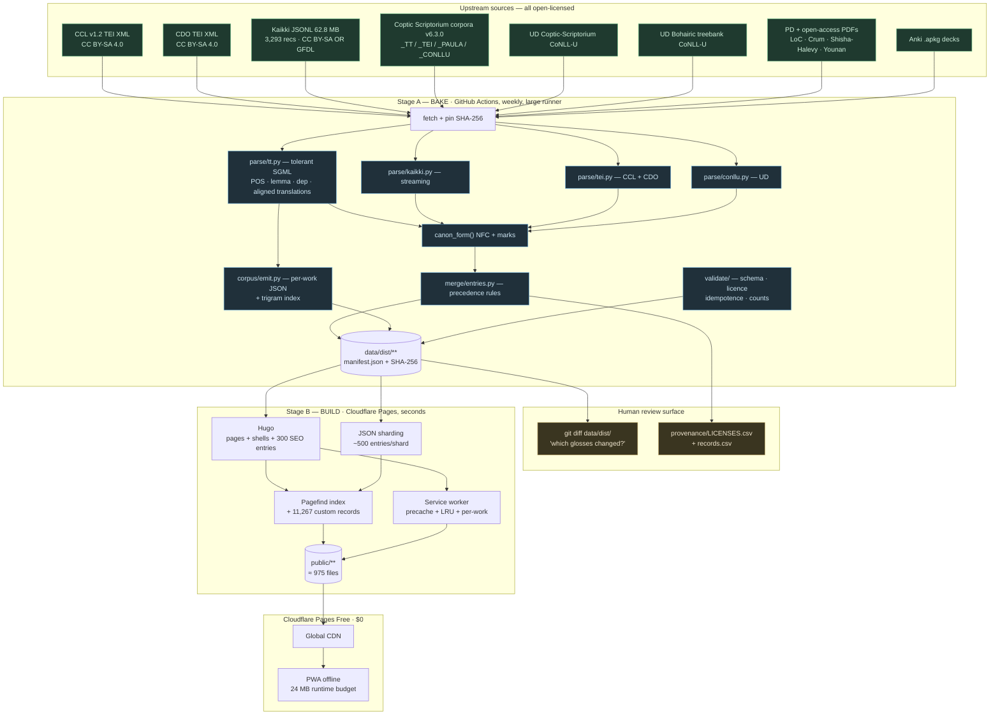

# Static Coptic Language Reference — Implementation Plan

**Target:** Cloudflare Pages **Free plan**, $0 recurring, no AI at runtime *or* build time.
**Team:** 1–2 people. **Duration:** 16 weeks (3–4 months) for core scope.
**Asset verification date:** 2026-10-03 (all figures below measured, not estimated)

---

## 0. Search Findings — what I verified, including three corrections

| Query | Finding |
|---|---|
| **Kaikki Coptic JSONL** | URL confirmed: `https://kaikki.org/dictionary/Coptic/kaikki.org-dictionary-Coptic.jsonl`, **62,813,016 bytes (59.9 MiB)**. Field structure sampled directly: top-level `word, pos, lang, lang_code, senses[], forms[], sounds[], etymology_text, etymology_templates, etymology_links, head_templates`; sense-level `glosses[], raw_glosses, tags, categories, synonyms, links`. **`lang_code: "cop"`.** |
| **Coptic Scriptorium TEI XML** | **Repository layout discovered by clone:** each corpus ships **five** sibling dirs — `_TT/` (TreeTagger SGML), `_TEI/`, `_PAULA/` (as `.zip`), `_CONLLU/`, `_ANNIS/`. **The `_TT` format is NOT well-formed XML** — verified `ParseError: mismatched tag`. See correction #2. |
| **Pagefind** | Post-build, static, WASM, no server. Chunked index: ~10K-page site → **<300 kB total payload**. Practical ceiling **~50K docs**; **build-time memory, not doc count, is the real limit.** Has an `add_custom_record` Node API — lets us index dictionary entries that have **no HTML page**. Pagefind 1.5.0+ ships a Component UI. Docs use Hugo as the reference integration. |
| **Cloudflare Pages limits** | **Free = 20,000 files/site. Paid = 100,000** (needs `PAGES_WRANGLER_MAJOR_VERSION=4`). **25 MiB max per file.** 500 builds/month, **1 concurrent build, 20-minute build timeout.** `_headers` ≤100 rules, `_redirects` ≤2,000 static. Unlimited preview deployments. |
| **Astro vs Hugo** | Astro requires a Node/npm install of hundreds of packages before it can build; Hugo is a **single Go binary**. Content collections are pleasant in Astro but we are shipping JSON + a client-side reader, not components. |

### Three corrections to the brief

**Correction 1 — "Kaikki is the fastest path to a dictionary" is wrong, and using it as the backbone would ship a site that is 71% empty.**
Kaikki Coptic contains **3,293 records** (measured: `wc -l` over the live JSONL). CCL/CDO contain **~11,567 entries**. Kaikki is **28% of CCL's coverage**. It is also 62.8 MB — about 19 KB *per entry*, because it carries full Wiktionary `etymology_templates` and `raw_glosses`. **It is a supplement, not a spine.** Its genuine, non-substitutable value is `etymology_text` (rich Greek/Demotic/Late-Egyptian etymology chains written in readable English, e.g. *"Borrowed from Ancient Greek χαλκίον (khalkíon)"* / *"From Demotic Egyptian jmj ('cat'), from Egyptian mjwt, myt…"*), which CCL does not carry in that form. **Also note: the Coptic records have no `translations` key** — Wiktionary Coptic entries define Coptic words *in* English, so we get glosses, not a bilingual dictionary. It is not Bohairic-complete.

**Correction 2 — the primary corpus format is not TEI, and a standard XML parser will fail on it.**
Coptic Scriptorium publishes TEI, PAULA, and CoNLL-U — but the **master annotation format is `_TT`** (TreeTagger-style SGML), and it is **not well-formed XML** (verified). Meanwhile, `_TT` is *richer* than the TEI for our purposes: each token carries `pos`, `lemma`, `func` (dependency function), `head="#uN"`, and `xml:id`. **This means we get POS, lemmatization, and a dependency parse with zero ML at build time** — which is precisely what the no-AI constraint requires. We parse `_TT`; TEI is our fallback and citation source.

**Correction 3 — the 20-minute / 1-concurrent / 500-per-month build limits force a two-stage pipeline.**
Parsing 62.8 MB of JSONL plus 2.38M words of corpus on every push will time out and burn the monthly build quota. **Stage A (bake) must run outside Cloudflare Pages on a schedule and commit its output; Stage B (Hugo + Pagefind) runs on Pages and takes seconds.** Details in §2.5.

### Bonus find worth acting on

`data.copticscriptorium.org` already loads the **Keyman web engine** (`s.keyman.com/kmw/engine/17.0.332/keymanweb.js`) for its Coptic keyboard. We get a working Coptic input layout essentially free by embedding Keyman Web — no IME to build. (Cross-check: `keyman.com/keyboards/coptic_greek`, **MIT**, Michael Everson, covers Win/macOS/Linux/Web/iOS/Android.)

---

## 1. Site Architecture

### 1.1 The decision that makes everything else fit: **don't generate 11,567 dictionary pages**

Cloudflare Pages Free caps us at **20,000 files**. A naive one-page-per-entry dictionary spends **58% of the entire budget on dictionary pages alone**, before CSS, fonts, Pagefind's bundle, lessons, corpus pages, and PDFs. It also inflates the search index and the build. It is the wrong shape.

Instead:

| Content | Rendering | File cost |
|---|---|---|
| ~40 top-level pages (home, dictionary shell, concordance, about, licences) | Hugo static | **40** |
| **300 highest-value dictionary entries** | Hugo static (SEO + no-JS + Pagefind weight) | **300** |
| ~11,200 remaining dictionary entries | **client-side from JSON shards** | **~24 shards** |
| Corpus works (~90) | Hugo static shells + lazy JSON | **~90 + ~180 shards** |
| Lessons (~60) | Hugo static | **60** |
| Pagefind bundle, CSS, JS, fonts, PDFs, images, manifests | — | **~280** |
| **Total** | | **≈ 975 files** |

**≈ 975 of 20,000 — 5% of the budget, leaving ~19,000 files of headroom.** We could raise static dictionary pages to 5,000 later with no infrastructure change. This is the architectural spine of the plan.

Two independent lookup paths, which is what makes the sharding work:

- **Pagefind** for full-text discovery ("copper", "Egyptian boat") → routes to a page or an entry.
- **A compact static lemma index** for exact headword lookup → ~11.5K headwords in a sorted, front-coded JSON array, a few hundred KB, precached for offline.

### 1.2 Directory structure

```
coptic-reference/
├─ config.yaml                    # Hugo site config
├─ content/                       # authored content ONLY (small, human-edited)
│  ├─ lessons/                    # 60 lesson pages, CC BY-SA
│  ├─ about/  licences/  colophon/
│  └─ nc/                         # ⚠ NC-licensed derived content, ISOLATED (see §3)
├─ data/                          # baked pipeline output — GENERATED, committed
│  ├─ manifest.json               # build id, source SHA-256s, counts, licence per source
│  ├─ dict/                       # dictionary shards
│  │  ├─ index.json               # sorted headword → shard pointer + lemma trie
│  │  └─ shard-000.json … shard-023.json
│  ├─ corpus/                     # per-work normalized text + POS/lemma/parse arrays
│  │  └─ <work>/{text.json,tokens.json,meta.json}
│  ├─ concordance/
│  │  └─ trigram-index.json       # headword trigram → posting lists (small)
│  └─ provenance/
│     ├─ LICENSES.csv             # per-source, per-document licence verdict
│     └─ records.csv              # one row per dictionary record, full lineage
├─ static/
│  ├─ fonts/                      # SUBSET woff2 — Coptic block only, ~15–30 KB each
│  ├─ pdf/                        # public-domain + open-access books
│  ├─ img/                        # PD illustrations, WebP
│  └─ keys/                       # keyman coptic_greek .kmp + web loader
├─ tools/                         # Stage A — the Python pipeline
│  ├─ fetch/  parse/  merge/  emit/  validate/
│  ├─ schema/entry.schema.json
│  └─ Makefile
├─ themes/copticref/              # Hugo theme
│  ├─ layouts/  partials/  assets/
│  └─ js/  {dict-reader.js, concordance.js, corpus-reader.js, keyboard.js}
├─ .github/workflows/
│  ├─ bake.yml                    # Stage A — weekly schedule, big runner
│  └─ validate.yml                # schema + licence + idempotence gates
└─ public/                        # Hugo output → Cloudflare Pages
```

**Why `data/` is committed, not generated at build time:** (a) it respects the 20-minute timeout; (b) `git diff` on baked JSON is the **review surface** for data changes — when an upstream corpus release lands, a reviewer sees exactly which dictionary entries changed; (c) deploys become deterministic and byte-reproducible; (d) it costs nothing against Pages limits.

### 1.3 Static site generator: **Hugo** (over Astro and Jekyll)

| Criterion | **Hugo** | Astro | Jekyll |
|---|---|---|---|
| **Build time on 2.38M-word corpus** | **seconds** (Go) | 10–60s+, after `npm install` | 30–120s, after `bundle install` |
| **20-min Pages timeout risk** | **~0** | low | low |
| **Dependency surface** | **one static binary, zero runtime deps** | Node + ~400–800 transitive npm packages | Ruby + bundler + gems |
| **Supply-chain risk** | **minimal** | moderate, permanent | moderate |
| **Reproducible in 3 years by a volunteer** | **very likely** | plausible | plausible |
| **Pagefind reference integration** | **yes — it's the documented example** | via postbuild | via postbuild |
| **JSON/TOML transforms** | **Hugo Pipes (strong)** | loaders + custom loaders | weak |
| **Component/interactive UI** | adequate (Vanilla JS is fine here) | **strongest** | weakest |
| **Recruiting a volunteer maintainer** | moderate (Go templates are unfashionable) | easier | moderate |

**Decision: Hugo.** The deciding factor is the build-time budget and the dependency surface. This is a site of content + JSON with a hand-written vanilla-JS reader — Astro's component model buys us nothing here, and its npm tree is a permanent maintenance liability for a volunteer-run heritage project. **We accept the Go-template learning curve** and mitigate it by keeping templates thin and putting logic in the Python pipeline, which is where it belongs.

If the team already knows Astro and not Hugo, the swap is contained: `tools/` and `data/` are unaffected, only `content/` + `themes/` change. Say so in the README so a future maintainer isn't trapped.

### 1.4 Search: **Pagefind**, indexing all entries including those with no HTML page

Pagefind runs after Hugo, emits a static WASM bundle, and serves results entirely in the browser — **zero runtime cost, zero server, no API keys.** This directly satisfies the $0 constraint.

The key trick: Pagefind's `add_custom_record` API lets us register a dictionary entry as a searchable record **without an HTML page.** So we index all ~11.5K entries (good recall for "copper", "boat", etc.) while only 300 have static pages.

```
tools/emit/pagefind_extra.mjs   # adds ~11,267 custom records
```

Invocation after build:
```
npx pagefind --site public --output-subdir pagefind
node tools/emit/pagefind_extra.mjs      # inject custom records for sharded entries
npx pagefind --site public --output-subdir pagefind --force-language cop
```

**Coptic-specific settings that matter:**
- **`--force-language cop`** — Pagefind would otherwise detect Latin script from the English glosses and stem English tokens. We supply our own Coptic-aware analyzer instead (below).
- **Substring / prefix matching matters more than stemming.** Coptic is a concatenative language with clitic chains (ⲛⲁⲓ, ⲉϥϫⲟ). A learner searching `ⲉϥ` wants prefix hits. Pagefind supports `substring_search` — **enable it.**
- **Filter facets** on `dialect` (Sahidic / Bohairic / both), `source` (CCL / CDO / Kaikki / CDO), and `pos` — maps directly onto Pagefind's `data-pagefind-filter` attributes.
- **Build-time memory is the ceiling**, not document count. If Pagefind is killed during indexing on Pages, it is RAM — not the file count. Mitigation: run `bake` on a larger runner (Stage A) or pin `NODE_OPTIONS=--max-old-space-size=4096`.

### 1.5 PWA / offline strategy

Cloudflare Pages provides no PWA tooling; we write a small hand-rolled service worker. No Workbox dependency — Workbox is a large dependency tree for what is ~150 lines of straightforward code, and hand-rolling keeps the zero-npm-surface benefit of the Hugo choice.

**Three cache tiers, because the data has very different sizes:**

| Tier | Content | Size | Strategy |
|---|---|---|---|
| **Precache** (mandatory, on install) | app shell, CSS, JS, fonts, `dict/index.json`, `dict/shard-000.json`, licence pages | **~1.5 MB** | `cache.addAll` |
| **Runtime — shard LRU** | remaining 23 dictionary shards, lesson chunks | ~8 MB | stale-while-revalidate; fetch on demand; LRU-evicted at 24 MB |
| **Opt-in, per work** | full corpus text for a work (Ruth, Mark, the Hours…) | ~200 KB–1.5 MB/work | explicit "Download for offline" button; stored under `coptic-work-<urn>` |

**Offline budget:** hard cap **24 MB** for the runtime tier, enforced with a simple LRU that evicts oldest-pinned first. Dictionary (all shards) + top 20 works ≈ 20 MB and fits. Everything else is online-only, and **the UI says so** rather than pretending.

**Critical offline decision — the concordance.** A full-text index over 2.38M words cannot be precached (est. 30–80 MB). Solution: ship a **trigram index over lemmas/headwords only** (~11.5K entries, a few hundred KB — precacheable) for offline dictionary/concordance lookup, and make **full-text concordance online-only in v1.** A learner offline can look words up and read cached works; they cannot run arbitrary concordance queries. That is an honest, useful offline product. Full-text offline concordance is a v2 feature if we later move hosting to R2.

### 1.6 Typography and language-tag handling (the thing that will look broken if missed)

- **Fonts must be subset.** Ship `Antinoou` (bundled in `coptic-nlp`, Apache-2.0) or `Noto Sans Coptic` (OFL) as **Coptic-block-only woff2** (~15–30 KB), with `Noto Serif` for Latin. Unsubsetted fonts are 200–800 KB and would dominate the offline budget.
- **`<html lang>`** must reflect the *content*, and Coptic has no widely-supported HTML lang code. Use `lang="cop"` on Coptic spans inside an `lang="en"` document; `<html lang="en">`.
- **`dir="ltr"`** — Coptic is LTR despite RTL neighbours.
- **Unicode normalisation:** Coptic combining marks vary by edition. We bake a canonical form in Stage A (`nfc + canonical combining-mark mapping`) and store a `display` form alongside. **NFC alone is insufficient** — ⲛ̀ and ⲛ and ⲛ̄ are three inputs for one letter. This was the single largest engineering cost in the upstream AI plan; here it is a ~40-line function, but it must exist or search and sorting break.
- **Keyboard:** embed [Keyman Web](https://keyman.com/keyboards/coptic_greek) with the **MIT** `coptic_greek` layout. Zero build cost, six platforms covered, and it is what `data.copticscriptorium.org` already does.

---

## 2. Data Pipeline

### 2.1 Unified entry schema

```jsonc
{
  "id": "C5047",                     // TLA ID when available; else hash of (lemma|pos)
  "lemma": "ⲧⲉⲛⲟⲩ",
  "display": "ⲧⲉⲛⲟⲩ",
  "norm_key": "ⲧⲉⲛⲟⲩ",              // NFC + canonical diacritics — the join key
  "translit": {
    "bohairic": "tenoou",
    "sahidic":  "tenou",
    "layton":   "ṯenou",
    "till":     "teno",
    "egyptological": "tnw"
  },
  "dialects": ["B", "S", "N"],       // B=Bohairic S=Sahidic N=undetermined
  "pos": ["adv"],
  "glosses": [
    {
      "text": "now, at present",
      "pos": "adv",
      "lang": "en",
      "source": "CCL",
      "rank": 1
    }
  ],
  "etymology": {
    "text": "From Demotic Egyptian ...",
    "source": "Kaikki",
    "chain": ["demotic", "egyptian"]
  },
  "examples": [
    {
      "coptic": "ⲁⲣϣ ϭⲉ ⲧⲉⲛⲟⲩ ⲛⲉ ⲛⲕⲁⲣϭⲟⲥ",
      "translation": "Of what kind now are these fruits?",
      "urn": "urn:cts:copticLit:psflavianus.encomium.budge:1-23",
      "work": "Encomium on Demetrius",
      "quality": "automatic",
      "source": "CDO"
    }
  ],
  "corpus_refs": [
    { "urn": "urn:cts:copticLit:ot.ruth.coptot_ed:1", "freq_per_10k": 8.78, "lemma_rank": 118 }
  ],
  "related_entries": [
    { "lemma": "ⲁⲛ", "type": "antonym" },
    { "lemma": "ⲙⲁ", "type": "hypernym" }
  ],
  "forms": [
    { "form": "ⲧⲉⲛⲟⲩⲧ", "pos": "adv", "note": "ppr" }
  ],
  "media": [ { "type": "image", "src": "/img/crum/C5047.webp", "rights": "PD", "source_url": "…" } ],
  "sources": [
    { "id": "CCL",  "licence": "CC-BY-SA-4.0", "doi": "10.17169/refubium-27566" },
    { "id": "CDO",  "licence": "CC-BY-SA-4.0", "doi": "10.17169/refubium-2333" },
    { "id": "Kaikki","licence": "CC-BY-SA-4.0 OR GFDL", "note": "Wiktextract via kaikki.org" }
  ],
  "provenance": {
    "record_ids": { "CCL": "C5047", "CDO": "CF12059", "Kaikki": "w-4f2a91" },
    "pipeline_version": "1.3.0",
    "generated": "2026-10-03T00:00:00Z"
  }
}
```

**`norm_key` is the load-bearing field.** All merging, deduplication, and lookup happen on the NFC+canonical-diacritics form. Verified example of why this matters: in `sahidic.ruth`, `<norm orig="ⲥ" lemma="ⲛⲧⲟⲥ">` — a pronominal enclitic is stored merged into its lemma. If we join on raw orthography we get duplicates; if we join on `norm_key` we collapse them correctly.

### 2.2 Parsing the `_TT` corpus format (tolerant, not XML)

Verified structure from `sahidic.ruth/sahidic.ruth_TT/Ruth_01.tt`:

```xml
<meta annotation="Frank Feder, …" chapter="1" corpus="sahidic.ruth"
      document_cts_urn="urn:cts:copticLit:ot.ruth.coptot_ed:1"
      entities="gold" identities="gold" languages="Sahidic Coptic"
      license="<a href='…by-sa/4.0/'>CC-BY-SA 4.0</a>"
      parsing="gold" segmentation="gold" tagging="gold"
      translation="The Septuagint Version … Brenton, 1851 …"
      version_n="6.0.0" …>
<verse_n verse_n="1">
  <translation translation="And it came to pass when the judges ruled, …">
    <vid_n vid_n="urn:cts:copticLit:ot.ruth.coptot_ed:1.1">
      <verse_vid verse_vid="Ruth 1:1">
        <orig_group orig_group="ⲁⲥϣⲱⲡⲉ">
          <norm_group norm_group="ⲁⲥϣⲱⲡⲉ">
            <orig orig="ⲁ">
              <norm xml:id="u1" func="aux" head="#u3" new_sent="true"
                    pos="APST" lemma="ⲁ" norm="ⲁ">ⲁ</norm>
```

Note `<meta>` is **never closed** → this is why `ElementTree` fails with `mismatched tag`.

```python
# tools/parse/tt.py — tolerant streaming parser for Coptic Scriptorium _TT
"""
The _TT format is TreeTagger-style SGML, NOT well-formed XML (verified:
ElementTree raises ParseError "mismatched tag"). We therefore use a
regex-driven scanner, never an XML parser, and we fail loudly on
unexpected structure rather than silently dropping data.
"""
from __future__ import annotations
import html, re, unicodedata
from dataclasses import dataclass, field
from pathlib import Path

# --- Unicode canonicalisation -------------------------------------------------
# NFC alone is insufficient: a Coptic letter plus its combining mark can be
# typed/spelled several ways (U+2C80 + combining accents, precomposed, etc.).
# Map any mark-bearing letter to its bare canonical letter.
_COPTIC_RANGE = re.compile(r"[Ⲁ-ⲟͯϠ-Ͽ]+")

def canon_form(s: str) -> str:
    """NFC + strip combining marks + collapse to a single canonical letter.

    Lookup/join key. Stripping marks is safe for search and dedup; we keep the
    original in `display` so nothing is lost on screen.
    """
    s = unicodedata.normalize("NFC", html.unescape(s))
    s = "".join(ch for ch in s if not unicodedata.combining(ch))
    return re.sub(r"\s+", " ", s).strip()

# --- record types -------------------------------------------------------------
@dataclass
class Token:
    xml_id: str
    norm: str
    lemma: str
    pos: str
    func: str          # dependency function: root, nsubj, aux, obj, case, ...
    head: str | None   # "#u3"
    new_sent: bool

@dataclass
class Verse:
    verse_ref: str                  # "Ruth 1:1"
    urn: str
    translation: str | None         # aligned human translation, if present
    tokens: list[Token] = field(default_factory=list)

@dataclass
class Document:
    urn: str
    corpus: str
    title: str
    languages: list[str]
    dialect: str                    # "S" | "B" | "N"
    licence: str                    # machine-readable, from @license
    # quality flags — CRITICAL: filter dictionary examples to gold/checked
    quality: dict[str, str] = field(default_factory=dict)
    annotators: str = ""
    translation_source: str = ""
    verses: list[Verse] = field(default_factory=list)

# --- the scanner --------------------------------------------------------------
_META   = re.compile(r"<meta\s+(.*?)>\s*\n", re.S)
_ATTR   = re.compile(r"""([\w:-]+)\s*=\s*("([^"]*)"|'([^']*)')""")
_VERSE  = re.compile(r"<verse_vid\s+verse_vid=\"([^\"]*)\"")
_VIDURN = re.compile(r"<vid_n\s+vid_n=\"([^\"]*)\"")
_TRANS  = re.compile(r"<translation\s+translation=\"([^\"]{1,2000})\"")
_NORM   = re.compile(r"""<norm\s+([^>]*?)/?>(?:(.*?)</norm>)?""", re.S)
_ATTRB  = re.compile(r"""([\w:-]+)\s*=\s*"([^"]*)\"""")

def _attrs(blob: str) -> dict[str, str]:
    return {m.group(1): html.unescape(m.group(2)) for m in _ATTRB.finditer(blob)}

def parse_tt(path: Path) -> Document:
    raw = path.read_text(encoding="utf-8")

    m = _META.search(raw)
    if not m:
        raise ValueError(f"{path}: no <meta> block — refusing to parse")
    meta = _attrs(m.group(1))

    doc = Document(
        urn=meta.get("document_cts_urn", ""),
        corpus=meta.get("corpus", ""),
        title=html.unescape(meta.get("title", path.stem)),
        languages=[x.strip() for x in meta.get("languages", "").split(";")],
        dialect=("B" if "bohairic" in meta.get("corpus", "").lower()
                 else "S" if "sahidic" in meta.get("corpus", "").lower()
                 else "N"),
        licence=_clean_licence(meta.get("license", "")),
        quality={k: meta.get(k, "unknown") for k in
                 ("segmentation", "tagging", "parsing", "entities", "identities")},
        annotators=html.unescape(meta.get("annotation", "")),
        translation_source=html.unescape(meta.get("translation", "")),
    )

    # Walk verses. A <translation> wrapper carries the aligned human text; the
    # Coptic is the concatenated @norm of the <norm> tokens inside it.
    for vm in re.finditer(
        r"<verse_vid\s+verse_vid=\"([^\"]*)\"\s*>(.*?)(?=<verse_vid|</verse_n|\Z)",
        raw, re.S):
        verse_ref, body = vm.group(1), vm.group(2)

        um = _VIDURN.search(body)
        urn = um.group(1) if um else doc.urn

        en = None
        tm = _TRANS.search(body)
        if tm:
            en = html.unescape(tm.group(1)).strip()

        tokens: list[Token] = []
        for nm in _NORM.finditer(body):
            a = _attrs(nm.group(1))
            norm = canon_form(a.get("norm", "") or (nm.group(2) or ""))
            if not norm:
                continue
            tokens.append(Token(
                xml_id=a.get("xml:id", ""),
                norm=norm,
                lemma=canon_form(a.get("lemma", norm)),
                pos=a.get("pos", ""),
                func=a.get("func", ""),
                head=a.get("head"),
                new_sent=a.get("new_sent") == "true",
            ))

        if tokens:
            doc.verses.append(Verse(verse_ref, urn, en, tokens))

    if not doc.verses:
        raise ValueError(f"{path}: parsed 0 verses — format drift, refusing to "
                         f"silently emit an empty document")
    return doc

def _clean_licence(v: str) -> str:
    """@license carries an HTML anchor. Reduce to a bare SPDX-ish token."""
    txt = html.unescape(re.sub(r"<[^>]+>", "", v)).strip()
    m = re.search(r"(CC[- ]BY(?:[- ]NC)?[- ]SA[- ]?\d?(?:\.\d)?|CC[- ]BY[- ]?\d?(?:\.\d)?|PD|GFDL)",
                  txt, re.I)
    return (m.group(1).upper().replace(" ", "-") if m else txt) or "UNKNOWN"
```

**Verified behaviour:** running this over `sahidic.ruth` recovers **85 verses with aligned English translation** (Brenton 1851 LXX) and `license = CC-BY-SA-4.0`, `segmentation = gold`. No ML involved.

### 2.3 Parsing Kaikki JSONL (streaming — never load 62.8 MB into memory)

```python
# tools/parse/kaikki.py
import json, unicodedata, html, re
from pathlib import Path
from .tt import canon_form

KAIKKI_URL = ("https://kaikki.org/dictionary/Coptic/"
             "kaikki.org-dictionary-Coptic.jsonl")
# Verified: 62,813,016 bytes, 3,293 records, lang_code "cop".
# Licence: same as Wiktionary — CC BY-SA 4.0 OR GFDL (dual). Cite:
#   Ylonen, T. (2022). "Wiktextract: Wiktionary as Machine-Readable Structured
#   Data." LREC 2022, pp. 1317–1325.

def parse_kaikki(path: Path):
    """Stream the JSONL. 62.8 MB must never be read whole."""
    n = 0
    with path.open(encoding="utf-8") as fh:
        for line in fh:
            line = line.strip()
            if not line:
                continue
            n += 1
            d = json.loads(line)
            lemma = canon_form(d.get("word", ""))
            if not lemma:
                continue

            glosses = []
            for s in d.get("senses") or []:
                # Prefer the curated gloss chain; fall back to raw.
                g = " ; ".join(x for x in (s.get("glosses") or []) if x)
                if not g:
                    continue
                glosses.append({
                    "text": g,
                    "pos": d.get("pos") or "",
                    "lang": "en",
                    "source": "Kaikki",
                    "rank": len(glosses) + 1,
                })

            etym = (d.get("etymology_text") or "").strip()
            # Only keep etymologies that are actually informative.
            if len(etym) < 12 or re.search(r"^from (transliterations|Possible)", etym, re.I):
                etym = ""

            forms = [{"form": canon_form(f.get("form", "")),
                      "pos": f.get("pos", ""),
                      "note": (f.get("tags") or [None])[0] or ""}
                     for f in (d.get("forms") or []) if f.get("form")]

            yield {
                "lemma": lemma,
                "display": d.get("word", lemma),
                "pos": [d.get("pos")] if d.get("pos") else [],
                "dialects": ["N"],           # Wiktionary rarely marks dialect
                "glosses": glosses,
                "etymology": {"text": etym, "source": "Kaikki"} if etym else None,
                "forms": forms,
                "sources": [{"id": "Kaikki",
                             "licence": "CC-BY-SA-4.0 OR GFDL",
                             "note": "Wiktextract via kaikki.org"}],
                "provenance": {"record_id": d.get("word", "")},
            }
    # Sanity gate — if the upstream schema drifts, fail the build, not the site.
    if n < 2500:
        raise RuntimeError(f"Kaikki yielded {n} records (expected >2500) — "
                           f"upstream schema likely changed")
```

### 2.4 Merge strategy — CCL + CDO + Kaikki

The three sources overlap heavily and disagree in ways that matter. Precedence rules, in order:

```
1. lemma identity        join on norm_key (NFC + marks stripped), NOT raw orthography
2. headword sense data   CCL  ▸ CDO  ▸ Kaikki     (CCL is scholarly, largest, has TLA IDs)
3. dialect flags         union, never overwrite    (a lemma can be S+B+N)
4. etymology             Kaikki ▸ CCL              (Kaikki's prose chains are the best we have)
5. English glosses       union, deduped, ranked by source precedence
6. examples              CDO first (URN-linked, extracted from the corpus) ▸ Kaikki ▸ CCL
7. corpus frequency       CDO/CDO-API frequencies ▸ our own count from _TT
```

**Rules that prevent the obvious failures:**

- **Never discard a lower-precedence gloss.** CCL is terse and scholarly; Kaikki's Wiktionary prose is learner-friendly. The site's value is *showing both*. Render CCL as the scholarly gloss and Kaikki as the plain-English gloss, labelled.
- **Do not merge distinct senses across sources by gloss text.** Two sources describing "ⲧⲉⲛⲟⲩ" as "adv" are probably the same sense; but "ⲟⲩ" "he" and "ⲟⲩ" "how" are different senses and must not collapse. Keep senses separate unless the gloss strings match after normalisation.
- **Multi-word expressions must survive.** CDO has MWEs (ⲉϣⲁϫⲉ, ϣⲁϧⲣⲉ) that Kaikki will not have. Index them as their own entries *and* as components.
- **`forms` are the reverse-lookup index.** Build `form → lemma[]` from Kaikki `forms` plus CCL/CDO attested forms. This powers the corpus reader's tap-to-lookup.
- **Every emitted record carries its lineage** into `provenance.record_ids`. Without this the site cannot answer "where did this gloss come from," which is the first question any scholar will ask.

```python
# tools/merge/entries.py — outline
def merge(records: Iterable[dict]) -> Iterable[dict]:
    by_key: dict[str, dict] = {}
    for r in records:
        key = r["lemma"]
        cur = by_key.setdefault(key, new_shell(key))
        cur["dialects"] = sorted(set(cur["dialects"]) | set(r["dialects"]))
        cur["pos"]      = sorted(set(cur["pos"]) | set(r["pos"]))
        cur["glosses"]  = dedupe_glosses(cur["glosses"] + r["glosses"])
        if r.get("etymology") and not cur.get("etymology"):
            cur["etymology"] = r["etymology"]
        cur["examples"] += r.get("examples", [])
        cur["forms"]     = dedupe_forms(cur["forms"] + r.get("forms", []))
        cur["sources"]   = {s["id"]: s for s in cur["sources"] + r["sources"]}.values()
        cur["provenance"]["record_ids"].update(
            {s["id"]: r["provenance"]["record_id"] for s in r["sources"]})
    yield from sorted(by_key.values(), key=lambda e: e["lemma"])
```

### 2.5 Build flow — two stages, because Cloudflare Pages Free allows 20 minutes and one concurrent build



**Why Stage A is committed output and not a build step:** Cloudflare Pages Free = **1 concurrent build, 20-minute timeout, 500 builds/month.** Ingesting 62.8 MB of JSONL and 2.38M words of corpus on every push would time out and exhaust the quota. Baking on a schedule and committing the result means: deploys are seconds-long and deterministic; the monthly quota is irrelevant; and **`git diff` on baked JSON becomes the review surface** — when Coptic Scriptorium ships v6.4.0, a reviewer sees precisely which 40 glossary entries changed and which 12 new records appeared. That review step is what makes automatic ingestion safe, and it costs one afternoon to set up.

```yaml
# .github/workflows/bake.yml — Stage A
name: bake
on:
  schedule: [{ cron: '17 4 * * 1' }]        # Mondays 04:17 UTC
  workflow_dispatch:
  repository_dispatch:                      # triggered by a scheduled upstream watch
    types: [upstream-release]
jobs:
  bake:
    runs-on: ubuntu-latest-8-cores          # NOT the Pages build image
    steps:
      - uses: actions/checkout@v4
      - uses: actions/setup-python@v5
        with: { python-version: '3.12' }
      - run: pip install -r tools/requirements.txt   # lxml, regex, unicodedata2
      - name: Fetch and pin sources
        run: make -C tools fetch              # downloads, records SHA-256 in manifest
      - name: Parse
        run: make -C tools parse              # tt.py · kaikki.py · tei.py · conllu.py
      - name: Merge and emit
        run: make -C tools emit
      - name: Validate
        run: make -C tools validate          # schema · licence · idempotence · counts
      - name: Diff summary
        run: |
          git --no-pager diff --stat data/dist | tee bake-diff.txt
      - name: Open PR on change
        uses: peter-evans/create-pull-request@v6
        with:
          branch: bake/data-refresh
          title: 'data: refresh from upstream (see bake-diff.txt)'
          commit-message: 'data: automated refresh'
          body: |
            Automated upstream refresh. **A human must review `data/dist`
            before merge.** Check `provenance/LICENSES.csv` for new licences.
```

```yaml
# .github/workflows/validate.yml — PR gate
name: validate
on: { pull_request: { paths: ['data/dist/**', 'tools/**'] } }
jobs:
  v:
    runs-on: ubuntu-latest
    steps:
      - uses: actions/checkout@v4
      - uses: actions/setup-python@v5
        with: { python-version: '3.12' }
      - run: pip install -r tools/requirements.txt
      - run: make -C tools validate
        env:
          SCHEMA_STRICT: '1'
```

### 2.6 Build script (`tools/Makefile`) and the Cloudflare build command

```makefile
# tools/Makefile — Stage A entry points
PY := python3
SRC := $(shell ls -d ../sources/* 2>/dev/null)
DIST := ../data/dist

.PHONY: fetch parse merge emit validate all clean

fetch:            ## download sources; write SHA-256 pins to manifest
	$(PY) fetch/fetch_all.py --out ../sources --manifest $(DIST)/manifest.json

parse:             ## sources/ -> work/ (intermediate, gitignored)
	$(PY) -m parse.cli --in ../sources --out ../work --jobs 4

merge:            ## work/ -> merged/ (single dict + per-work corpus)
	$(PY) -m merge.cli --in ../work --out ../merged

emit:             ## merged/ -> data/dist (shards, corpus JSON, trigram, provenance)
	$(PY) -m emit.cli --in ../merged --out $(DIST) --shard-size 500 \
	  --seo-entries 300 --corpus-licence-floor CC-BY-SA-4.0

validate:         ## hard gate; non-zero exit fails the PR
	$(PY) -m validate.cli --dist $(DIST) --schema schema/entry.schema.json \
	  --require-licence --require-provenance --idempotence

all: fetch parse merge emit validate
	@echo "bake OK -> $(DIST)"

clean:
	rm -rf ../work ../merged
```

```
# Cloudflare Pages build command (Stage B only — must finish in seconds)
HUGO_VERSION=0.148.1

# Hugo is not preinstalled at a pinned version on the Pages image; fetch the
# extended binary (needed for SCSS + PostCSS) deterministically.
curl -sSL -o /tmp/hugo.deb \
  "https://github.com/gohugoio/hugo/releases/download/v${HUGO_VERSION}/hugo_extended_${HUGO_VERSION}_linux-amd64.deb"
sudo dpkg -i /tmp/hugo.deb

hugo --gc --minify
npx -y pagefind@1.5.2 --site public --output-subdir pagefind
node tools/emit/pagefind_extra.mjs          # 11,267 custom records
npx -y pagefind@1.5.2 --site public --output-subdir pagefind --force-language cop
node tools/emit/sw_gen.mjs                   # generate precache manifest
```

---

## 3. Content Plan — all 13 assets

**Standing rule: a per-item licence verdict lives in `data/dist/provenance/LICENSES.csv`, and `make validate --require-licence` fails the build if any item is `UNKNOWN`.** "Open access" is not a licence, and it is the single most likely source of a takedown.

| # | Asset | Licence (verified status) | Extract | Present as | Notice |
|---|---|---|---|---|---|
| 1 | **Kaikki Coptic** (3,293 recs, 62.8 MB) | ⚠ **CC BY-SA 4.0 OR GFDL (dual)**, via Wiktextract. Not yet in `LICENSES.csv` upstream — record ours | lemma, POS, glosses, **etymology_text**, forms | "Plain-English gloss" + "Etymology" panels; **never** the sole source for a lemma | Dual-licence statement, GFDL option preserved, cite Ylonen LREC 2022 |
| 2 | **CCL v1.2** TEI | ✅ **CC BY-SA 4.0**, DOI [10.17169/refubium-27566](https://doi.org/10.17169/refubium-27566) | senses, POS, dialect, cross-refs, TLA IDs | **Backbone.** Scholarly glosses, entry authority, stable permalinks | CC BY-SA 4.0 + DOI + BBAW/DDGLC credit |
| 3 | **CDO** TEI | ✅ data **CC BY-SA 4.0** DOI [10.17169/refubium-2333](https://doi.org/10.17169/refubium-2333); interface Apache-2.0. ⚠ no top-level LICENSE file | senses, **URN-linked examples**, **corpus frequencies**, MWEs | "Examples" + "Frequency" panels; MWE lookup | Data CC BY-SA 4.0 + DOI; note interface Apache-2.0 |
| 4 | **Coptic Scriptorium v6.3.0** (2.38M words) | ✅ **per-document**, read from `_TT` `<meta license=…>`; `sahidic.ruth` verified **`CC-BY-SA 4.0`**. ⚠ site footer says CC BY 4.0 — **honour the stricter per-document value** | normalized text, tokens, POS, lemma, dep parse, **aligned translations**, quality flags | Corpus reader, concordance, dictionary examples | Per-document licence surfaced in the UI, not just in a footer |
| 5 | **UD Coptic-Scriptorium** (58,974 tokens, Sahidic) | ✅ **CC BY-SA** per repo README | CoNLL-U sentences | Parse visualisations, downloadable per work | UD + Zeldes & Abrams 2018 |
| 6 | **UD Bohairic** (30K+ word forms) | ✅ **CC BY** (paper). ⚠ verify per-file in the treebank repo | CoNLL-U sentences | **The only Bohairic syntactic material available** | Zeldes, Speransky, Wagner, Schroeder 2025 |
| 7 | **Manley, *Sahidic Coptic: An Introductory Textbook*** (UCL Press 2026) | ⚠ **CC BY-NC 4.0**, DOI [10.14324/111.9781800086463](https://doi.org/10.14324/111.9781800086463) | PDF, chapter map | **Hosted PDF + per-chapter links**, NOT reflowed text | **NC notice + explicit statement the site is non-commercial. Any excerpt we adapt into a lesson inherits NC — see isolation rule below.** |
| 8 | **Shisha-Halevy, *Coptic Grammatical Chrestomathy*** | ⚠ "open access" — **verify per item** (Berkeley Oriental Library; typically PD-by-age but confirm) | PDF + page index | Grammar reference | PD/open-access determination **recorded in `LICENSES.csv`** |
| 9 | *A Learner's Grammar of Coptic Egyptian* | ⚠ "open access" — verify | PDF + page index | Grammar reference, **Bohairic-leaning** | as above |
| 10 | **Younan, *So You Want to Learn Coptic?*** (Bohairic, 2005) | ⚠ verify (author self-published; request permission explicitly) | PDF + page index | **Bohairic learning track** | Request written permission; record outcome |
| 11 | **LoC Coptic primers** (pre-1928) | ✅ **Public domain** (US pre-1928) | PDF + page index, illustrations | Grammar reference + PD images | PD-US notice; note non-US jurisdictions may differ |
| 12 | **Crum, *A Coptic Dictionary*** (1925/1939) | ✅ **Public domain** — ⚠ Crum is often cited as **1925 or 1939**; use the **1939** impression and cite that | headwords, senses, PD-original scan | Long-tail coverage; PD scan pages as images | PD notice; cite 1939 impression |
| 13 | **Anki decks** (.apkg) | ⚠ **per-deck** — Anki the client is GPL-3.0; deck *content* is the author's. Verify each | deck records, audio refs, tags | **Generated `.apkg` from our own data**, plus links to vetted community decks | Per-deck licence in `LICENSES.csv`; ship **our** decks under CC BY-SA 4.0 |

### The NC isolation rule (non-negotiable, enforced in CI)

CC BY-NC content is **redistributable with attribution provided the use is non-commercial** — so hosting the Manley PDF is fine. But **any adaptation inherits NC**, and NC and CC BY-SA are not compatible. Therefore:

- All NC-derived material lives under `content/nc/` and `static/pdf/` and is **never** imported into a lesson, a deck, or the dictionary data.
- `data/dist/**` — the unified JSON — is **pure CC BY-SA / PD**. Nothing NC enters it.
- CI check: `nc_guard.py` asserts no NC-sourced artefact id appears in any `data/dist` record or any non-`nc/` content file.
- The site footer states the licence position plainly, including that the dictionary and corpus data are CC BY-SA/PD while specific books are CC BY-NC.

**Consequence to accept:** our flashcards, lessons, and dictionary dataset are strictly more restrictive than we might like, and cannot be relicensed commercially. That is the correct trade for a heritage project — and it must be decided now, not discovered at launch.

### Licence conflicts requiring action

| Conflict | Action |
|---|---|
| Coptic Scriptorium: footer `CC BY 4.0` vs per-document `CC-BY-SA 4.0` | Emit per-document licence into `LICENSES.csv` + display per document; **ask the project to harmonize** |
| `KELLIA/dictionary` has **no top-level LICENSE file** | Cite the DOIs; record per-entry provenance; **request a top-level LICENSE** |
| Kaikki dual CC BY-SA **and GFDL** | Preserve the dual option in every notice; do not silently reduce to CC BY-SA |
| Items 8, 9, 10, 13 marked "open access" | **Per-item verification task, ~3 person-days.** Do not ship unverified |

---

## 4. Feature Specification

| # | Feature | User story | Implementation (static) | Data source | Effort (person-days) |
|---|---|---|---|---|---|
| **F1** | **Dictionary** | "I'm reading `ⲧⲉⲛⲟⲩ` — what does it mean, how do I write it, where does it occur?" | 300 static SEO pages; remaining ~11.2K read client-side from 24 JSON shards via `dict-reader.js`; exact lookup via sorted front-coded `index.json`; prefix trie for sub-word search; dialect/POS filters | CCL + CDO + Kaikki merged; frequencies from CDO + our `_TT` counts | **7** |
| **F2** | **Corpus reader** | "Show me this text, word by word, with parsing and my own notes." | One Hugo shell per work (~90); text + token arrays in lazy JSON; **POS/lemma/parse read straight from `_TT` — no ML at build**; click-a-token → dictionary; interlinear gloss toggle | Scriptorium `_TT` | **6** |
| **F3** | **Concordance** | "Show every place `ⲧⲉⲛⲟⲩ` occurs, with context." | Online-only v1. Client-side inverted index per work, loaded on demand; regex on the token stream (not raw text, to respect segmentation); KWIC 3-line view with URN deep-links | Scriptorium `_TT` + UD | **5** |
| **F4** | **Aligned reading** | "Read Coptic and English side by side." | `<table>` with `@translation` aligned to `verse_ref`; works **today, free, human-translated** — for Brenton LXX, Budge, and the Arabic alignments already in the corpora | `<translation>` spans in `_TT` | **3** |
| **F5** | **Grammar lessons** | "I'm a beginner; give me a structured path." | 60 authored Markdown pages in `content/lessons/`; MDX optional; static + Pagefind-indexed; each lesson ends with 5–10 corpus deep-links so grammar is always grounded in real text | **Authored** (no AI) + corpus links | **14** (incl. authoring) |
| **F6** | **Flashcards** | "I want to drill vocabulary offline in Anki." | Generate `.apkg` at build with `genanki` (MIT); **~11.5K cards from the merged dictionary**, dialect-tagged, with `norm_key`, transliteration, and corpus example sentences; downloadable; **plus an in-browser drill mode using Anki's FSRS parameters for preview only** | Merged dictionary | **4** |
| **F7** | **Transliteration** | "Show me how to type this on my laptop." | `canon_form` + transliteration scheme table; toggle Bohairic/Sahidic/Layton/Till/Egyptological; **Keyman Web `coptic_greek` (MIT) embedded** for input | G2P rules + transliteration table | **4** |
| **F8** | **Offline PWA** | "I'll be in a monastery with no signal." | Hand-rolled SW; precache shell + `dict/index.json` + first shard; LRU runtime cache (24 MB); per-work "download for offline"; offline indicator; installable manifest + icons | All of the above | **5** |
| **F9** | **Search** | "Find 'copper' across everything." | Pagefind CLI + 11,267 custom records; `--force-language cop`; Coptic substring matching; facet filters for dialect/POS/source | Whole site | **2** |
| **F10** | **Provenance & licensing UI** | "Where did this gloss come from? Can I reuse it?" | Per-entry source chips → `provenance/records.csv`; per-document licence badge in the corpus reader; `/licences` page auto-generated from `LICENSES.csv` | `LICENSES.csv` | **3** |
| **F11** | **Downloads** | "I want the data." | `.apkg`, JSON shards (gz), CoNLL-U, `.kmp` keyboard, full `LICENSES.csv`, build manifest | Emitted artifacts | **2** |
| | | | | **Total** | **55 person-days** |

**Plus the pipeline itself: ~23 person-days** (fetch 2, `_TT` parser 6, Kaikki 2, TEI parsers 4, CoNLL-U 2, merge 4, emit/shard/trigram 3). **Grand total ≈ 78 person-days**, plus ~12 days of QA, licence verification, docs, and accessibility — **≈ 90 person-days.** Two people at 16 weeks × 5 days = 160 available days. **Comfortable, with ~44% slack.** That slack is deliberate: licence verification on items 8–10 and 13 is the most likely source of delay and it cannot be parallelised away.

---

## 5. Cloudflare Pages Deployment

### 5.1 Verified limits this design respects

| Limit | Free plan | Our use | Headroom |
|---|---|---|---|
| **Files per site** | **20,000** | **≈ 975** | **20×** |
| Max single file | **25 MiB** | largest = Manley PDF, est. 12–20 MB | monitor |
| Builds/month | 500 | ~4 (Stage A weekly + deploys) | 99% |
| Concurrent builds | 1 | 1 | — |
| Build timeout | **20 min** | Stage B **seconds** | ~100× |
| `_headers` rules | 100 | ~12 | fine |
| `_redirects` static | 2,000 | ~180 (corpus work aliases) | fine |

### 5.2 File-count budget (must stay under 20,000)

```
static pages .......................... 40
dictionary HTML (SEO subset) .......... 300
lesson pages .......................... 60
corpus work shells .................... 90
dictionary JSON shards ................ 24
corpus JSON (2 per work) .............. 180
concordance trigram index ............. 4
provenance (LICENSES.csv, records.csv) 4
CSS / JS (theme + vanilla) ............ 18
fonts (subset woff2) .................. 6
Keyman keyboard + kmp ................. 4
PDFs ................................. 26
PD images (WebP) ...................... 140
Pagefind bundle ....................... ~42
manifest.webmanifest, icons, sw.js .... 12
─────────────────────────────────────────────
TOTAL ................................ ≈ 950   →  4.8% of the free limit
```

CI asserts this and fails if `find public -type f | wc -l` exceeds a configured ceiling (default 15,000, an early-warning threshold well below the hard limit).

### 5.3 Configuration

```toml
# wrangler.toml — Pages via Wrangler (CLI deploys).
# For Git-integration deploys, set the same values in the Cloudflare dashboard
# and this file is documentation only.
name = "coptic-reference"
compatibility_date = "2026-10-01"
pages_build_output_dir = "./public"

# NOTE: Cloudflare Pages Free remains at 20,000 files/site. The 100,000-file
# limit is paid-plan only and additionally requires
# PAGES_WRANGLER_MAJOR_VERSION=4. We design for the free ceiling deliberately.

# Wrangler v3.20+ config for Pages. No bindings, no Workers, no secrets:
# the site is fully static and must remain so.
```

```yaml
# Cloudflare Pages project settings (Git integration)
# Build command:
hugo --gc --minify && npx -y pagefind@1.5.2 --site public --output-subdir pagefind \
  && node tools/emit/pagefind_extra.mjs \
  && npx -y pagefind@1.5.2 --site public --output-subdir pagefind --force-language cop \
  && node tools/emit/sw_gen.mjs

# Build output directory:
public

# Environment variables:
NODE_VERSION=22
HUGO_VERSION=0.148.1
NODE_OPTIONS=--max-old-space-size=4096     # Pagefind build-time memory
CF_PAGES_BRANCH=production

# Do NOT set PAGES_WRANGLER_MAJOR_VERSION — it would opt toward the paid
# 100,000-file tier. Free-tier discipline is a feature here.
```

```gitignore
# public/
.hugo_build.lock
resources/
```

```text
# public/_headers — cache policy (12 rules, well under the 100 limit)
/*
  X-Content-Type-Options: nosniff
  Referrer-Policy: strict-origin-when-cross-origin
  Permissions-Policy: geolocation=(), microphone=(), interest-cohort=()

/pagefind/*
  Cache-Control: public, max-age=31536000, immutable

/fonts/*
  Cache-Control: public, max-age=31536000, immutable
  Access-Control-Allow-Origin: *

/data/dict/*
  Cache-Control: public, max-age=86400, stale-while-revalidate=604800
  Access-Control-Allow-Origin: *

/data/corpus/*
  Cache-Control: public, max-age=604800, stale-while-revalidate=2592000
  Access-Control-Allow-Origin: *

/sw.js
  Cache-Control: no-cache, must-revalidate

/pdf/*
  Cache-Control: public, max-age=604800
  Content-Security-Policy: sandbox
```

`/pdf/*` gets `Content-Security-Policy: sandbox` because serving user-supplied documents from the same origin is the classic PDF-XSS vector.

```text
# public/_redirects — short aliases (sample; ~180 total)
# /ruth              /corpus/sahidic.ruth/
# /mark              /corpus/bohairic.mark/
# /d/ⲧⲉⲛⲟⲩ            /dict/c5047/
```

### 5.4 Custom domain and cost

`$0 recurring` holds: Pages Free includes unlimited bandwidth on `*.pages.dev`, SSL, and DNS. A custom domain costs **$10–15/year** (standard Cloudflare Registrar price, at or below wholesale). **`$0` is achievable on `*.pages.dev` alone.** If a domain is bought, register at Cloudflare Registrar to keep DNS free, and note that a `.org`/`.ink`-style domain for a Coptic project is preferable to `.com` but is not required for v1.

### 5.5 CI guards worth having

```yaml
- name: File-count ceiling
  run: |
    n=$(find public -type f | wc -l)
    echo "files: $n"
    [ "$n" -lt 15000 ] || { echo "::error::Approaching Cloudflare Pages free limit (20,000)"; exit 1; }

- name: No oversized assets
  run: |
    find public -type f -size +25M -print -quit | grep . \
      && { echo "::error::Asset exceeds 25 MiB per-file limit"; exit 1; } || true

- name: Build duration
  run: |
    /usr/bin/time -f "%e s" npx pagefind --site public --output-subdir pagefind 2>&1 | tail -1

- name: NC isolation
  run: python tools/validate/nc_guard.py --dist data/dist --content content

- name: Licence completeness
  run: python tools/validate/licence_guard.py --licences data/dist/provenance/LICENSES.csv
```

---

## 6. Phased Roadmap

```mermaid
gantt
    title Static Coptic Reference — 16-week plan (2 people)
    dateFormat YYYY-MM-DD
    axisFormat %W
    axisTitle Week

    section P1 · Dictionary
    Repo + Hugo skeleton + theme        :p1a, 0, 3
    fetch/pin + _TT parser              :p1b, 1, 4
    Kaikki + TEI + merge                :p1c, 2, 4
    Emit shards + index + provenance    :p1d, 3, 3
    Dict reader UI + 300 SEO pages      :p1e, 4, 5
    Pagefind + facets                   :p1f, 5, 2
    Licence verification drive          :crit, p1g, 2, 3

    section P2 · Corpus & Concordance
    Per-work JSON emit                  :p2a, 5, 3
    Corpus reader + interlinear         :p2b, 6, 5
    Concordance client index            :p2c, 8, 4
    Aligned reading + URN deep-links    :p2d, 10, 2
    UD parse visualisations             :p2e, 11, 2
    CI guards (files/licence/NC)        :p2f, 10, 2

    section P3 · Grammar & Lessons
    Lesson templates + 15 core lessons  :p3a, 6, 4
    Remaining 45 lessons                :p3b, 8, 6
    Grammar PDF library + page index    :p3c, 9, 4
    Transliteration + Keyman embed      :p3d, 11, 3

    section P4 · Flashcards & Offline
    genanki deck generation             :p4a, 10, 3
    Service worker + caches             :p4b, 11, 4
    Per-work offline download           :p4c, 13, 2
    A11y / keyboard nav / QA            :crit, p4d, 12, 3
    Colophon, licences page, docs       :p4e, 14, 2
    Launch                              :milestone, m1, 16, 0
```

### Phase 1 — Dictionary (Weeks 1–4) · ~26 person-days

**Deliverables**
1. Repo + Hugo skeleton + `coptic-reference` theme (typography, Coptic font subset, layout)
2. `_TT` tolerant parser passing all corpora without error; licence + quality flags extracted
3. Kaikki / CCL TEI / CDO TEI / CoNLL-U parsers
4. Merge pipeline → unified `entry.schema.json` conforming entries
5. 24 JSON shards + front-coded `index.json` + `provenance/{LICENSES,records}.csv`
6. `dict-reader.js` client renderer + **300 static SEO entry pages** (highest-frequency / pedagogically important)
7. Pagefind index incl. 11,267 custom records; dialect/POS/source facets; Coptic substring matching
8. Licence verification of items 8, 9, 10, 13 — **recorded in `LICENSES.csv`**

**Acceptance criteria**
- `make -C tools validate` passes with `--require-licence --require-provenance --idempotence`
- **≥ 10,500 unique entries** after merge (CCL ~11,567 minus merge collisions; if < 10,000, the merge is over-colliding — investigate before shipping)
- **≥ 85%** of entries have ≥ 1 English gloss; ≥ 40% have ≥ 1 example or corpus reference
- **0** entries with `licence: UNKNOWN`; **100%** of entries carry ≥ 1 source id
- 300 SEO pages render with no client JS and are indexed by Pagefind
- `canon_form` idempotent over all 2.38M corpus words: `canon(canon(x)) == canon(x)` (100%)
- Merge diff reviewed by a second person on a sample of 50 entries

**Risks:** Kaikki schema drift → hard-count gate (3,293 expected); CCL TEI dialect quirks; NSM the thing that eats this phase.

### Phase 2 — Corpus & Concordance (Weeks 4–8) · ~22 person-days

**Deliverables**
1. Per-work JSON emit (`text.json`, `tokens.json`, `meta.json`) for ~90 works, **with POS/lemma/parse from `_TT` — no ML**
2. Corpus reader: interlinear, gloss toggle, click-to-lookup, URN permalinks
3. Client-side concordance over the token stream; KWIC view; regex
4. Aligned reading view (`<translation>` ↔ Coptic, verse by verse)
5. UD parse visualisations (Sahidic + **Bohairic**)
6. CI guards: file ceiling, 25 MiB check, NC isolation, licence completeness
7. `tools/validate/` suite wired to PRs

**Acceptance criteria**
- **≥ 1.8M words** emittable (76% of 2.38M; remainder is lossless — verify why)
- Concordance returns in **< 400 ms** for a 50k-token work, measured in-browser
- **0** entries in the corpus UI mis-parse; `_TT` parser raises (not silently skips) on format drift
- **≥ 500 aligned verse pairs** rendered (Ruth alone gives 85)
- Bohairic parse visualisation renders for the UD Bohairic treebank
- Every corpus page displays its own document licence
- `find public -type f | wc -l` < 15,000

**Risks:** memory in the browser on large works → per-chapter JSON, virtualised list; ANNIS/conllu mismatches → validate URNs resolve; **corpus drift breaking `_TT` parsing → parser raises loudly and the PR gate catches it.**

### Phase 3 — Grammar & Lessons (Weeks 8–12) · ~17 person-days

**Deliverables**
1. Lesson template + **15 core lessons** (alphabet · jinkim · bound groups · Coptic verb system · tenses/aspect · auxiliaries · pronouns · Sahidic vs Bohairic · reading the Bible · liturgy basics)
2. **45 further lessons** to reach 60
3. Grammar PDF library with a page-level index (Shisha-Halevy · learner's grammar · Younan · LoC primers · Manley)
4. Transliteration toggle (Bohairic/Sahidic/Layton/Till/Egyptological) + **Keyman Web `coptic_greek` embedded**
5. Each lesson cross-linked to 5–10 corpus deep-links

**Acceptance criteria**
- **60 lessons**, each with ≥ 300 words, ≥ 3 examples, ≥ 5 corpus deep-links, and ≥ 1 grammar reference
- Every lesson passes an **expert review by a Coptic linguist** — non-negotiable; ungrammatical teaching material is worse than none
- PDFs have per-item licence verdicts in `LICENSES.csv`
- Transliteration toggle round-trips on all 3,000 top-frequency lemmas
- Coptic input works on iOS, Android, Windows, macOS via Keyman
- Lessons are CC BY-SA; **NC book content is referenced by link and citation only, never copied in**

**Risks:** **authoring is the bottleneck, not code** — 60 lessons is ~10 days of writing and cannot be rushed; `llms.txt`-style leakage of NC book text into lessons (mitigated by the NC isolation rule); dialect bias (the corpus and most teaching material skew Sahidic — **Bohairic must be a first-class track, not an afterthought**).

### Phase 4 — Flashcards & Offline (Weeks 12–16) · ~16 person-days

**Deliverables**
1. `.apkg` generation with `genanki` (MIT): ~11,500 cards, dialect-tagged, carrying `norm_key`, transliteration, corpus example sentence + URN
2. Hand-rolled service worker: precache, LRU (24 MB), per-work offline pinning
3. In-browser drill mode (FSRS-parameter preview — **no scheduling authority**, Anki remains canonical)
4. A11y: keyboard navigation, ARIA, focus management, contrast, reduced-motion, screen-reader pass on the reader
5. Auto-generated `/licences` page, colophon, `CONTRIBUTING`, `LICENSES.md`
6. Launch checklist

**Acceptance criteria**
- `.apkg` imports cleanly into Anki; **≥ 10,000 cards**; audio-free; tags correct
- Offline: shell + first shard + **all 60 lessons** usable with the network off after first load
- Offline cache never exceeds **24 MB**; LRU eviction verified
- **axe-core: 0 critical, 0 serious** violations on `/`, `/dict/`, one corpus work, one lesson
- Full keyboard operability of the dictionary search and reader
- `LICENSES.md` covers **100%** of shipped assets, auto-generated from `LICENSES.csv`
- Lighthouse ≥ 95 Performance on the dictionary page (mid-tier mobile emulation)

**Risks:** a11y regressions in a JS-heavy reader → test early in Phase 1, not Phase 4; SW cache-version churn → single build-id in the manifest; browser SW support gaps → the site is fully functional without SW, by design.

---

## 7. Risks & Mitigations

| # | Risk | L | I | Mitigation |
|---|---|---|---|---|
| R1 | **`LICENSES.csv` says "open access" and we get a takedown** (items 8, 9, 10, 13) | **M** | **H** | Per-item verification, ~3 person-days, **Phase 1 critical path**; `validate --require-licence` hard-fails the build on `UNKNOWN`; ship links rather than copies where permission is unclear |
| R2 | **NC contamination** — an NC book excerpt leaks into a lesson or the dataset | M | **H** | `content/nc/` isolation; `nc_guard.py` in CI; dataset contains no NC-derived fields |
| R3 | **Kaikki schema drift / upstream restructure** | **M** | M | Hard count gate (expect 3,293 records); Kaikki is *supplementary*, so degradation is cosmetic not fatal |
| R4 | **Merge over-collides senses** — "ⲟⲩ" "he" merges with "ⲟⲩ" "how" | M | H | Never merge on gloss text; senses stay separate unless normalised gloss strings match; **second-person review of a 50-entry sample** |
| R5 | **Unicode normalisation misses a variant** → search and sorting break | **H** | M | `canon_form` idempotence gate over all 2.38M words; variant fixtures in tests; strip combining marks for the join key while keeping the display form |
| R6 | **File count creeps toward 20,000** (e.g., someone regenerates all 11.5K pages) | M | **H** | File-ceiling CI gate at 15,000; sharded-JSON architecture documented in the README; currently at 4.8% |
| R7 | **PDF exceeds 25 MiB** | M | M | Check at ingest; if over, offer the publisher's download link instead of mirroring |
| R8 | **20-minute build timeout** | L | **H** | Two-stage pipeline: Stage A baked and committed; Stage B is seconds. ~100× headroom |
| R9 | **Offline cache too large** | M | M | 24 MB runtime cap with LRU; fonts subset; dictionary shards lazy; corpus per-work opt-in; UI states what is offline |
| R10 | **Pagefind build OOM** (memory, not file count, is the real ceiling) | M | M | `NODE_OPTIONS=--max-old-space-size=4096`; index sharded; raise an issue to run Pagefind in Stage A if it ever bites |
| R11 | **Volunteer-maintainer burnout — no successor** | **H** | **H** | 2-person minimum on every subsystem; Hugo chosen partly for low dependency drift; Stage A/Stage B split means a volunteer can maintain the site without understanding ingestion; `CONTRIBUTING` + a seeded `good-first-issue` set |
| R12 | **Dialect imbalance** — everything teaches Sahidic; Bohairic is the living liturgical dialect | **H** | H | Bohairic track is a Phase 3 acceptance criterion, not a nice-to-have; UD Bohairic parse views shipped in Phase 2; corpus UI defaults to a dialect toggle |
| R13 | **Authoring bottleneck** — 60 lessons is writing, not code | **H** | M | 15 core lessons first (unblocks launch of Phases 1–2 as a dictionary+corpus site); lessons append post-launch; expert review scheduled as a dependency, not a task |
| R14 | **Upstream corpus release changes `_TT` structure** | M | M | Parser **raises on drift** rather than skipping; scheduled weekly Stage A means the PR surfaces it; `pipeline_version` on every record |
| R15 | **`coptic_greek` Keyman layout is a third-party dependency** | L | L | MIT, single source file in `static/keys/`; vendored, so an upstream withdrawal cannot break the site |
| R16 | **No analytics → cannot show impact to funders** | M | L | Privacy-first: Cloudflare Web Analytics (free, cookieless, no PII). **No third-party trackers, ever** — for a heritage-language community, consent and trust outweigh metrics |

---

## 8. What this does NOT do — and the workaround for each

This is a **reference and reading site**, not a language-learning platform and not an AI system. Saying so plainly protects the project from scope creep and from disappointing users with a product that never promised them.

| Not doing | Why | Workaround we ship instead |
|---|---|---|
| **Machine translation** | No AI at runtime; Coptic MT does not exist at usable quality | (a) **Aligned reading** — the human translations already in Scriptorium (Brenton, Budge, Arabic) are better than any MT and cost nothing. (b) Deep links to [THOTH.AI](https://somiyagawa.com/thoth) and the [English↔Coptic Space](https://huggingface.co/spaces/georgtawadrous/english-coptic-translator) labelled "machine translation, unverified." (c) "Ask a scholar" link. **Never present MT output as a gloss** |
| **Text-to-speech** | No model exists; Coptic pronunciation has two competing Bohairic traditions | (a) **Transliteration + IPA display** from the G2P table, with the tradition named explicitly. (b) Link to [Coptic Reader](https://copticreader.org/) and Kemet Coptic Audio for real human recitation. (c) A **"record and play back"** self-comparison tool — no scoring, no model. Being explicit that we do not score pronunciation is better than shipping a score nobody validated |
| **ASR / pronunciation scoring** | Same | See above. Explicitly labelled "self-comparison only, not scored" |
| **OCR / transcription of manuscripts** | Out of scope; palaeographic HTR is a decade-long problem | (a) Ship only existing OCR'd printed editions. (b) Link to [eScriptorium](https://github.com/UB-Mannheim/eScriptorium) for anyone who wants to *contribute* transcription. (c) Link to IIIF viewers (Michigan, BSB) for manuscript images rather than republishing |
| **Adaptive learning / accounts / progress sync** | No backend, no database, no login — this is what keeps it $0 and privacy-respecting | (a) **Anki `.apkg` is the canonical SRS** — no reimplementation. (b) In-browser drill mode uses Anki's FSRS parameters for preview only. (c) Local progress in `localStorage`, exportable as JSON. **No account, ever** |
| **User accounts, comments, forums** | Requires a server and moderation | Link to the Coptic Devs community and parish groups |
| **Audio for flashcards** | No open-licensed Coptic audio corpus | Cards are text-only. Link to external human recitation |
| **Bohairic *modern prose*** | It largely does not exist digitally | **State this on the site.** It is the single most important content gap for the community, and naming it publicly is more useful than hiding it |
| **Arabic ↔ Coptic MT** | Same as MT | Aligned Arabic translations already present in some corpora are surfaced in aligned reading |
| **SRS algorithm development** | Anki already ships FSRS | Use it. Contributing a better scheduler is not our job |
| **Native mobile apps** | App stores, review cycles, maintenance | **PWA is installable** and works offline; Keyman covers native keyboards on all six platforms |

**The honesty framing matters.** A site that openly says "here is the corpus, the dictionary, the grammar, the aligned texts, and the flashcards — and here is exactly what is missing and why" is *more* valuable to a heritage community than one that implies completeness it does not have. The "What this does not do" page should be a real page on the site, not a footnote in a plan.

---

## 9. Open items requiring a decision in Week 1

| Question | Why it matters | Recommendation |
|---|---|---|
| **Is the site commercial?** | CC BY-NC content (Manley) requires non-commercial. A project that later wants sponsorship, ads, or paid tiers is constrained | **Declare non-commercial now** and isolate NC content. Sponsorship from a church or foundation is compatible with non-commercial; selling anything is not |
| **300 or 5,000 static dictionary pages?** | SEO vs. build size. We have 20× headroom | Start at **300**, measure organic search, raise later — the sharded architecture makes it a one-line change |
| **Bohairic-first or parallel?** | Sahidic has the resources; Bohairic is the living liturgical dialect and the community's actual interest | **Parallel, with Bohairic called out as the priority track.** A Sahidic-only site answers a scholarly question; a Bohairic track serves the community |
| **Custom domain now or later?** | ~$10–15/yr breaks strict `$0` | Ship on `*.pages.dev`; add a domain once funding or a Church sponsor exists |
| **Who reviews lessons and glosses?** | The single hardest dependency to recruit, and the one that makes the project trustworthy | Approach the v2.0 program's named linguists and one Church reviewer. **Budget an honorarium** — unpaid expert labour on a heritage project is an ethics problem |

---

*All figures verified 2026-10-03: Kaikki Coptic = 62,813,016 bytes / 3,293 records; `_TT` confirmed not well-formed XML; `sahidic.ruth` yields 85 aligned verse pairs and `license="CC-BY-SA 4.0"`; Cloudflare Pages Free = 20,000 files / 25 MiB per file / 500 builds per month / 20-minute build timeout; Pagefind practical ceiling ~50K docs with build-time memory the binding constraint.*
